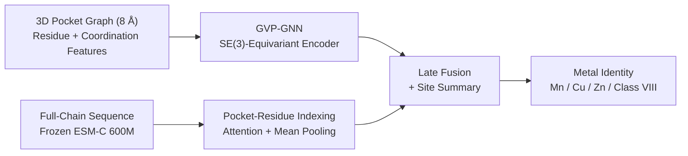

# DeepMzyme: Metal-Type Prediction from Protein Structure and Sequence

[](pyproject.toml)
[](pyproject.toml)
[](pyproject.toml)
[](https://huggingface.co/datasets/GMBioinformatics/DeepMzyme)

**DeepMzyme** predicts transition-metal identity at a supplied protein metal-binding site by combining a 3D pocket graph with frozen full-chain **ESM-C 600M** sequence embeddings. Local coordination geometry can be similar across metals; the model learns from both the surrounding residues and their sequence context.

The inference interface accepts a **PDB or mmCIF structure** and an explicit **atom locator or 3D coordinate**. It assumes that the supplied site binds a metal and returns **uncalibrated scores for Mn, Cu, Zn, and Class VIII (Fe + Co + Ni)**. Site localization and metal-binding versus non-binding classification are outside this interface's scope. Evaluation uses known metal sites in experimental holo structures; performance on apo or predicted structures has not been established.

<a id="approach"></a>
## Approach

The benchmark late-fusion model builds an 8 Å residue neighborhood around each target ion. A GVP-GNN processes residue chemistry and scalar/vector geometry, while a sequence branch pools the corresponding ESM-C residue embeddings. The graph encoder, sequence pooling and classifier are trainable; ESM-C is frozen.



Models can train on four, five or six classes. Five-class training separates Fe from Co + Ni; six-class training separates all six metals. For common-four reporting, Fe/Co/Ni probabilities are summed **before** choosing the predicted class. These training objectives retain separate identities and native metrics. The [feature reference](src/metal_release/README.md#input-features) describes the graph inputs and dimensions.

## Quick start

### Install and check the CPU environment

The lockfile targets Linux x86_64, Python 3.12 and PyTorch 2.5.1 CPU. With [uv](https://docs.astral.sh/uv/) installed:

```bash
git clone https://github.com/MECHTI1/DeepMzyme.git
cd DeepMzyme
uv sync --frozen
uv run --frozen --no-sync python src/train.py --help
uv run --frozen --no-sync python tests/smoke_checks.py
```

This example needs no benchmark data or checkpoints. Run `uv run --frozen --no-sync pytest` for the test suite. Environment details and GPU setup are in [Getting started](docs/GETTING_STARTED.md) and the [environment guide](requirements/README.md).

### Train on the frozen benchmark folds

Use the [exact frozen-fold recipe](docs/METAL_TRAINING_PIPELINE_PLAYBOOK.md#reproduce-the-frozen-v3-sequence-clustered-folds) for public data downloads, full checksums and the current single-fold command. It uses `--model-architecture gvp --fusion-mode late_fusion` and a single comma-separated `--omit-node-features` value. Frozen membership is supplied through `--source-cohort-csv`, `--fold-membership-csv`, their checksum flags and `--fold-split-source membership`.

Run the documented recipe for fold indices 0–4 to cover the five sequence-clustered folds. The older `run_zenodo_pmm_exact_5fold_cv.py` uses pocket-based splits and does **not** reproduce this benchmark's frozen folds. Training on these folds reproduces the specified recipe, not every ensemble in the results below.

### Use the public five-checkpoint ensemble

The supported standalone candidate is **`unified_p5_trunklr1e4_5fold_s42`**, backed by the archived `unified__P_five_class_trunklr1e4` family. Follow the [download, verify, bind and predict instructions](src/metal_release/README.md#public-checkpoint-inference). Candidate-scoped binding requires only that family's five completed runs and the frozen fold file; it verifies checkpoint and metadata hashes before use.

Prediction uses `--generate-embeddings` and a separate inference cache after installing the `esm` dependency group. The result records the predicted class, four class scores, `calibration: none` and site quality flags.

Of the **55 checkpoints in the reference ensemble**, these five are publicly archived; Phase 2 evaluated **180 checkpoints** in total. Other catalog candidates need local training artifacts. This standalone public candidate is distinct from the differential-LR five-model and Recipe P 15-model research configurations below. **No deployment default has been frozen.** See the [checkpoint inventory](docs/DATASETS.md#benchmark-runs-and-checkpoint-releases).

## Benchmark summary

Balanced accuracy (BA) is the unweighted mean recall over **Mn, Cu, Zn and Class VIII**. The matched comparison uses **7,398 ion examples**, split into five folds with **2,208 near-copy groups at ≥90% sequence identity**, and PinMyMetal's **1,488-site reference test set**.

| Method | Neural checkpoints | Pooled OOF BA | Reference-test BA [95% CI] |
| :--- | ---: | ---: | :--- |
| PinMyMetal PMM-D, 89 features | — | 62.96% | 58.27% [53.53, 62.85] |
| PinMyMetal PMM-R, 93 features | — | 67.16% | 63.41% [59.64, 67.25] |
| HistGB, 89 features | — | 71.22% | 68.83% [64.26, 73.04] |
| DeepMzyme full-data refit | 1 | 74.34%* | 67.55% [62.93, 71.65] |
| Differential GVP learning rate, four-class | 5 | 75.51% | 70.75% [66.29, 74.77] |
| Recipe P, five-class, three seeds | 15 | 75.82% | 71.10% [66.65, 75.14] |
| Top-4 late-fusion families, all seeds | 50 | 76.46% | 71.75% [67.22, 75.80] |

*The full-data refit has no OOF predictions of its own; its CV entry is the five-fold score of its training recipe. OOF means out-of-fold. The [matched report](docs/campaigns/phase2_unified_2026-10/pmm_matched/README.md) contains all ensemble comparisons, per-class recalls, macro-precision and bootstrap methods.*

PinMyMetal's published **≈72.7% CV BA** and **67.85% test BA** are unmatched context: its original CV uses different rows and folds, and equivalent pooled aggregation has not been established. PMM-D omits four bond-valence/vector-sum columns; PMM-R retains all 93 published features. The [feature audit](docs/FOLLOW_UP_TECHNICAL_ISSUES.md#tech-028--pmm-comparator-inherits-a-true-metal-label-leak) identifies target-dependent inputs in the released tables. Removing those columns produced a **decrease of 17.4 pp [11.1, 24.1]** in the matched PinMyMetal refit's test Mn recall.

DeepMzyme improves over the matched PMM-D classifier, but **has not demonstrated a statistically resolved advantage over gradient boosting on those 89 tabular features**. The 50-model ensemble has a higher test point estimate than HistGB, with a paired difference of **+2.92 pp [−1.15, +7.11]**. The original pre-registered superiority criterion also required beating HistGB and was not met; the narrower PMM claim follows the report's disclosed post-hoc amendment A1.

### How to interpret these results

- **Secondary reference testing:** 668 PDB IDs occur on both sides of PinMyMetal's published split; 809 test rows share a PDB ID with training. The test set was also opened before this comparison. Its **423-site filtered reference subset** excludes training PDB overlap, identifiable near-copy context chains, unverifiable context and previously opened PDB IDs. It remains a secondary subset, not an independent final test. Definitions and access history are in the [dataset ledger](docs/DATASETS.md#test-use-ledger).
- **Selection uncertainty:** Near-copy grouping controls close redundancy, not remote homology. Post-hoc OOF ranking is optimistic. The linked reports' “nested” scores evaluate an **OOF-based ensemble-selection procedure**, not a fixed named ensemble; they reuse predictions from fits that can have trained on the scored fold, and the procedure was specified after historical results. See the [release audit's limitations](docs/campaigns/phase2_unified_2026-10/release_audit/README.md#decision). Test scores select no configuration here.
- **Model size:** Five- and 15-model ensembles are simpler research configurations with a modest performance trade-off. The 55-model reference's OOF advantages over them are **1.66 pp [0.38, 2.97]** and **1.35 pp [0.21, 2.49]**, respectively. Its gains over 20–30 models are unresolved; that finding does not establish the same result for the newer 50-model ensemble. The five-model differential-LR timing of **5.85 seconds/site** is a median on four CPU threads **with cached embeddings**, including checkpoint verification/loading ([audit](docs/campaigns/phase2_unified_2026-10/release_audit/README.md#prediction-parity-and-cost)).

### Modalities and finer targets

In matched Seed 42 comparisons, late fusion improves over Only-GVP in both five-fold CV and on the reference test, whose paired 95% intervals exclude zero. Relative to the Only-ESM-C pocket classifier, late fusion has higher CV scores and higher test point estimates, with paired test confidence intervals that include zero. The [modality and regularization tables](docs/campaigns/phase2_unified_2026-10/log.md) preserve the individual contrasts and settings.

Five- and six-class training objectives are supported; fine-grained Co/Ni classification remains weak in the evaluated runs. The [target-comparison campaign](docs/campaigns/metal_completion_2026-10/README.md) records the recipes and assessment rules. Standalone EC level-1 and joint training are also implemented (`--task ec` / `--task joint`), with single-label EC targets. EC evidence currently comes from fixed splits; this README's benchmark and public inference workflow concern metal identity ([status](EXPERIMENT_STATUS.md)).

## Documentation

- [Getting started](docs/GETTING_STARTED.md), [documentation index](docs/README.md), and [research policy](Plan.md).
- [Dataset and checkpoint inventory](docs/DATASETS.md), including reconstructed structures and precomputed feature bundles on [Hugging Face](https://huggingface.co/datasets/GMBioinformatics/DeepMzyme).
- [Public inference and feature reference](src/metal_release/README.md).
- [Matched PinMyMetal report](docs/campaigns/phase2_unified_2026-10/pmm_matched/README.md), [release audit](docs/campaigns/phase2_unified_2026-10/release_audit/README.md), and [benchmark figure](docs/assets/benchmark_overview.svg).

## Citation and licensing

**Author:** Gilad Mechtinger ([`@MECHTI1`](https://github.com/MECHTI1)), Tel Aviv University.

```bibtex
@software{mechtinger2026deepmzyme,
  author       = {Mechtinger, Gilad},
  title        = {DeepMzyme: Metal-Type Prediction from Protein Structure and Sequence},
  year         = {2026},
  publisher    = {GitHub},
  url          = {https://github.com/MECHTI1/DeepMzyme}
}
```

**DeepMzyme code license:** No project code license has yet been declared. Upstream licenses do not specify a license for DeepMzyme's own code.

Related work includes [PinMyMetal](https://doi.org/10.1038/s41467-025-57637-5) and its [Zenodo dataset](https://doi.org/10.5281/zenodo.17610514), GVP-GNN (Jing et al., ICLR 2021), and ESM-C (EvolutionaryScale; subject to the EvolutionaryScale Cambrian License). Other tools and benchmarks include Metal3D, MAHOMES, CLEAN, CARE, PROPKA and RING.
