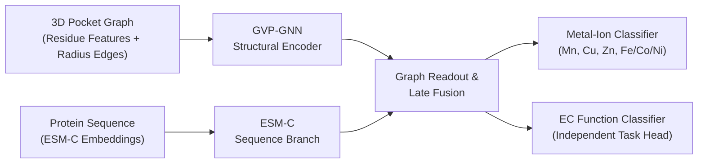

# DeepMzyme

[](https://github.com/MECHTI1/DeepMzyme/actions/workflows/cpu-ci.yml)
[](pyproject.toml)

DeepMzyme predicts which metal occupies a known binding site in an experimental, metal-bound protein structure: Mn, Cu, Zn or the Fe/Co/Ni group. It combines a Geometric Vector Perceptron graph network (GVP-GNN) over the site's 3D neighbourhood with ESM-C protein language model embeddings. Enzyme Commission (EC) number prediction is a separate, earlier-stage task.

## Approach

Which metal a site binds depends on its local coordination geometry and on the wider sequence context, so DeepMzyme encodes each site with two branches:

1. **3D Structural Pocket Graph (GVP-GNN):** Represents residues around the site as nodes with scalar features (amino-acid identity, physicochemical flags, first- and second-shell roles, distances to the metal) and vector features (side-chain and residue-to-metal directions), connected by 8 Å radius edges. PROPKA electrostatics and RING interaction edges are supported but unused by the reported models.
2. **Sequence Context Branch (ESM-C):** Projects per-residue ESM-C 600M embeddings of the chain and pools them (mean and attention) over the same site residues.



Metal classification (`--task metal`) and EC classification (`--task ec`) are independently trainable primary tasks, with shared-encoder multi-task learning (`--task joint`) for transfer experiments. Standalone unimodal baselines (`Only-GVP`, `Only-ESM`), alternative fusion modes (early, hybrid, cross-attention), and training objectives (`four_class`, `five_class`, `six_class`) are documented in [`Plan.md`](Plan.md).

## Results

Models are scored with unweighted balanced accuracy on four classes (Mn, Cu, Zn and the Fe/Co/Ni group, "Class VIII" in PinMyMetal notation): 5-fold cross-validation on 7,398 ion sites, with chains of ≥90% sequence identity kept in one fold, and PinMyMetal's 1,488-site reference test set:

| Model | Checkpoints | Pooled out-of-fold balanced accuracy | CV macro-precision | Reference-test balanced accuracy |
|:---|---:|---:|---:|---:|
| Single model (pre-declared full-data refit) | 1 | 74.34%\* | 75.74%\* | 67.55% |
| 15 ensembles chosen by cross-validation only | 5–70 | 74.3–76.6%† | 75.7–81.1%‡ | 68.8–71.8% |
| Late-fusion ensemble (test-ranked membership§) | 30 | 76.81% | 78.38% | 72.20% |
| Combined ensemble (late fusion + Only-ESM + Only-GVP; test-ranked membership§) | 55 | 77.17% | 80.34% | 71.00% |
| PinMyMetal classifier retrained on the same sites, deployment-available features | — | 62.96% | 68.47% | 58.27% |
| PinMyMetal classifier retrained on the same sites, all published features¶ | — | 67.16% | 71.24% | 63.41% |
| Gradient boosting on PinMyMetal's features (internal ablation) | — | 71.22% | 75.51% | 68.83% |
| PinMyMetal, published (own folds and pipeline; unpaired) | — | ≈72.7% (BA equivalent) | 75.08% | 67.85% |

\*Five-fold CV of the same recipe; the refit itself has no out-of-fold score. †Nested CV for the rule-selected
ensembles; the two retained-configuration ensembles are not nested. ‡Pooled and non-nested, so optimistic for the
rule-selected ensembles. §Membership follows the full-test ranking, so the test score is optimistic by construction; these two rows enter no PinMyMetal comparison ([release audit](docs/campaigns/phase2_unified_2026-10/release_audit/README.md)).
¶Inputs include `valence_3a`, which in PinMyMetal's released tables equals the bond-valence sum computed with the true
metal; a reference, not a deployment-faithful system.

- **Model selection:** The 55-model ensemble scores best out of fold, but its 0.4–0.8 pp gain over the 20- to 30-model late-fusion ensembles is not significant (95% intervals include zero), and larger ensembles also average more checkpoints per out-of-fold site, which favours them. Complexity is added only when validation evidence justifies it ([`Plan.md`](Plan.md#7-baseline-first-model-comparison-policy)), so no deployment default is chosen yet. Repeating the ensemble selection inside cross-validation gives 76.5% either way ([release audit](docs/campaigns/phase2_unified_2026-10/release_audit/README.md)).
- **PinMyMetal comparison:** In a pre-registered matched comparison (same training sites, folds and test rows), DeepMzyme outperformed PinMyMetal's released classifier retrained with deployment-available features: +9.3 pp on the test set (97.5% CI 3.6 to 15.1) and +11.3 pp in cross-validation (mean over folds; 97.5% CIs 6.2 to 15.4 and 2.9 to 19.6). All 15 ensembles chosen by cross-validation alone also exceeded PinMyMetal's full published recipe retrained the same way (+5.4 to +8.3 pp, unadjusted paired 95% intervals above zero), with lower Mn recall (descriptive; several members' test scores were already public). They lie above PinMyMetal's published 67.85% test value by point estimate (unpaired context; +1.0 to +3.9 pp; every two-sided 95% interval includes it), and the single model is 0.3 pp below it. A gradient-boosting model on PinMyMetal's features was not distinguishable from DeepMzyme, so the advantage is over PinMyMetal's classifier rather than its features. The pre-registered criterion for "outperforms PinMyMetal" also required beating that model and was met in neither setting; after the results were known, amendment A1 reclassified it as an internal ablation, so the claim above rests on a decision rule re-scoped post hoc. In the matched refits, removing the four columns that are Zn-based at deployment ([TECH-028](docs/FOLLOW_UP_TECHNICAL_ISSUES.md#tech-028--pmm-comparator-inherits-a-true-metal-label-leak): `valence_3a` equals the true-metal bond-valence sum) lowered the retrained classifier's test Mn recall from 79.0% to 61.7% (17.4 pp, 95% CI 11.1 to 24.1); neither refit reproduces the published 88.6%, and DeepMzyme's single-model Mn recall (55.7%) is below both. Both systems classify the metal at known metal-bound sites in experimental holo structures; PinMyMetal's site localization is not evaluated, and the test set had been opened before, so these test results are secondary. Details and disclosures: [matched comparison report](docs/campaigns/phase2_unified_2026-10/pmm_matched/README.md).
- **Reference test:** The test set was opened before these comparisons, so every result on it is secondary. Only the single model was a pre-declared one-shot evaluation ([`docs/DATASETS.md`](docs/DATASETS.md#final-reporting-status)). On the 1,346-site eligible and 423-site near-copy-filtered subsets, the single model reaches 69.33% / 48.85%, the 30-model 73.94% / 59.18% and the 55-model 72.76% / 61.33%. PinMyMetal's reported 61.70% is its own score on a Metal3D-derived set, not a Metal3D result. Full tables: [campaign report](docs/campaigns/phase2_unified_2026-10/README.md).
- **Task maturity and dataset coverage:** Metal classification has completed cross-validation and reference-test evaluation; EC classification has preliminary fixed-split validation, and joint multi-task learning is experimental ([`EXPERIMENT_STATUS.md`](EXPERIMENT_STATUS.md)). The Zenodo PinMyMetal ion-level reconstruction covers 99.89% of sites (9,398 of 9,408 ions in 7,724 structure files; [`docs/ZENODO_PINMYMETAL_EXACT_ION_LEVEL_REPRODUCIBILITY.md`](docs/ZENODO_PINMYMETAL_EXACT_ION_LEVEL_REPRODUCIBILITY.md)).

## Installation and verification

These commands create the locked Linux x86_64 Python 3.12 CPU environment and run the CLI, unit tests and synthetic smoke checks without datasets or a GPU:

```bash
git clone https://github.com/MECHTI1/DeepMzyme.git
cd DeepMzyme
uv sync --frozen
uv run --frozen --no-sync python src/train.py --help
uv run --frozen --no-sync pytest
uv run --frozen --no-sync python tests/smoke_checks.py
```

## Example usage

Unpack the reconstructed PinMyMetal structures (see below) so that the archive's `dataset/` folder becomes `DeepMzyme_Data/train_and_test_sets_structures_zenodo_pmm_exact/`. Generate ESM-C 600M embeddings once (optional `esm` dependency group), then train fold 0 of a grouped 5-fold late-fusion (`GVP-GNN + ESM-C`) metal classifier:

```bash
uv sync --frozen --group esm
uv run --frozen --no-sync python src/embed_helpers/esmc.py \
  --structure-dir DeepMzyme_Data/train_and_test_sets_structures_zenodo_pmm_exact/train \
  --out-dir DeepMzyme_Data/esm_embeddings_esmc600m \
  --model-name esmc_600m
uv run --frozen --no-sync python src/train.py \
  --task metal \
  --metal-example-unit ion \
  --metal-label-scheme merge_fe_class_viii \
  --structure-dir DeepMzyme_Data/train_and_test_sets_structures_zenodo_pmm_exact/train \
  --summary-csv DeepMzyme_Data/train_and_test_sets_structures_zenodo_pmm_exact/train/final_data_summarazing_table.csv \
  --esm-embeddings-dir DeepMzyme_Data/esm_embeddings_esmc600m \
  --esm-dim 1152 \
  --n-folds 5 \
  --fold-index 0 \
  --train-val-split-by pdbid \
  --epochs 50 \
  --runs-dir runs \
  --run-name example_metal_late_fusion_fold0
```

The run folder under `--runs-dir` holds `run_config.json`, per-epoch metrics, `selected_checkpoint.json` and out-of-fold `val_predictions.csv`. The reported results use the frozen near-copy folds instead (`--fold-membership-csv`).

## Data and pretrained models

- **Public data (Hugging Face):** [`GMBioinformatics/DeepMzyme`](https://huggingface.co/datasets/GMBioinformatics/DeepMzyme) hosts the reconstructed PinMyMetal ion-level structures and site tables (1.1 GB), an earlier 4.7 GB data bundle (structures, CLEAN/CARE splits, ESM-C 300M embeddings, RING and PROPKA features) and archived benchmark runs. Only 5 of the 55 ensemble checkpoints (the five folds of one five-class recipe) are public; the other checkpoints and the ESM-C 600M embeddings are unpublished. Inventory: [`docs/DATASETS.md`](docs/DATASETS.md#hugging-face-repository-inventory), [`docs/STRUCTURE_STORE.md`](docs/STRUCTURE_STORE.md).

## Technical documentation

- **Setup & execution guide:** [`docs/GETTING_STARTED.md`](docs/GETTING_STARTED.md) and [`requirements/README.md`](requirements/README.md)
- **Scientific design & model matrix:** [`Plan.md`](Plan.md) and [`docs/PARAMETER_FINDINGS.md`](docs/PARAMETER_FINDINGS.md)
- **Benchmark evaluation reports:** [`docs/campaigns/phase2_unified_2026-10/README.md`](docs/campaigns/phase2_unified_2026-10/README.md) and [`EXPERIMENT_STATUS.md`](EXPERIMENT_STATUS.md)
- **Datasets, splits & test-use ledger:** [`docs/DATASETS.md`](docs/DATASETS.md) and [`docs/README.md`](docs/README.md)

## Author and acknowledgments

**Author:** Gilad Mechtinger ([`@MECHTI1`](https://github.com/MECHTI1)), Tel Aviv University.

**Upstream methods and datasets:**
- **GVP-GNN:** Jing et al., *Learning from Protein Structure with Geometric Vector Perceptrons*, ICLR 2021.
- **ESM-C:** EvolutionaryScale, *ESM Cambrian (ESM-C)* protein language models.
- **PinMyMetal:** Zhang et al., *PinMyMetal*, Nature Communications 2025 ([`10.1038/s41467-025-57637-5`](https://doi.org/10.1038/s41467-025-57637-5)), and the Zenodo benchmark structure dataset ([`10.5281/zenodo.17610514`](https://doi.org/10.5281/zenodo.17610514)).
- **Comparators & functional benchmarks:** Metal3D (Dürr et al., *Nature Communications* 2023), MAHOMES (Feehan et al.), CLEAN (Yu et al., *Science* 2023), CARE, PROPKA, and RING residue interaction networks.
