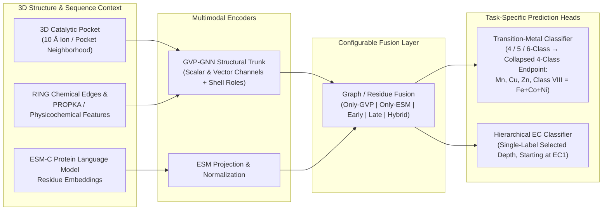

# DeepMzyme

[](https://github.com/MECHTI1/DeepMzyme/actions/workflows/cpu-ci.yml)
[](pyproject.toml)
[](src/model.py)
[](src/embed_helpers/esmc.py)
[](https://huggingface.co/datasets/GMBioinformatics/DeepMzyme)

**DeepMzyme** is a multimodal geometric deep-learning framework for structural enzymology with two independent primary missions:
1. **Catalytic Transition-Metal Identity Prediction** ($\text{Mn}$, $\text{Cu}$, $\text{Zn}$, and $\text{Class VIII} = \text{Fe}+\text{Co}+\text{Ni}$) from 3D protein binding pockets.
2. **Enzyme Commission (EC) Function Classification** (starting scientifically at EC depth 1) from pocket graphs and protein language model representations, with shared multi-task learning supported as a controlled challenger.

---

## Key Highlights

- **State-of-the-Art Held-Out Metal Benchmark Performance:** Outperforms published baselines **Metal3D** (`61.70%`) and **PinMyMetal** (`67.85%`) on the `1,488`-site held-out PinMyMetal test set, reaching **`72.20%` Balanced Accuracy (Full Test)**, **`73.94%` (Eligible)**, and **`61.33%` (Strict Clean Subset)** via 5-fold out-of-fold cross-validation (`7,398` ion sites) model selection ([benchmark report](docs/campaigns/phase2_unified_2026-10/README.md)).
- **Exact Ion-Level Replication (`99.89%` BA):** Reproduces the Zenodo PinMyMetal 5-fold cross-validation benchmark at **`99.89%` Balanced Accuracy** with automated SHA-256 data verification ([reproducibility guide](docs/ZENODO_PINMYMETAL_EXACT_ION_LEVEL_REPRODUCIBILITY.md)).
- **Multimodal 3D + Sequence Architecture:** Combines **Geometric Vector Perceptrons (GVP-GNN)** over 3D atomic/residue coordinates, physicochemical/PROPKA electrostatics, **RING** non-covalent interaction edges, first/second coordination shell roles, and **ESM-C** evolutionary embeddings under configurable fusion regimes (`Only-GVP`, `Only-ESM`, `Early`, `Late`, `Hybrid`).
- **Leakage-Safe Scientific Protocol:** Enforces near-copy-disjoint 5-fold cross-validation, validation-only hyperparameter and ensemble selection, paired bootstrap confidence intervals, rare-class recall protection, and SHA-256 content-addressed structure deduplication ([`Plan.md`](Plan.md)).

---

## Architecture Overview



---

## Benchmark Results: Transition-Metal Classification

All models below are selected strictly by 5-fold out-of-fold cross-validation (**`7,398` ion sites**) and evaluated on the held-out PinMyMetal test set (**`1,488` sites**) and its audited subsets (`LINK-Free`, `Eligible`, `Deduplicated`, and homology/leak-filtered `Clean`). The reporting endpoint is 4-class Balanced Accuracy across $\text{Mn}$, $\text{Cu}$, $\text{Zn}$, and $\text{Class VIII}$ ($\text{Fe}+\text{Co}+\text{Ni}$).

| Method / Selection Tier | Models | 5-Fold CV (`7,398`) | Full Test (`1,488`) | LINK-Free (`1,349`) | Eligible (`1,346`) | Dedup (`1,098`) | Clean (`423`) | Eligible Recalls (`Mn/Cu/Zn/VIII`) |
|:---|---:|:---:|:---:|:---:|:---:|:---:|:---:|:---:|
| **Metal3D** *(Published)* | 1 | — | `61.70%` | — | — | — | — | — |
| **PinMyMetal** *(Published)* | 1 | `75.08%` | `67.85%` | — | — | — | — | `88.6/59.4/65.9/57.5` |
| **DeepMzyme Step F Single Refit (`s42`)** | 1 | `74.28%` *(mean)* | `67.55%` | `68.99%` | `69.33%` | `68.45%` | `48.85%` | `56.9/73.3/85.8/61.3` |
| **DeepMzyme 5-Fold Baseline (`4-class`)** | 5 | `74.34%` *(OOF)* | `69.02%` | `70.40%` | `70.75%` | `69.76%` | `52.32%` | `60.0/73.3/87.0/62.6` |
| **DeepMzyme 5-Fold `trunklr1e4` (`4-class`)** | 5 | `75.51%` *(OOF)* | `70.75%` | `71.89%` | `72.25%` | `71.43%` | `55.87%` | `62.5/75.0/86.3/65.2` |
| **DeepMzyme 15-Model `Recipe P` (`5-class`)** | 15 | `75.82%` *(OOF)* | `71.10%` | `72.33%` | `72.68%` | `71.83%` | `58.21%` | `64.4/75.0/89.6/61.7` |
| **DeepMzyme 5-Fold Unified `P+5c+trunklr1e4`** | 5 | `74.91%` *(OOF)* | `71.72%` | `72.71%` | `73.08%` | `72.24%` | `57.58%` | `65.6/76.7/88.3/61.7` |
| **DeepMzyme Top-4 Late-Fusion Ensemble** | 30 | `76.81%` *(OOF)* | **`72.20%`** | **`73.58%`** | **`73.94%`** | **`73.11%`** | `59.18%` | `66.2/75.0/89.7/64.8` |
| **DeepMzyme CV-Locked Tri-Modal Ensemble** | 55 | **`77.17%`** *(OOF)* | `71.00%` | `72.42%` | `72.76%` | `71.64%` | **`61.33%`** | `68.1/70.0/90.3/62.6` |

> [!NOTE]
> Full 27-tier progression tables, 10,000-draw paired bootstrap confidence intervals, SHA-256 checkpoint hashes, and test-use disclosures (`both_results_secondary`) are documented in [`docs/campaigns/phase2_unified_2026-10/README.md`](docs/campaigns/phase2_unified_2026-10/README.md), [`EXPERIMENT_STATUS.md`](EXPERIMENT_STATUS.md), and [`docs/DATASETS.md`](docs/DATASETS.md#test-use-ledger).

---

## Datasets, Checkpoints & Cloud Backups

All dataset bundles, precomputed ESM-C embeddings, RING interaction graphs, trained 5-fold cross-validation model weights (`180` checkpoints), and source audit crosswalks are permanently hosted and versioned:
- **Hugging Face Hub:** [`GMBioinformatics/DeepMzyme`](https://huggingface.co/datasets/GMBioinformatics/DeepMzyme)
- **Cloud Inventory & Restore Guide:** [`docs/BACKUP_AND_DATA_INVENTORY.md`](docs/BACKUP_AND_DATA_INVENTORY.md)
- **VM Orchestration Manager:** [`MECHTI1/deepmzyme-vm-manager`](https://github.com/MECHTI1/deepmzyme-vm-manager)

---

## Quick Start

For complete setup details, data bundle extraction, and execution workflows, see [`docs/GETTING_STARTED.md`](docs/GETTING_STARTED.md) and [`requirements/README.md`](requirements/README.md).

### 1. Environment Installation

```bash
# Locked Linux x86_64 Python 3.12 environment via uv:
uv sync --frozen

# Run CPU unit tests and compatibility smoke checks:
uv run --frozen pytest
uv run --frozen python tests/smoke_checks.py
```

### 2. Unified Training CLI

```bash
# Inspect all CLI flags and task configurations:
python src/train.py --help

# Task-specific entry points (metal, EC, or experimental joint training):
python src/train.py --task metal --help
python src/train.py --task ec --help
python src/train.py --task joint --help

# Thin task-specific wrappers:
python src/train_metal.py --help
python src/train_ec.py --help
```

### 3. Reproducing the Metal Benchmarks

```bash
# Reproduce the 180-checkpoint 5-Fold OOF-CV & Held-Out PinMyMetal evaluation:
python docs/campaigns/phase2_unified_2026-10/eval_phase2_unified.py

# 1-command replication of the 99.89% exact Zenodo PinMyMetal ion-level benchmark:
bash scripts/reproduce_zenodo_pmm_benchmark.sh

# Generalized 5-fold CV orchestrator across ion-centered or clustered-pocket modes:
python scripts/run_metal_5fold_cv.py \
  --dataset train_and_test_sets_structures_exact_pinmymetal \
  --metal-example-unit ion \
  --dry-run
```

Interactive Google Colab workflow: [`notebooks/DeepMzyme_training_colab.ipynb`](notebooks/DeepMzyme_training_colab.ipynb) (see [`docs/COLAB_GPU_RUNBOOK.md`](docs/COLAB_GPU_RUNBOOK.md) for GPU runtime setup).

---

## Repository Structure

| Path | Purpose |
|:---|:---|
| [`src/`](src/) | Core training loops, GVP/ESM/Fusion model architectures, pocket graph construction, featurization, and reporting |
| [`scripts/`](scripts/) | End-to-end 5-fold CV orchestrators, Zenodo benchmark replication, and dataset preparation utilities |
| [`tests/`](tests/) | Automated `pytest` suite and CPU compatibility smoke checks ([`.github/workflows/cpu-ci.yml`](.github/workflows/cpu-ci.yml)) |
| [`notebooks/`](notebooks/) | Unified interactive Colab training, Optuna HPO, and evaluation notebook |
| [`docs/`](docs/) | Scientific design specifications, reproducibility playbooks, dataset ledgers, and campaign reports |
| [`bench/`](bench/) | GPU compute-throughput benchmarks and profiling schemas ([`bench/README.md`](bench/README.md)) |
| [`requirements/`](requirements/) | Locked dependency specifications and Colab overlay ([`requirements/README.md`](requirements/README.md)) |
| `prepare_training_and_test_set/` | PinMyMetal structure preparation scripts and split membership files |
| `CLEAN_prepare_training_and_test_set/` | CLEAN enzyme dataset preparation and tracked provenance |
| `CARE_prepare_training_and_test_set/` | CARE dataset preparation and tracked provenance |

---

## Documentation Map

| Topic | Document |
|:---|:---|
| Getting started & execution paths | [`docs/GETTING_STARTED.md`](docs/GETTING_STARTED.md) |
| Current experiment status & benchmark summary | [`EXPERIMENT_STATUS.md`](EXPERIMENT_STATUS.md) |
| Phase 2 Unified & 180-checkpoint benchmark report | [`docs/campaigns/phase2_unified_2026-10/README.md`](docs/campaigns/phase2_unified_2026-10/README.md) |
| Scientific design, split rules & neutral target tests | [`Plan.md`](Plan.md) |
| Datasets, splits, bundles & test-use ledger | [`docs/DATASETS.md`](docs/DATASETS.md) |
| Cloud backups & Hugging Face inventory | [`docs/BACKUP_AND_DATA_INVENTORY.md`](docs/BACKUP_AND_DATA_INVENTORY.md) |
| Content-addressed SHA-256 structure store | [`docs/STRUCTURE_STORE.md`](docs/STRUCTURE_STORE.md) |
| Empirical HPO & validation findings | [`docs/PARAMETER_FINDINGS.md`](docs/PARAMETER_FINDINGS.md) |
| Exact Zenodo PinMyMetal 5-fold CV replication | [`docs/ZENODO_PINMYMETAL_EXACT_ION_LEVEL_REPRODUCIBILITY.md`](docs/ZENODO_PINMYMETAL_EXACT_ION_LEVEL_REPRODUCIBILITY.md) |
| Generalized 5-fold CV runner guide | [`docs/GENERALIZED_METAL_5FOLD_CV_GUIDE.md`](docs/GENERALIZED_METAL_5FOLD_CV_GUIDE.md) |
| Metal & EC training pipeline playbooks | [`docs/METAL_TRAINING_PIPELINE_PLAYBOOK.md`](docs/METAL_TRAINING_PIPELINE_PLAYBOOK.md), [`docs/EC_TRAINING_PIPELINE_PLAYBOOK.md`](docs/EC_TRAINING_PIPELINE_PLAYBOOK.md) |
| Complete documentation index | [`docs/README.md`](docs/README.md) |
