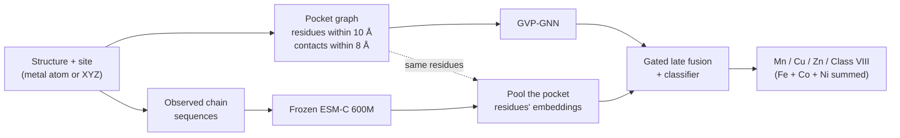

# DeepMzyme: Metal-Type Prediction from Protein Structure and Sequence

[](pyproject.toml)
[](pyproject.toml)
[](src/metal_release/README.md#input-features)
[](https://huggingface.co/datasets/GMBioinformatics/DeepMzyme)

**DeepMzyme** predicts which metal occupies a known metal-binding site in a protein structure. It combines a geometric graph neural network over the 3D pocket with sequence context from the frozen **ESM-C 600M** protein language model.

> [!IMPORTANT]
> **You supply the site; DeepMzyme scores the metal.** It returns uncalibrated scores for **Mn, Cu, Zn and Class VIII** (Fe, Co or Ni) and assumes the site binds one of these metals. It does not find sites or decide whether a site binds a metal. It has been evaluated only on experimental metal-bound (holo) structures; metal-free and predicted structures are untested.

[Quick start](#quick-start) · [How it works](#how-it-works) · [Results](#results) · [Prediction guide](src/metal_release/README.md#public-checkpoint-inference) · [Citation](#citation-and-license)

## Highlights

- **Improves on PinMyMetal's released classifier with deployment-available features, under matched retraining.** With both trained on the same 7,398 sites and folds, DeepMzyme's pre-declared single model scored +11.25 balanced-accuracy points higher in cross-validation (mean over folds) and +9.28 on PinMyMetal's reference test (a secondary check). It was **not** distinguishable from gradient boosting on PinMyMetal's features, so the pre-registered superiority criterion was not met; this narrower claim follows amendment A1, made after the results were known ([details](#comparison-with-pinmymetal)).
- **Structure plus sequence beats either alone in cross-validation:** 74.34% balanced accuracy, against 72.38% for ESM-C alone and 69.71% for the structure network alone, with the same baseline settings and seed; the combined model was higher than ESM-C alone on all five folds. ESM-C alone was not tuned separately, and on the reference test the gain over it is not resolved ([tables](docs/campaigns/phase2_unified_2026-10/log.md#p2u-005-2026-10-20--matched-modality--target--ensemble-fairness-audit)).
- **Found a label leak in PinMyMetal's released data.** Its training table computes `valence_3a` from the true metal (7,919 of 7,920 rows). Removing it and three related columns lowered the retrained classifier's test Mn recall from 79.0% to 61.7% ([TECH-028](docs/FOLLOW_UP_TECHNICAL_ISSUES.md#tech-028--pmm-comparator-inherits-a-true-metal-label-leak)). DeepMzyme uses none of these columns, but its own test Mn recall (55.7%) is lower still.
- **Runs on a CPU from public files:** hash-checked checkpoints, benchmark structures on [Hugging Face](https://huggingface.co/datasets/GMBioinformatics/DeepMzyme), and a locked environment tested in CI.

<a id="approach"></a>
## How it works



The pocket is every standard amino-acid residue with an atom within **10 Å** of the site; residues are linked when their closest atoms are within **8 Å**. An SE(3)-equivariant graph neural network (GVP-GNN) encodes this graph. ESM-C embeds each chain's sequence of residues observed in the coordinate file, and a trained layer pools the pocket residues' embeddings. A learned gate combines the two summaries. The metal's element, ligands and waters are not inputs ([feature reference](src/metal_release/README.md#input-features)).

Every DeepMzyme model in the [results](#results) uses this late-fusion design, except the greedy ensemble, which also averages in two structure-only families. The ESM-C-only and structure-only models in the highlights are comparison baselines.

Models can train on four, five (Fe separate from Co + Ni) or six classes; Fe, Co and Ni scores are summed into Class VIII **before** the top class is chosen. Finer classes showed no supported gain in validation, and when Co and Ni are scored as separate classes their recall stays low (six-class validation: Co about 3–5%, Ni about 25–31%; [evidence](docs/notebook_outputs/summaries/summary_pmm_ion_metal_v3_20261013.md#1-validation-findings-development-validation-no-test-data)). The public model's five-class training is a design choice, not a shown improvement.

## Quick start

### Install (CPU)

The lockfile (`uv.lock`: Python 3.12, CPU-only PyTorch 2.5.1) is tested in CI on Linux x86_64. With [uv](https://docs.astral.sh/uv/) installed:

```bash
git clone https://github.com/MECHTI1/DeepMzyme.git
cd DeepMzyme
uv sync --frozen
uv run --frozen --no-sync python tests/smoke_checks.py
```

The smoke check needs no data or checkpoints; `uv run --frozen --no-sync pytest` runs the full test suite. The [environment guide](requirements/README.md) covers Colab GPU use and the limits of local GPU setups.

### Predict the metal at a site

The **public model**, `unified_p5_trunklr1e4_5fold_s42`, averages five checkpoints, one per cross-validation fold. It is an available research configuration, not a chosen default.

1. **Once:** download the 99 MB checkpoint archive, verify and extract it, then run `bind`. This checks every checkpoint's SHA-256 hash and writes `bound_manifest.json`. The [prediction guide](src/metal_release/README.md#public-checkpoint-inference) gives the exact commands; `bind` reports `"status": "provisional"` on success.
2. **Predict** a site in an uncompressed `.pdb`, `.cif` or `.mmcif` file:

```bash
uv sync --frozen --group esm   # adds ESM-C, needed for prediction
uv run --frozen --no-sync python src/metal_release_cli.py predict \
  --manifest DeepMzyme_Data/public_metal/bound_manifest.json \
  --candidate unified_p5_trunklr1e4_5fold_s42 \
  --structure path/to/holo_structure.pdb \
  --atom A:402:_:ZN:_ \
  --embedding-cache ~/.cache/deepmzyme/inference_esmc600m \
  --generate-embeddings \
  --output DeepMzyme_Data/public_metal/site_prediction.json
```

- `A:402:_:ZN:_` means chain A, residue 402, no insertion code, atom ZN, no alternate location (`_` = blank). Use `--center X Y Z` for a coordinate instead (flagged in the output as not independently validated; evaluation used deposited metal positions), or `--sites sites.json` for several sites.
- Keep `--candidate`: the manifest binds only this model.
- The first run downloads the ESM-C 600M weights (about 2.3 GB; [non-commercial license](#citation-and-license)) and caches chain embeddings for later runs.
- Outputs are never overwritten; choose a new `--output` for each run.
- The [release audit](docs/campaigns/phase2_unified_2026-10/release_audit/README.md#prediction-parity-and-cost) timed a different five-checkpoint ensemble at a median 5.85 s per one-site call on four CPU threads, with cached embeddings.

The output records the predicted class and one score per class (abridged; `…` marks omitted fields):

```text
{"calibration": "none", …, "class_order": ["Mn", "Cu", "Zn", "Class VIII"], …,
 "sites": [{…, "class_scores": {"Class VIII": …, "Cu": …, "Mn": …, "Zn": …}, …,
            "predicted_class": "…", …,
            "quality_flags": ["known_site_classifier", "scores_are_uncalibrated", …], …}], …}
```

### Reproduce training

The [frozen-fold recipe](docs/METAL_TRAINING_PIPELINE_PLAYBOOK.md#reproduce-the-frozen-v3-sequence-clustered-folds) downloads and hash-checks the 1.1 GB structure archive, computes ESM-C embeddings and trains the public model's recipe one fold per command (folds 0–4). It is a fresh reproduction, not a bit-identical replay. Keep its `--task metal` flag if you adapt the commands.

## Results

**Balanced accuracy (BA)** is the mean recall over the four classes (chance: 25%). **CV** pools out-of-fold predictions from five-fold cross-validation on 7,398 sites; PDB entries linked by ≥90% sequence identity stay in the same fold. **Test** is PinMyMetal's 1,488-site reference test, a secondary check (see [below](#what-these-results-do-and-do-not-show)).

| Model | CV BA | Test BA |
| :--- | ---: | ---: |
| PinMyMetal classifier retrained, 89 deployment-available features (PMM-D) | 62.96% | 58.27% |
| PinMyMetal classifier retrained, all 93 published features (PMM-R) | 67.16% | 63.41% |
| Gradient boosting on the 89 PMM-D features (untuned internal ablation) | 71.22% | 68.83% |
| DeepMzyme single model, pre-declared | 74.34%¹ | 67.55% |
| DeepMzyme, 15 ensembles chosen by CV only (5–70 checkpoints) | 74.34–77.99%² | 68.83–71.75% |
| DeepMzyme public model (5 checkpoints)³ | 74.91% | 71.72% |

¹ Trained on all sites and frozen before it was first scored on the test; the CV value is the five-fold score of the same recipe.

² Chosen using these same out-of-fold predictions, so the upper end is optimistic (nested CV, where computed: 74.54–76.61%). Amendment A1 added this set after the comparison's results were known, when several members' test scores were already public; only the greedy ensemble was pre-registered.

³ The only row with downloadable checkpoints (the model in [Quick start](#predict-the-metal-at-a-site)); it is listed for that reason, not because it scored best. It is not one of the 15 ensembles, and its recipe was assembled after the test had been opened (see *Model selection and the public model* below).

### Comparison with PinMyMetal

[PinMyMetal](https://doi.org/10.1038/s41467-025-57637-5) (Zhang et al., 2025) is a published metal-site predictor. Under a pre-registered plan, its released classifier was retrained on DeepMzyme's sites and folds. PMM-R keeps all 93 published features. PMM-D drops four bond-valence and vector-sum columns that the released tables compute with the true metal (verified for `valence_3a`).

- **Against PMM-D:** the single model scored +9.28 points on the test (97.5% paired CI [3.59, 15.10]) and +11.25 in CV (mean over folds; 97.5% CI [6.25, 15.36]).
- **Against PMM-R:** the single model's test difference, +4.14 points (95% CI [−1.12, 9.00]), is not resolved, and its Mn recall is 23.4 points lower. On the test, the 15 CV-selected ensembles, a set added after the results were known (amendment A1; note ²), scored 5.42–8.34 points higher (unadjusted 95% CIs above zero), each with lower Mn recall than PMM-R.
- **Against gradient boosting:** test differences for the single model and the 15 ensembles ranged from −1.28 to +2.92 points, and every interval includes zero. The pre-registered "outperforms PinMyMetal" criterion also required beating this model and was **not met**. Amendment A1, made after the results were known, reclassified it as an internal ablation. The supported claim is therefore narrower: an advantage over PinMyMetal's released classifier with deployment-available features (PMM-D), not over its feature representation.

### What these results do and do not show

- **The test is secondary.** 809 of its 1,488 rows share a PDB ID with training sites, and it had been opened before, so it is not an independent test.
- **On a harder 423-site subset** without training-PDB overlap, near-copy chains or previously opened entries (descriptive, still not pristine), every method scores lower. The single model (48.85%) is not distinguishable from PMM-D (47.09%) and is below PMM-R (59.46%) and gradient boosting (58.36%) by point estimate.
- **Mn is a weak spot.** The single model's test Mn recall (55.7%) is below PMM-D's (61.7%), and every DeepMzyme model in the table, including the public model (63.5%), is below PMM-R's 79.0%.
- **CV can be optimistic.** Only DeepMzyme was tuned on these folds, and the folds separate near-identical proteins, not remote homologs.
- **Published PinMyMetal values are context, not a comparison.** Its reported CV result (75.08% macro-precision, about 72.7% BA) uses its own rows and folds. Its published 67.85% test BA is on the same test rows, but the matched refit did not reproduce it (PMM-R 63.41%; cause not determined). The 95% interval of every DeepMzyme model in the [matched report](docs/campaigns/phase2_unified_2026-10/pmm_matched/README.md) includes 67.85%, so no difference from it is shown.

<details>
<summary><b>More about the comparison and the test set</b></summary>

- The arms, statistics and wording were pre-registered before any PinMyMetal fit; an independent recomputation reproduced all 2,534 reported values.
- PMM-D drops `valence_3a`, `valence_4a`, `vecsum_3a` and `vecsum_4a`. Removing them lowered the refit's test Mn recall by 17.4 points [11.1, 24.1]. Judging from its source code, deployed PinMyMetal writes candidate sites as Zn, so it would keep Zn-based versions of three of these columns; PMM-D may slightly understate deployed PinMyMetal.
- The CV difference against PMM-D uses means over folds (74.28% vs 63.03%), not the pooled values in the table; its t interval is [2.88, 19.62].
- 668 PDB IDs occur on both sides of PinMyMetal's own train/test split. The [test-use ledger](docs/DATASETS.md#test-use-ledger) records the known and possible earlier accesses.
- The 423-site subset excludes test rows with a training PDB ID, a near-copy chain, unverifiable context or a previously opened PDB ID. Other scores on it: CV-selected ensembles 52.32–59.20%, public model 57.58%. Single model − PMM-D: +1.76 points [−9.64, 11.64].
- All contrasts, amendments A1 and A2 and bootstrap methods: [matched comparison report](docs/campaigns/phase2_unified_2026-10/pmm_matched/README.md).

</details>

<details>
<summary><b>Model selection and the public model</b></summary>

- Validation-only selection kept the single model's four-class late-fusion recipe. Population-normalized class weights, five- and six-class training ([target and loss recipes](docs/PARAMETER_FINDINGS.md#metal-completion-bps-loss-recipes-on-fourfivesix-objectives-executed-2026-10-1516)) and a lower GVP-trunk learning rate (1e-4 instead of 3e-4; [comparison](docs/PARAMETER_FINDINGS.md#pmm-trunk-learning-rate-comparison-closed-2026-10-13)) were not promoted.
- The public model combines two of those recipes, five-class training with population-normalized class weights (recipe P) and the lower GVP-trunk learning rate, both already scored on the test. No validation-only reason for it is recorded. Its test BA is 71.72% (95% CI [67.34, 75.64]).
- The 15 CV-selected ensembles are the top 1–6 recipe families by out-of-fold rank (all seeds or seed 42), the pre-registered greedy ensemble (30 checkpoints; 70.57% [65.90, 74.75] on the test) and the four-class baseline with one or three seeds.
- The [release audit](docs/campaigns/phase2_unified_2026-10/release_audit/README.md) compares ensemble size, accuracy and CPU cost.

</details>

## Documentation

- **Use:** [prediction guide and input features](src/metal_release/README.md), [getting started](docs/GETTING_STARTED.md), [documentation index](docs/README.md)
- **Evidence:** [matched PinMyMetal report](docs/campaigns/phase2_unified_2026-10/pmm_matched/README.md), [Phase 2 results](docs/campaigns/phase2_unified_2026-10/README.md), [release audit](docs/campaigns/phase2_unified_2026-10/release_audit/README.md), [datasets, checkpoints and test-use ledger](docs/DATASETS.md), [research policy](Plan.md)
- **Second task:** `src/train.py` also supports experimental Enzyme Commission (EC) top-level class prediction (`--task ec` or `--task joint`); see [project status](EXPERIMENT_STATUS.md).

<details>
<summary><b>Repository layout</b></summary>

| Path | Contents |
| :--- | :--- |
| `src/` | Model, featurization, graph construction and the training CLI (`train.py`) |
| `src/metal_release/` | Public inference: binding, hash checks and prediction |
| `tests/` | pytest suite and CPU smoke checks run in CI |
| `scripts/` | Cross-validation and PinMyMetal-comparison runners; data, Colab and reporting helpers |
| `docs/` | Datasets, playbooks and campaign reports |
| `requirements/` | Environment contracts for the lockfile and Colab |
| `prepare_training_and_test_set/` | Metal benchmark preparation from PinMyMetal's released tables |
| `CLEAN*/`, `CARE_prepare_training_and_test_set/` | EC-task data and baselines, separate from the metal pipeline |
| `bench/` | Compute benchmarks, not model quality |
| `notebooks/`, `tools/` | Colab training notebook; analysis scripts and the documentation checker |

</details>

## Citation and license

**Author:** Gilad Mechtinger ([`@MECHTI1`](https://github.com/MECHTI1)), Tel Aviv University.

```bibtex
@software{mechtinger2026deepmzyme,
  author       = {Mechtinger, Gilad},
  title        = {DeepMzyme: Metal-Type Prediction from Protein Structure and Sequence},
  year         = {2026},
  publisher    = {GitHub},
  url          = {https://github.com/MECHTI1/DeepMzyme}
}
```

If you use the benchmark data or models, please also cite PinMyMetal, GVP-GNN and ESM-C.

**License:** no license has been declared yet for DeepMzyme's own code. Third-party models and data keep their own terms: the pinned `esm` 3.2.3 package lists the ESM-C 600M weights under EvolutionaryScale's [Cambrian Non-Commercial License Agreement](https://www.evolutionaryscale.ai/policies/cambrian-non-commercial-license-agreement), and PinMyMetal's released tables remain under their authors' terms.

## Related work

- **Components and data:** [PinMyMetal](https://doi.org/10.1038/s41467-025-57637-5) and its [Zenodo dataset](https://doi.org/10.5281/zenodo.17610514), [GVP-GNN](https://arxiv.org/abs/2009.01411) (Jing et al., ICLR 2021), [ESM-C](https://evolutionaryscale.ai/blog/esm-cambrian) (EvolutionaryScale, 2024) and [MAHOMES](https://doi.org/10.1038/s41467-021-24070-3)-format site tables. Optional [PROPKA 3](https://doi.org/10.1021/ct100578z) and RING 4.0 features are off in the public model.
- **Related tools:** PinMyMetal and [Metal3D](https://doi.org/10.1038/s41467-023-37870-6) also locate metal sites, which DeepMzyme does not do. [CLEAN](https://doi.org/10.1126/science.adf2465) and [CARE](https://arxiv.org/abs/2406.15669) provide the EC-task benchmarks.
