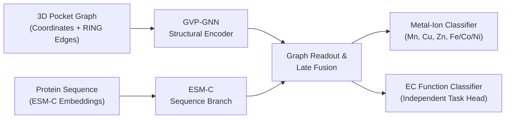

# DeepMzyme

[](https://github.com/MECHTI1/DeepMzyme/actions/workflows/cpu-ci.yml)
[](pyproject.toml)

DeepMzyme predicts catalytic metal-ion identity and enzyme commission (EC) function from protein structures. It combines 3D binding-pocket graphs encoded with Geometric Vector Perceptrons (GVP-GNN) and evolutionary sequence context from ESM-C protein language models.

## Approach

Metalloenzymes rely on transition-metal cofactors (Mn, Cu, Zn, Fe, Co, Ni) whose local coordination geometry and broader sequence context jointly determine catalytic activity. DeepMzyme models each metal-binding site or pocket using two complementary branches:

1. **3D Structural Pocket Graph (GVP-GNN):** Encodes residue-level scalar features (physicochemical descriptors, PROPKA electrostatics, first- and second-shell coordination indicators) and 3D vector channels (backbone and side-chain geometry) over spatial radius edges and optional RING chemical interaction edges.
2. **Sequence Context Branch (ESM-C):** Projects and normalizes precomputed ESM-C residue embeddings across the parent protein chain before pooling at the binding-site level.



Metal classification (`--task metal`) and EC classification (`--task ec`) are independently trainable primary tasks, with shared-encoder multi-task learning (`--task joint`) supported for controlled transfer experiments. Standalone unimodal baselines (`Only-GVP`, `Only-ESM`), alternative fusion modes (early, hybrid, cross-attention), and training objectives (`four_class`, `five_class`, `six_class`) are documented in [`Plan.md`](Plan.md).

## Results

Metal-classification models are evaluated on the common four-class endpoint—Mn, Cu, Zn, and the Fe/Co/Ni grouped class (Class VIII in PinMyMetal notation)—using unweighted four-class balanced accuracy across a near-copy-grouped 5-fold cross-validation cohort (7,398 ion sites) and the PinMyMetal reference test set (1,488 ion sites):

| Model | Models combined | Pooled out-of-fold balanced accuracy | Full reference-test balanced accuracy |
|:---|---:|---:|---:|
| Single-model baseline | 1 | 74.34% | 67.55% |
| Late-fusion ensemble | 30 | 76.81% | 72.20% |
| Combined-model ensemble | 55 | 77.17% | 71.00% |

**Evaluation notes and project status:**
- **Four-class endpoint and model selection:** Models trained under 4-class, 5-class, or 6-class objectives are evaluated on the common 4-class endpoint (Mn, Cu, Zn, Fe/Co/Ni grouped class). The single-model baseline achieves 74.28% mean-fold balanced accuracy (74.34% pooled out-of-fold across all 7,398 validation sites). All hyperparameter and ensemble selections were locked strictly on 5-fold cross-validation out-of-fold predictions.
- **Reference-test qualification:** The 1,488-site PinMyMetal reference test set enables comparison with published PinMyMetal (75.08% CV / 67.85% test) and Metal3D (61.70% test) results. Because the single-model baseline was the predeclared one-shot test evaluation and the 30-model and 55-model ensembles were evaluated afterward on a previously accessed reference test set, all test scores are documented as reference-test evaluations (`both_results_secondary`) rather than an unopened independent final test; see [`docs/DATASETS.md`](docs/DATASETS.md#final-reporting-status).
- **Filtered test subsets and full reports:** On the 1,346-site eligible reference-test subset, the 30-model late-fusion ensemble reaches 73.94% balanced accuracy (vs. 69.33% for the single-model baseline); on the 423-site homology-filtered clean subset, the 55-model ensemble reaches 61.33%. Complete 27-tier tables, 10,000-draw PDB-cluster bootstrap confidence intervals, and per-class recalls are in [`docs/campaigns/phase2_unified_2026-10/README.md`](docs/campaigns/phase2_unified_2026-10/README.md).
- **Task maturity and dataset coverage:** Metal classification has completed 5-fold cross-validation and reference-test evaluations; EC classification has preliminary fixed-split validation; joint multi-task learning remains experimental ([`EXPERIMENT_STATUS.md`](EXPERIMENT_STATUS.md)). The Zenodo PinMyMetal ion-level dataset reconstruction achieves 99.89% site coverage (9,398 / 9,408 ions across 7,724 PDB entries; [`docs/ZENODO_PINMYMETAL_EXACT_ION_LEVEL_REPRODUCIBILITY.md`](docs/ZENODO_PINMYMETAL_EXACT_ION_LEVEL_REPRODUCIBILITY.md)).

## Installation and verification

The commands below create the locked Linux x86_64 Python 3.12 CPU environment and verify the CLI entry points, unit test suite, and synthetic smoke checks without requiring external datasets or GPU hardware:

```bash
git clone https://github.com/MECHTI1/DeepMzyme.git
cd DeepMzyme
uv sync --frozen
uv run --frozen --no-sync python src/train.py --help
uv run --frozen --no-sync pytest
uv run --frozen --no-sync python tests/smoke_checks.py
```

## Example usage

Once the dataset bundle and precomputed feature directories are placed under `DeepMzyme_Data/`, run a grouped 5-fold cross-validation metal-classification experiment with late fusion (`GVP-GNN + ESM-C`):

```bash
uv run --frozen --no-sync python src/train.py \
  --task metal \
  --model-Variant gvp_late_fusion \
  --metal-example-unit ion \
  --metal-label-scheme merge_fe_class_viii \
  --train-dir DeepMzyme_Data/train_and_test_sets_structures_zenodo_pmm_exact/train \
  --summary-csv DeepMzyme_Data/train_and_test_sets_structures_zenodo_pmm_exact/train_sites_summary.csv \
  --esm-dir DeepMzyme_Data/esm_embeddings_esmc600m_v1 \
  --split-strategy group_kfold \
  --group-col pdbid \
  --n-splits 5 \
  --fold-index 0 \
  --epochs 50 \
  --output-dir runs/example_metal_late_fusion_fold0
```

- **Inputs:** PDB/mmCIF structure directory (`--train-dir`), ion- or pocket-level label summary CSV (`--summary-csv`), and precomputed ESM-C residue embeddings (`--esm-dir`).
- **Outputs:** Structured run artifacts in `--output-dir`, including `config.json`, per-epoch validation history (`history.json`), best-validation checkpoint metadata (`selected_checkpoint.json`), and out-of-fold predictions (`val_predictions.csv`, `metrics.json`) reporting four-class balanced accuracy and per-metal recalls.

## Data and pretrained models

- **Public dataset & checkpoint archive (Hugging Face):** Reconstructed PinMyMetal benchmark structures, fold memberships, precomputed ESM-C / PROPKA / RING feature bundles, and trained model checkpoints (`Step F` single-model refit, `Top-4 LF` 30-model ensemble, and `CV-Locked Tri-Modal` 55-model ensemble) are indexed in [`docs/DATASETS.md`](docs/DATASETS.md), [`docs/STRUCTURE_STORE.md`](docs/STRUCTURE_STORE.md), and [`docs/BACKUP_AND_DATA_INVENTORY.md`](docs/BACKUP_AND_DATA_INVENTORY.md) ([`MECHTI1/DeepMzyme-Benchmark`](https://huggingface.co/datasets/MECHTI1/DeepMzyme-Benchmark)).

## Technical documentation

- **Setup & execution guide:** [`docs/GETTING_STARTED.md`](docs/GETTING_STARTED.md) and [`requirements/README.md`](requirements/README.md)
- **Scientific design & model matrix:** [`Plan.md`](Plan.md) and [`docs/PARAMETER_FINDINGS.md`](docs/PARAMETER_FINDINGS.md)
- **Benchmark evaluation reports:** [`docs/campaigns/phase2_unified_2026-10/README.md`](docs/campaigns/phase2_unified_2026-10/README.md) and [`EXPERIMENT_STATUS.md`](EXPERIMENT_STATUS.md)
- **Datasets, splits & test-use ledger:** [`docs/DATASETS.md`](docs/DATASETS.md) and [`docs/README.md`](docs/README.md)

## Author and acknowledgments

**Author:** Gilad Mechtinger ([`@MECHTI1`](https://github.com/MECHTI1)), Tel Aviv University.

**Upstream methods and datasets:**
- **GVP-GNN:** Jing et al., *Learning from Protein Structure with Geometric Vector Perceptrons*, ICLR 2021.
- **ESM-C:** EvolutionaryScale, *ESM Cambrian (ESM-C)* protein language models.
- **PinMyMetal:** Zheng et al., *PinMyMetal*, and the Zenodo benchmark structure dataset ([`10.5281/zenodo.17610514`](https://doi.org/10.5281/zenodo.17610514)).
- **Comparators & functional benchmarks:** Metal3D (Dürr et al., *Nature Communications* 2023), MAHOMES (Feehan et al.), CLEAN (Yu et al., *Science* 2023), CARE, PROPKA, and RING residue interaction networks.
