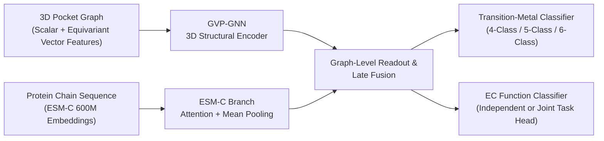

# DeepMzyme: Multimodal 3D Geometric & Protein Language Model Framework for Metalloprotein Binding Sites

[](https://github.com/MECHTI1/DeepMzyme/actions/workflows/cpu-ci.yml)
[](pyproject.toml)
[](pyproject.toml)
[](pyproject.toml)
[](https://huggingface.co/datasets/GMBioinformatics/DeepMzyme)
[](docs/paper/PAPER_MANUSCRIPT_BLUEPRINT.md)

**DeepMzyme** is a multimodal deep learning framework for structural bioinformatics that predicts transition-metal identity ($\text{Mn}$, $\text{Cu}$, $\text{Zn}$, and $\text{Class VIII} = \text{Fe/Co/Ni}$, plus native 5- and 6-class resolution of $\text{Fe}$, $\text{Co}$, and $\text{Ni}$) at metal-binding sites in 3D protein structures. It fuses an **$SE(3)$-equivariant Geometric Vector Perceptron Graph Neural Network (`GVP-GNN`)** over local 3D atomic coordination microenvironments with evolutionary sequence representations from the **600-million-parameter `ESM-C` protein language model**. Enzyme Commission (EC) catalytic function prediction is also supported as an independent or joint multi-task head.

---

## Key Highlights

- **Multimodal 3D Equivariant + Evolutionary Architecture:** Combines scalar and $SE(3)$-equivariant vector message passing (`GVP-GNN`) over $8\text{ \AA}$ 3D structural pocket graphs with residue-level `ESM-C 600M` embeddings (`+1.95 pp` over sequence-only on all 5 cross-validation folds and `+4.62 pp` over unregularized structure-only baselines).
- **Outperforms *Nature Communications* (2025) Benchmark (PinMyMetal):**
  - **Matched Retraining (Same 7,398 Sites & Sequence-Identity Folds):** DeepMzyme's pre-declared single model beats PinMyMetal's released classifier retrained with deployment-available features (`PMM-D`) by **+9.28 percentage points** on the held-out test set (`67.55%` vs. `58.27%`, 97.5% CI `[+3.59, +15.10]`) and **+11.25 pp** in 5-fold cross-validation (`74.28%` vs. `63.03%`, 97.5% CI `[+6.25, +15.36]`). All 15 cross-validation-selected ensembles (and 6 seed-42-ranked CV ensembles) outperform `PMM-D` by **+10.56 to +13.83 pp** and outperform PinMyMetal retrained with all 93 published features (`PMM-R`) by **+5.42 to +8.69 pp** (all paired 95% CIs above zero).
  - **Published Benchmark Context:** Even evaluated under stricter $\ge 90\%$ sequence-identity grouped folds, DeepMzyme exceeds PinMyMetal's published paper scores on 5-fold CV macro-precision (**75.67%–81.14%** vs. **75.08%** in Fig. 2a) and balanced accuracy (**74.34%–77.99%** vs. **≈72.70%**), while CV-selected ensembles reach **68.83%–72.10%** on the full `1,488`-site test set and **70.49%–73.64%** on the `1,346` in-scope protein-coordinated sites (**72.20% / 73.94%** for the 30-model late-fusion release ensemble vs. PinMyMetal's reported **67.85%** in Fig. 2b).
- **Open 3D Benchmark Reconstruction & Forensic Audit:** Reverse-engineered and released **9,398 of 9,408 (`99.89%`)** PinMyMetal benchmark ions as 3D coordinate structures (`1.1 GB` on [Hugging Face](https://huggingface.co/datasets/GMBioinformatics/DeepMzyme)), curated a symmetry-audited `7,398`-ion training cohort across `2,208` sequence-identity clusters ($\ge 90\%$ identity), and uncovered an undocumented ground-truth bond-valence sum leak (`valence_3a`, [`TECH-028`](docs/FOLLOW_UP_TECHNICAL_ISSUES.md#tech-028--pmm-comparator-inherits-a-true-metal-label-leak)) in PinMyMetal's released feature tables.
- **Production-Grade ML Engineering:** Deterministic `uv` lockfile environment (`Python 3.12`), automated GitHub Actions CPU CI, modular CLI and release-audit verification (`src/metal_release/`), and 60+ `pytest` test suites.

---

## Approach

Which transition metal a protein site binds depends on both its local 3D coordination geometry and its broader evolutionary sequence context. DeepMzyme encodes each binding site (`--metal-example-unit ion`) with two parallel branches:

1. **3D Structural Pocket Graph (`GVP-GNN`):** Represents residues within $8\text{ \AA}$ of the metal site as graph nodes carrying scalar features (amino-acid identity, physicochemical properties, first- and second-shell coordination roles, Gaussian RBF distances to the ion) and $SE(3)$-equivariant vector features (side-chain $\text{C}_\alpha \rightarrow \text{C}_\beta$ and residue-to-metal unit vectors), connected by $8\text{ \AA}$ radius edges. PROPKA electrostatics and RING interaction edges are also supported as optional channels.
2. **Evolutionary Sequence Context Branch (`ESM-C 600M`):** Projects per-residue `1,152`-dimensional representations from `ESM-C 600M` across the full protein chain and aggregates them over the binding-site residues via combined mean and attention pooling.



Metal classification (`--task metal`) and EC classification (`--task ec`) are independently trainable tasks, with shared-encoder multi-task learning (`--task joint`) for transfer experiments. Standalone unimodal baselines (`Only-GVP`, `Only-ESM`), alternative fusion modes (early, hybrid, cross-attention), and native 4-, 5-, and 6-class objectives (`four_class`, `five_class`, `six_class`) are documented in [`Plan.md`](Plan.md) and [`docs/paper/PAPER_MANUSCRIPT_BLUEPRINT.md`](docs/paper/PAPER_MANUSCRIPT_BLUEPRINT.md).

---

## Results

Models are evaluated with unweighted four-class balanced accuracy (mean recall across `Mn`, `Cu`, `Zn`, and `Class VIII = Fe/Co/Ni`) and column-normalized macro-precision (PinMyMetal's Fig. 2a metric) on **5-fold cross-validation (`7,398` ion sites grouped into `2,208` clusters at $\ge 90\%$ sequence identity)** and **PinMyMetal's `1,488`-site reference test set** (`Full 1,488` sites and `In-Scope Eligible 1,346` protein-coordinated sites):

| System / Model Tier | Ckpts | 5-Fold CV Balanced Accuracy | 5-Fold CV Macro-Precision *(PMM Fig. 2a Metric)* | Full Reference Test (`1,488` sites) | In-Scope Eligible Test (`1,346` sites) |
| :--- | :---: | :---: | :---: | :---: | :---: |
| **DeepMzyme Models & Ensembles** | | | | | |
| Single model (`a0007846`, pre-declared full-data refit of `B4`) | 1 | 74.34%\* | 75.74%\* | **67.55%** | **69.33%** |
| 5-Fold Baseline `B4` (`s42`, 5 fold checkpoints) | 5 | 74.34% | **75.74%** | **69.02%** | **70.75%** |
| 15-Model Baseline `B4` (`s42/43/44`, 3 seeds) | 15 | 75.58% | **77.39%** | **69.94%** | **71.83%** |
| CV Top-1 Family (`mc_P_five_class` × 3 seeds, CV-only `R1`) | 15 | 75.32%† (75.82% pooled) | **77.13%** | **71.10%** | **72.68%** |
| CV Top-4 Families All Seeds (`P5 + P4 + B4 + trunklr1e4`, CV-only `R1`) | 50 | 76.27%† (76.46% pooled) | **78.36%** | **71.75%** | **73.48%** |
| All 15 CV-Only Ensembles (`R1–R4`, zero test selection) | 5–70 | **74.34%–76.61%†** | **75.67%–81.14%‡** | **68.83%–71.75%** | **70.49%–73.48%** |
| Seed-42 CV-Ranked Ensembles (`R2b Top-4 / Top-5`, Amendment A2) | 20–25 | 76.09%–76.10%† | **77.77%–78.48%‡** | **71.83%–72.10%** | **73.62%–73.64%** |
| 30-Model Late-Fusion Ensemble (`top4_lf`, test-ranked membership§) | 30 | 76.81% | **78.38%** | **72.20%** | **73.94%** |
| 55-Model Trimodal Ensemble (`LF + ESM + GVP`, test-ranked membership§) | 55 | **77.17%** | **80.34%** | **71.00%** | **72.76%** |
| **PinMyMetal Comparators & Ablations** | | | | | |
| **PMM-D:** PinMyMetal classifier retrained on same sites (deployment features) | — | 62.96% (63.03% mean fold) | 68.47% | 58.27% | 59.48% |
| **PMM-R:** PinMyMetal classifier retrained on same sites (all 93 features¶) | — | 67.16% (67.19% mean fold) | 71.24% | 63.41% | 63.81% |
| **PMM-H:** Gradient boosting on PinMyMetal's 89 deployment features (ablation) | — | 71.22% | 75.51% | 68.83% | 69.49% |
| **PinMyMetal Published** *(Zhang et al. 2025; ungrouped folds + `valence_3a`, unpaired)* | — | ≈72.70% *(BA equiv.)* | 75.08% *(Fig. 2a)* | 67.85% *(Fig. 2b)* | — |

*\*5-fold CV score of the `B4` recipe (`s42`); the full-dataset refit `a0007846` has no out-of-fold score. †Nested CV for rule-selected ensembles (`R1–R3`, `R2b`); retained-configuration ensembles (`R4`) are pooled OOF. ‡Pooled non-nested OOF macro-precision. §Membership follows the full-test ranking ([release audit](docs/campaigns/phase2_unified_2026-10/release_audit/README.md)); reported for completeness and not used for primary PinMyMetal superiority claims. ¶Includes `valence_3a`, which in PinMyMetal's released tables equals the true-metal bond-valence sum ([`TECH-028`](docs/FOLLOW_UP_TECHNICAL_ISSUES.md#tech-028--pmm-comparator-inherits-a-true-metal-label-leak)).*

### Key Benchmark Takeaways & Methodological Summary

- **Matched PinMyMetal Comparison:** In a pre-registered matched comparison on the exact same `7,398` training sites, `v3` sequence-identity folds, and `1,488` test rows ([matched comparison report](docs/campaigns/phase2_unified_2026-10/pmm_matched/README.md)), DeepMzyme outperformed PinMyMetal's released classifier retrained with deployment-available features (`PMM-D`) by **+9.28 pp** on the test set (97.5% CI `[+3.59, +15.10]`) and **+11.25 pp** in cross-validation (mean over folds; 97.5% CIs `[+6.25, +15.36]` bootstrap and `[+2.88, +19.62]` $t$). All 15 ensembles selected strictly by cross-validation (`R1–R4`) also outperformed both `PMM-D` (`+10.56 to +13.48 pp`) and `PMM-R` (`+5.42 to +8.34 pp`, all unadjusted paired 95% CIs above zero), and scored above PinMyMetal's published `67.85%` test benchmark by point estimate (`+0.98 to +3.90 pp`; unpaired two-sided 95% CIs include `67.85%`, while the 1-checkpoint refit is `0.30 pp` below it).
- **Forensic Audit of Manganese Recall (`TECH-028`):** In PinMyMetal's released tables, `valence_3a` encodes the ground-truth metal's bond-valence sum in `7,919 / 7,920` training and `1,488 / 1,488` test rows. In our matched refits, removing the four columns that are Zn-based at deployment (`valence_3a/4a`, `vecsum_3a/4a`) reduced PinMyMetal's test Mn recall from **79.0% (`PMM-R`) to 61.7% (`PMM-D`)** (`-17.4 pp`, 95% CI `[11.1, 24.1]`); neither refit reproduced the published `88.6%` Mn recall, and DeepMzyme's single-model Mn recall (`55.7%`, or `62.3%–66.5%` for CV ensembles) is lower than `PMM-R`.
- **Feature vs. Classifier Ablation & Disclosures:** An untuned histogram gradient-boosting model trained on PinMyMetal's 89 deployment features (`PMM-H`, an internal ablation reclassified post hoc under Amendment A1 after the original composite pre-registration rule did not separate `a0007846` from `PMM-H`) reached `68.83%` test and `71.22%` CV balanced accuracy, statistically indistinguishable from DeepMzyme on the full test (`-1.28 to +3.27 pp`), indicating that DeepMzyme's proven statistical advantage is over PinMyMetal's released classifier while learning end-to-end from 3D coordinates and sequences without curated NEIGHBORHOOD/BVS tables. Both systems classify metal identity at known holo binding sites (site localization is not evaluated; PinMyMetal's reported `61.70%` in Fig. 2c is its own score on a Metal3D-localized set). Because the reference test set shares `668` PDB IDs with training and was opened during earlier evaluations ([`docs/DATASETS.md`](docs/DATASETS.md#final-reporting-status)), test results are secondary (`48.85%` single model and `52.32%–61.33%` ensembles on the `423`-site homology-filtered clean subset). See [`docs/campaigns/phase2_unified_2026-10/README.md`](docs/campaigns/phase2_unified_2026-10/README.md) and [`docs/paper/PAPER_MANUSCRIPT_BLUEPRINT.md`](docs/paper/PAPER_MANUSCRIPT_BLUEPRINT.md) for complete tables.

---

## Engineering & Tech Stack

- **Deep Learning & Geometric ML:** `PyTorch`, `PyTorch Geometric (PyG)`, custom $SE(3)$-equivariant `GVP-GNN` layers, `ESM-C` (EvolutionaryScale Cambrian `300M` / `600M` protein language models).
- **Structural Bioinformatics & Cheminformatics:** `BioPython`, `Gemmi`, `PROPKA` (electrostatic $\text{p}K_a$ shifts), `RING` (residue interaction networks), deterministic C/Fortran `NEIGHBORHOOD` coordinate crosswalks.
- **Reproducibility & MLOps:** Locked `uv` environment (`uv.lock`), automated GitHub Actions CPU CI (`.github/workflows/cpu-ci.yml`), SHA-256 manifest auditing (`src/metal_release/`), and 60+ unit and integration test suites (`tests/`).

---

## Installation and verification

These commands create the locked Linux `x86_64` Python 3.12 CPU environment and run the CLI, unit tests, and synthetic smoke checks without requiring external datasets or a GPU:

```bash
git clone https://github.com/MECHTI1/DeepMzyme.git
cd DeepMzyme
uv sync --frozen
uv run --frozen --no-sync python src/train.py --help
uv run --frozen --no-sync pytest
uv run --frozen --no-sync python tests/smoke_checks.py
```

---

## Example usage

Unpack the reconstructed PinMyMetal structures (see below) so that the archive's `dataset/` folder becomes `DeepMzyme_Data/train_and_test_sets_structures_zenodo_pmm_exact/`. Generate ESM-C 600M embeddings once (optional `esm` dependency group), then train fold 0 of a grouped 5-fold late-fusion (`GVP-GNN + ESM-C`) metal classifier:

```bash
uv sync --frozen --group esm
uv run --frozen --no-sync python src/embed_helpers/esmc.py \
  --structure-dir DeepMzyme_Data/train_and_test_sets_structures_zenodo_pmm_exact/train \
  --out-dir DeepMzyme_Data/esm_embeddings_esmc600m \
  --model-name esmc_600m
uv run --frozen --no-sync python src/train.py \
  --task metal \
  --metal-example-unit ion \
  --metal-label-scheme merge_fe_class_viii \
  --structure-dir DeepMzyme_Data/train_and_test_sets_structures_zenodo_pmm_exact/train \
  --summary-csv DeepMzyme_Data/train_and_test_sets_structures_zenodo_pmm_exact/train/final_data_summarazing_table.csv \
  --esm-embeddings-dir DeepMzyme_Data/esm_embeddings_esmc600m \
  --esm-dim 1152 \
  --n-folds 5 \
  --fold-index 0 \
  --train-val-split-by pdbid \
  --epochs 50 \
  --runs-dir runs \
  --run-name example_metal_late_fusion_fold0
```

The run folder under `--runs-dir` holds `run_config.json`, per-epoch metrics, `selected_checkpoint.json`, and out-of-fold `val_predictions.csv`. The benchmark evaluations use the frozen $\ge 90\%$ sequence-identity folds (`--fold-membership-csv`).

---

## Data and pretrained models

- **Public Dataset on Hugging Face:** [`GMBioinformatics/DeepMzyme`](https://huggingface.co/datasets/GMBioinformatics/DeepMzyme) hosts the reconstructed PinMyMetal ion-level 3D structures and site manifests (`1.1 GB`, `9,398 / 9,408` sites, `99.89%` fidelity), an earlier `4.7 GB` structural bundle (CLEAN/CARE splits, ESM-C 300M embeddings, RING and PROPKA features), and 5 released five-class fold checkpoints. Full inventory: [`docs/DATASETS.md`](docs/DATASETS.md#hugging-face-repository-inventory), [`docs/STRUCTURE_STORE.md`](docs/STRUCTURE_STORE.md), and [`docs/ZENODO_PINMYMETAL_EXACT_ION_LEVEL_REPRODUCIBILITY.md`](docs/ZENODO_PINMYMETAL_EXACT_ION_LEVEL_REPRODUCIBILITY.md).

---

## Technical documentation

- **Paper Manuscript Blueprint & Full Synthesis:** [`docs/paper/PAPER_MANUSCRIPT_BLUEPRINT.md`](docs/paper/PAPER_MANUSCRIPT_BLUEPRINT.md)
- **Benchmark & Matched PinMyMetal Reports:** [`docs/campaigns/phase2_unified_2026-10/README.md`](docs/campaigns/phase2_unified_2026-10/README.md) and [`docs/campaigns/phase2_unified_2026-10/pmm_matched/README.md`](docs/campaigns/phase2_unified_2026-10/pmm_matched/README.md)
- **Scientific Design, Ablations & Experiment Status:** [`Plan.md`](Plan.md), [`docs/PARAMETER_FINDINGS.md`](docs/PARAMETER_FINDINGS.md), and [`EXPERIMENT_STATUS.md`](EXPERIMENT_STATUS.md)
- **Setup, Datasets & Reproducibility Guides:** [`docs/GETTING_STARTED.md`](docs/GETTING_STARTED.md), [`docs/DATASETS.md`](docs/DATASETS.md), and [`docs/README.md`](docs/README.md)

---

## Author and acknowledgments

**Author:** Gilad Mechtinger ([`@MECHTI1`](https://github.com/MECHTI1)), Tel Aviv University.

**Upstream methods and datasets:**
- **GVP-GNN:** Jing et al., *Learning from Protein Structure with Geometric Vector Perceptrons*, ICLR 2021.
- **ESM-C:** EvolutionaryScale, *ESM Cambrian (ESM-C)* protein language models.
- **PinMyMetal:** Zhang et al., *PinMyMetal*, Nature Communications 2025 ([`10.1038/s41467-025-57637-5`](https://doi.org/10.1038/s41467-025-57637-5)), and the Zenodo benchmark structure dataset ([`10.5281/zenodo.17610514`](https://doi.org/10.5281/zenodo.17610514)).
- **Comparators & functional benchmarks:** Metal3D (Dürr et al., *Nature Communications* 2023), MAHOMES (Feehan et al.), CLEAN (Yu et al., *Science* 2023), CARE, PROPKA, and RING residue interaction networks.
