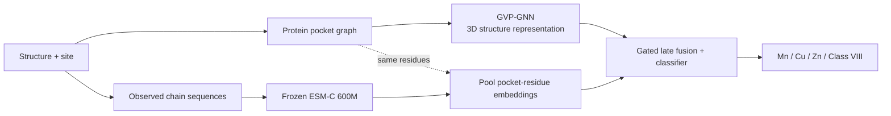

# DeepMzyme: Metal-Type Prediction from Protein Structure and Sequence

[](pyproject.toml)
[](pyproject.toml)
[](src/metal_release/README.md#input-features)
[](https://huggingface.co/datasets/GMBioinformatics/DeepMzyme)

**DeepMzyme predicts which metal occupies a known metal-binding site in a protein structure.** It combines the 3D geometry and chemistry of nearby protein residues with sequence representations from the pretrained **ESM-C 600M** protein language model.

- **Input:** a protein structure (`.pdb`, `.cif` or `.mmcif`) and a site, supplied as a metal atom or XYZ coordinates. The sequence is read from the structure file.
- **Output:** a predicted class and scores for **Mn** (manganese), **Cu** (copper), **Zn** (zinc) and **Class VIII** (iron, cobalt and nickel grouped together).
- **Available now:** a five-model research ensemble with public weights and a CPU prediction interface. No deployment default has been selected.

DeepMzyme assumes the supplied site binds one of these metals. It does not locate binding sites or determine whether metal binding occurs. Evaluation used experimental metal-bound (holo) structures; performance on metal-free or predicted structures is untested. The output scores are uncalibrated.

[Quick start](#quick-start) · [How it works](#how-it-works) · [Results](#results) · [Documentation](#documentation) · [Citation](#citation-and-license)

## Highlights

- **Combines structure and sequence.** In matched five-fold cross-validation, the combined model scored 74.34% balanced accuracy, versus 72.38% for ESM-only and 69.71% for structure-only. The reference-test gain over ESM-only remains uncertain ([comparison](docs/campaigns/phase2_unified_2026-10/log.md#p2u-005-2026-10-20--matched-modality--target--ensemble-fairness-audit)).
- **Uses protein residues and sequence without requiring resolved waters or other non-protein ligands.** This avoids dependence on a complete experimental coordination sphere ([why this matters for AlphaFold2](#coordination-geometry-and-alphafold2)).
- **Provides reproducible research artifacts.** Public model weights, frozen training folds, configuration records and benchmark reports accompany the code. The [results below](#results) distinguish the public model from the selected single model and larger research ensembles.

## Quick start

### Install (CPU)

Install [uv](https://docs.astral.sh/uv/), then run:

```bash
git clone https://github.com/MECHTI1/DeepMzyme.git
cd DeepMzyme
uv sync --frozen
uv run --frozen --no-sync python tests/smoke_checks.py
```

The lockfile specifies Python 3.12 and CPU PyTorch 2.5.1 on Linux x86_64. The smoke check needs no model weights or benchmark data. See the [environment guide](requirements/README.md) for other environments.

### Predict the metal at a site

First follow the [checkpoint download and binding commands](src/metal_release/README.md#public-checkpoint-inference). They download the 99 MB archive, verify its five models and write `DeepMzyme_Data/public_metal/bound_manifest.json`. Here, **binding** means checking model files and recording their locations.

Then use your own uncompressed holo structure. Replace the structure path and atom locator in this example:

```bash
uv sync --frozen --group esm
uv run --frozen --no-sync python src/metal_release_cli.py predict \
  --manifest DeepMzyme_Data/public_metal/bound_manifest.json \
  --candidate unified_p5_trunklr1e4_5fold_s42 \
  --structure path/to/holo_structure.pdb \
  --atom A:402:_:ZN:_ \
  --embedding-cache ~/.cache/deepmzyme/inference_esmc600m \
  --generate-embeddings \
  --device cpu \
  --output DeepMzyme_Data/public_metal/site_prediction.json
```

`A:402:_:ZN:_` selects chain A, residue 402, atom ZN, with blank insertion and alternate-location codes (`_`). The atom supplies the **site position**, not the metal identity as a model input. Alternatively, use `--center X Y Z` in ångströms; user-supplied centers have not been independently validated.

The first prediction downloads ESM-C weights if needed (about 2.3 GB) and caches the sequence embeddings. Keep this inference cache separate from training caches. Choose a new output filename for each run; existing files are not overwritten.

The JSON output contains `predicted_class`, four `class_scores` and `quality_flags` for each site, plus model and input provenance. A high score ranks a metal class; it is not a calibrated probability that the site binds that metal. See the [prediction guide](src/metal_release/README.md) for multiple sites and validation details.

<a id="approach"></a>
## How it works



The graph includes standard amino-acid residues with an atom within **10 Å** of the site, linking residues whose closest atoms are within **8 Å**. A geometric vector perceptron graph neural network (**GVP-GNN**) processes their chemistry and 3D geometry. ESM-C supplies sequence context; its weights stay frozen while the graph network, sequence pooling and fusion classifier train together.

Training supports four, five or six metal classes. For the reported four-class task, Fe, Co and Ni scores are summed into Class VIII before choosing the top class. The public ensemble uses five-class training; this has not been established as better than direct four-class training. Detailed representations are in the [feature reference](src/metal_release/README.md#input-features).

### Coordination geometry and AlphaFold2

**Coordinating waters and other non-protein ligands can complete the metal's coordination sphere.** Their donor atoms contribute to geometries such as tetrahedral or octahedral arrangements, which carry information about metal preference. Omitting these atoms can change both the coordination number and the assigned geometry ([FindGeo](https://doi.org/10.1093/bioinformatics/bts246)). PinMyMetal's coordination descriptors therefore provide information from the experimental holo structure that DeepMzyme's protein-residue graph does not receive.

Standard **AlphaFold2 models contain protein coordinates but omit waters, metal ions and other non-protein ligands** ([AlphaFill](https://doi.org/10.1038/s41592-022-01685-y)). Protein-donor geometry remains informative, but the complete holo coordination environment cannot be recovered directly from those coordinates alone. DeepMzyme avoids requiring these missing components, making its input representation relevant to this setting; predicting metal identity on AlphaFold2 models still requires a supplied site and separate validation. The [benchmark discussion](docs/campaigns/phase2_unified_2026-10/pmm_matched/README.md#coordination-environment-and-transfer-to-predicted-structures) explains this input advantage and its limits.

## Results

**Balanced accuracy (BA)** averages recall across the four classes, giving each metal class equal weight. **Cross-validation (CV)** uses 7,398 sites in five folds, keeping PDB entries linked by ≥90% sequence identity together. Pooled CV scores combine predictions made while each site's fold was excluded from training.

The **reference test** contains 1,488 sites from PinMyMetal. It had been accessed previously, and 809 sites share a PDB entry with training sites. These results are secondary evidence, not an independent final test ([test-use ledger](docs/DATASETS.md#test-use-ledger)).

### Models compared

All scores below are balanced accuracy. An ensemble averages predictions from multiple trained models.

| Model | Pooled CV BA | Reference-test BA |
| :--- | ---: | ---: |
| PinMyMetal classifier, retrained on 89 features (PMM-D) | 62.96% | 58.27% |
| PinMyMetal classifier, retrained on all 93 features (PMM-R) | 67.16% | 63.41% |
| Gradient-boosted trees on the same 89 features (HistGB) | 71.22% | 68.83% |
| DeepMzyme selected single model¹ | 74.34% | 67.55% |
| DeepMzyme research ensembles, 5–70 models² | 74.34–77.99% | 68.83–71.75% |
| **DeepMzyme public ensemble, 5 models**³ | **74.91%** | **71.72%** |

¹ CV evaluates the selected training recipe. The single model was then trained on all 7,398 sites and frozen before its first test evaluation.

² These 15 ensembles were assembled using CV-based rules. Selecting from the same CV predictions makes the upper scores optimistic. The reported nested selection estimates are **74.54–76.61%**, with the [limitations of reusing fitted models](docs/campaigns/phase2_unified_2026-10/release_audit/README.md#decision). Most use late fusion; the greedy ensemble also includes structure-only models.

³ This is the downloadable model used in the quick start. Its recipe combined previously tested components after test scores were known; no validation-only selection rationale was recorded. It is separate from the 15-ensemble comparison and has not been promoted as a deployment default.

### Comparison with PinMyMetal

[PinMyMetal](https://doi.org/10.1038/s41467-025-57637-5) also locates metal sites; this comparison evaluates only metal classification at supplied sites. Its released classifier was retrained on the same sites and folds. **HistGB** is a separate, fixed gradient-boosted tree classifier trained here on PinMyMetal's features.

**The feature sets differ.** The released tables contain a label leak: `valence_3a`, a bond-valence score, was computed using the true metal identity. PMM-D removes it and three related columns; PMM-R retains all 93. The remaining 89 include the coordination and geometry information [discussed above](#coordination-geometry-and-alphafold2). Element-specific `bvs_*` scores evaluate candidate metals and are distinct from the verified label leak ([feature audit](docs/FOLLOW_UP_TECHNICAL_ISSUES.md#tech-028--pmm-comparator-inherits-a-true-metal-label-leak)).

**What the comparison supports.** Against PMM-D, the selected single model gained **9.28 percentage points** on the reference test (97.5% paired confidence interval **[3.59, 15.10]**); its recipe gained **11.25 points** in mean-fold CV (**[6.25, 15.36]**). PMM-D approximates deployment inputs: deployed PinMyMetal could retain some removed features recomputed with a zinc probe.

**The comparison with HistGB is more nuanced.** DeepMzyme has higher CV point estimates. For the greedy ensemble, resampling protein groups gives a positive interval conditional on the fitted models, while resampling the five folds leaves the advantage unresolved. On the reference test, the 50-model ensemble's advantage is **+2.92 points [−1.15, 7.11]** (95% confidence interval); all reported single-model and 15-ensemble contrasts include zero. Thus a reference-test advantage remains statistically unresolved. The [matched report](docs/campaigns/phase2_unified_2026-10/pmm_matched/README.md#interpreting-the-histgb-comparison) gives the estimates and their limits.

The pre-registered success rule required beating both PMM-D and HistGB and was **not met**. Amendment A1, adopted after the results were known, narrowed the claim to improvement over the released PinMyMetal classifier with the reduced feature set. The report preserves that history, all ensemble comparisons and the distinction from PinMyMetal's published scores.

### Limits of the evidence

- **Generalization:** the folds control close sequence redundancy, not remote homology. Only DeepMzyme was tuned on these folds. A 423-site filtered reference subset excludes training-PDB overlap, identifiable near-copy chains, unverifiable context and previously opened PDB IDs; it remains descriptive, and all methods score lower there ([results](docs/campaigns/phase2_unified_2026-10/pmm_matched/README.md)).
- **Rare metals:** reference-test Mn recall is 55.7% for the selected single model and 63.5% for the public ensemble, versus 61.7% for PMM-D and 79.0% for PMM-R. Separate Co/Ni classification remains exploratory ([native-target results](docs/PARAMETER_FINDINGS.md#metal-completion-bps-loss-recipes-on-fourfivesix-objectives-executed-2026-10-1516)).
- **Structure versus sequence:** the ESM-only baseline still pools residues from a structure-defined pocket and was not tuned separately. The combined model's higher CV scores do not establish a resolved reference-test gain over ESM-only.

## Documentation

- **Prediction:** [public weights, binding, inference and input features](src/metal_release/README.md)
- **Training:** [frozen-fold reproduction recipe](docs/METAL_TRAINING_PIPELINE_PLAYBOOK.md#reproduce-the-frozen-v3-sequence-clustered-folds), including data downloads, full checksums and one command per fold
- **Evidence:** [matched benchmark report](docs/campaigns/phase2_unified_2026-10/pmm_matched/README.md), [full ensemble and CPU-cost audit](docs/campaigns/phase2_unified_2026-10/release_audit/README.md), [datasets and releases](docs/DATASETS.md)
- **Project:** [getting started](docs/GETTING_STARTED.md), [documentation and repository index](docs/README.md), [current status](EXPERIMENT_STATUS.md)

The repository also supports independent **EC level-1 enzyme-function classification**. This is a research training path, separate from the public metal predictor; it does not assign complete EC numbers. See the [EC playbook](docs/EC_TRAINING_PIPELINE_PLAYBOOK.md) for its current scope and compatibility limits.

## Citation and license

**Author:** Gilad Mechtinger ([`@MECHTI1`](https://github.com/MECHTI1)), Tel Aviv University.

```bibtex
@software{mechtinger2026deepmzyme,
  author       = {Mechtinger, Gilad},
  title        = {DeepMzyme: Metal-Type Prediction from Protein Structure and Sequence},
  year         = {2026},
  publisher    = {GitHub},
  url          = {https://github.com/MECHTI1/DeepMzyme}
}
```

If you use the benchmark data or models, please also cite PinMyMetal, GVP-GNN and ESM-C.

**License:** no license has been declared yet for DeepMzyme's own code. Third-party models and data keep their own terms: the pinned `esm` 3.2.3 package lists the ESM-C 600M weights under EvolutionaryScale's [Cambrian Non-Commercial License Agreement](https://www.evolutionaryscale.ai/policies/cambrian-non-commercial-license-agreement), and PinMyMetal's released tables remain under their authors' terms.

## Related work

[PinMyMetal](https://doi.org/10.1038/s41467-025-57637-5) and its [Zenodo dataset](https://doi.org/10.5281/zenodo.17610514) supply the metal benchmark. The architecture uses [GVP-GNN](https://arxiv.org/abs/2009.01411) and [ESM-C](https://evolutionaryscale.ai/blog/esm-cambrian). PinMyMetal and [Metal3D](https://doi.org/10.1038/s41467-023-37870-6) also address site localization. [CLEAN](https://doi.org/10.1126/science.adf2465) and [CARE](https://arxiv.org/abs/2406.15669) provide EC-task benchmarks.
