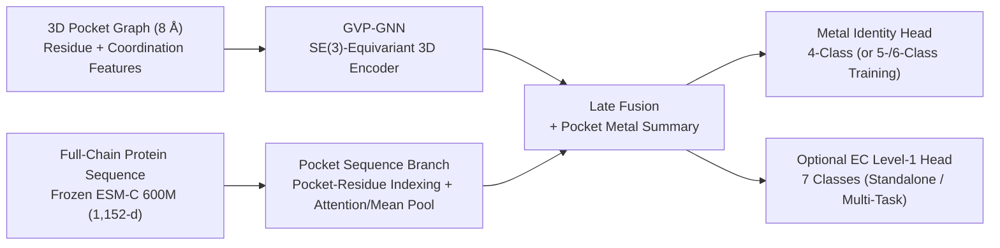

# DeepMzyme: Metal-Type Prediction from Protein Structure and Sequence

[](pyproject.toml)
[](pyproject.toml)
[](pyproject.toml)
[](https://huggingface.co/datasets/GMBioinformatics/DeepMzyme)

**DeepMzyme** predicts transition-metal identity (**Mn, Fe, Co, Ni, Cu, Zn**) at protein metal-binding sites from 3D structure and sequence.

Because first-row transition metals share common coordinating residues (His, Cys, Asp, Glu) and similar coordination geometries, local first-shell geometry alone is often insufficient to distinguish metal identity. DeepMzyme combines an *SE*(3)-equivariant 3D pocket graph neural network (`GVP-GNN`) over residue and coordination-shell features with frozen full-chain `ESM-C 600M` residue embeddings pooled over the binding pocket.

### Overview & Current Status

- **Prediction tasks:**
  - **4-class metal classification:** `Mn`, `Cu`, `Zn`, and `Class VIII` (`Fe / Co / Ni` combined).
  - **5- and 6-class metal classification:** native 5-class (`Fe` separated from `Co + Ni`) and 6-class (`Mn, Fe, Co, Ni, Cu, Zn`) training, evaluated both natively and after summing `Fe / Co / Ni` probabilities into `Class VIII`. In 5-fold cross-validation, `Fe` is separated with ~61% recall, whereas discrete `Co` vs. `Ni` recall remains low (29.5% `Ni` recall, 4.9% `Co` recall in 6-class CV; 0.680 pairwise `Co` vs. `Ni` ROC-AUC).
  - **Optional EC level-1 head (`--task ec` or `--task joint`):** single-label classification of the first Enzyme Commission digit (7 classes); currently evaluated on fixed splits only ([`EXPERIMENT_STATUS.md`](EXPERIMENT_STATUS.md)).
- **Inference input and output:**
  - `src/metal_release_cli.py predict` takes a **PDB or mmCIF structure** and a **user-supplied candidate site** (`--atom CHAIN:RESSEQ:ICODE:ATOM` or `--center X Y Z`).
  - It assumes the supplied site binds a metal ion and returns **uncalibrated 4-class scores** (`Mn`, `Cu`, `Zn`, `Class VIII`). It does not localize binding sites de novo or classify metal-binding vs. non-binding pockets.
- **Public data and checkpoints:**
  - Reconstructed 3D benchmark structures (9,398 of 9,408 PinMyMetal sites, 99.89%) and precomputed feature bundles are hosted on Hugging Face ([`GMBioinformatics/DeepMzyme`](https://huggingface.co/datasets/GMBioinformatics/DeepMzyme)).
  - Of the 55 checkpoints evaluated in Phase 2, the 5-checkpoint `unified__P_five_class_trunklr1e4` ensemble is publicly archived on Hugging Face; the remaining 50 checkpoints are local development artifacts, and no single deployment default has been frozen yet ([Release Audit](docs/campaigns/phase2_unified_2026-10/release_audit/README.md)).

---

<a id="approach"></a>
## Approach

DeepMzyme extracts an 8 Å residue graph around the metal site and trains a `GVP-GNN` encoder, a pocket sequence pooling branch, and a late-fusion classifier jointly on top of frozen full-chain `ESM-C 600M` embeddings:



| Component | Input Features | Representation (`src/featurization.py`, `src/graph/edge_geometry.py`) |
| :--- | :--- | :--- |
| **Pocket Graph Nodes**<br>*(residues within 8 Å of site)* | Amino-acid type, donor/acceptor/charge flags, hydrophobicity, 1st/2nd-shell indicators, radial distances to metal, ligand orientation angle (plus optional SASA / `PROPKA` $\Delta\text{p}K_a$ in non-release runs) | **Scalar ($s_i$):** 20-d AA one-hot + 5-d chemistry flags + Kyte–Doolittle hydrophobicity + 1st/2nd-shell flags + distances to nearest metal ($\text{C}\alpha$, functional-group centroid, min donor) + $\cos\theta(\mathbf{v}_{\text{net}}, \mathbf{v}_{\text{res}})$<br>**Vector ($V_i \in \mathbb{R}^{2\times 3}$):** raw 3D displacement from $\text{C}\beta$ ($\text{C}\alpha$ for Gly) to functional-group centroid ($\mathbf{x}_{\text{fg}} - \mathbf{x}_{\text{C}\beta}$) and raw displacement from nearest metal to $\text{C}\alpha$ ($\mathbf{x}_{\text{C}\alpha} - \mathbf{x}_{\text{metal}}$) |
| **Pocket Graph Edges**<br>*(contact $r \le 8\text{ \AA}$ + optional `RING`)* | Inter-residue contact distance, $\text{C}\alpha\text{–C}\alpha$ distance, sequence separation, chain match, and optional `RING` interaction types | **Scalar ($s_{ij}$):** Gaussian RBF encodings of closest inter-atom contact distance and $\text{C}\alpha\text{–C}\alpha$ distance + sequence separation $|\Delta\text{resseq}|$ + same-chain indicator<br>**Vector ($V_{ij} \in \mathbb{R}^{1\times 3}$):** raw 3D displacement between closest inter-residue contact atoms ($\mathbf{x}_j^{\text{contact}} - \mathbf{x}_i^{\text{contact}}$) |
| **Pocket Sequence Branch**<br>*(frozen `ESM-C 600M`)* | Full-chain per-residue sequence representations | Per-residue embeddings ($\mathbb{R}^{L\times 1152}$) precomputed over the full coordinate chain, indexed onto the 8 Å pocket residues, and pooled via learned attention + mean pooling (`Only-ESM-C` uses this pocket-pooled branch without `GVP-GNN`) |
| **Late Fusion & Readout** | Pooled structure and sequence representations + site metal summary | Concatenates pooled `GVP-GNN` and `ESM-C` pocket vectors with pocket metal summary features (`is_multinuclear`, `metal_count`, inter-metal distances) before an MLP classifier |

---

## Quick Start

### 1. Installation & CPU Tests

`pyproject.toml` and `uv.lock` pin a Linux `x86_64` **CPU** environment (`Python 3.12`, `torch==2.5.1+cpu`) for local development and testing. For CUDA GPU setup on cloud VMs or Colab, see [`docs/GCP_GPU_RUNBOOK.md`](docs/GCP_GPU_RUNBOOK.md) and [`docs/COLAB_GPU_RUNBOOK.md`](docs/COLAB_GPU_RUNBOOK.md).

```bash
git clone https://github.com/MECHTI1/DeepMzyme.git
cd DeepMzyme
uv sync --frozen
uv run --frozen --no-sync python src/train.py --help
uv run --frozen --no-sync pytest
uv run --frozen --no-sync python tests/smoke_checks.py
```

### 2. Training

Download the reconstructed benchmark structures from [Hugging Face (`GMBioinformatics/DeepMzyme`)](https://huggingface.co/datasets/GMBioinformatics/DeepMzyme) into `DeepMzyme_Data/train_and_test_sets_structures_zenodo_pmm_exact/`.

To train **Fold 0** of a 4-class late-fusion model with release-compatible settings (`--checkpoint-rule terminal` and omitting external SASA/`PROPKA` features):

```bash
# Optional: install the ESM package group to compute training embeddings
uv sync --frozen --group esm

uv run --frozen --no-sync python src/embed_helpers/esmc.py \
  --structure-dir DeepMzyme_Data/train_and_test_sets_structures_zenodo_pmm_exact/train \
  --out-dir DeepMzyme_Data/esm_embeddings_esmc600m \
  --model-name esmc_600m

# Single-fold training example (Fold 0; replace --train-val-split-by pdbid with
# --explicit-split-manifest <manifest.json> to use the frozen >=90% sequence-ID folds)
uv run --frozen --no-sync python src/train.py \
  --task metal \
  --metal-example-unit ion \
  --metal-label-scheme merge_fe_class_viii \
  --model-architecture gvp_late_fusion \
  --checkpoint-rule terminal \
  --omit-node-features residue_sasa custom_charge_distance_proxy dpka_titr \
  --structure-dir DeepMzyme_Data/train_and_test_sets_structures_zenodo_pmm_exact/train \
  --summary-csv DeepMzyme_Data/train_and_test_sets_structures_zenodo_pmm_exact/train/final_data_summarazing_table.csv \
  --esm-embeddings-dir DeepMzyme_Data/esm_embeddings_esmc600m \
  --esm-dim 1152 \
  --n-folds 5 \
  --fold-index 0 \
  --train-val-split-by pdbid \
  --epochs 50 \
  --runs-dir runs \
  --run-name example_metal_late_fusion_fold0
```

- **Reproducing all 5 folds (`≥ 90%` sequence identity):** Run `--fold-index 0` through `4` with the frozen sequence-clustered split manifest (`v3-seqid90-s42-b2`, SHA-256 `e6b21364...`; see [`docs/campaigns/phase2_unified_2026-10/log.md`](docs/campaigns/phase2_unified_2026-10/log.md) and [`scripts/run_zenodo_pmm_exact_5fold_cv.py`](scripts/run_zenodo_pmm_exact_5fold_cv.py)).

### 3. Binding-Site Inference (`src/metal_release_cli.py`)

`src/metal_release_cli.py` verifies checkpoint SHA-256 hashes from a bound manifest and predicts 4-class scores at an explicit atom locator (`--atom`) or 3D coordinate (`--center`).

- **Checkpoints:** `src/metal_release_cli.py bind` binds local terminal checkpoint directories to the release catalog. The 5-checkpoint `unified__P_five_class_trunklr1e4__fold{0..4}__seed42` family is available in [`benchmarks/DeepMzyme_phase2_unified_and_180ckpt_eval_20261019.tar.gz`](https://huggingface.co/datasets/GMBioinformatics/DeepMzyme/resolve/main/benchmarks/DeepMzyme_phase2_unified_and_180ckpt_eval_20261019.tar.gz) on Hugging Face; running the other catalog candidates (`step_f_single_refit_s42`, `trunklr1e4_5fold_s42`, `recipe_p_5class_3seed`, `top4_lf`, or the 55-model reference) requires checkpoints from local training runs ([Release Audit](docs/campaigns/phase2_unified_2026-10/release_audit/README.md)).
- **Embeddings:** The inference validator checks for `bfloat16` `model_dtype` metadata in cached embeddings (which is not written by the training helper `src/embed_helpers/esmc.py`). Pass `--generate-embeddings` (with `uv sync --frozen --group esm`) so `metal_release_cli.py predict` computes and caches compliant `ESM-C 600M` embeddings for new structures automatically.

```bash
# 1. Bind local terminal checkpoints into a hash-verified manifest
uv run --frozen --no-sync python src/metal_release_cli.py bind \
  --run-root path/to/completed_runs \
  --fold-membership path/to/fold_membership.csv \
  --output bound_manifest.json

# 2. Predict 4-class metal scores at a known metal atom or 3D coordinate
uv run --frozen --no-sync python src/metal_release_cli.py predict \
  --manifest bound_manifest.json \
  --candidate trunklr1e4_5fold_s42 \
  --structure path/to/holo_structure.pdb \
  --atom A:402:_:ZN:_ \
  --embedding-cache ~/.cache/deepmzyme/embeddings \
  --generate-embeddings \
  --output site_prediction.json
```

`site_prediction.json` contains `"predicted_class"`, `"class_order": ["Mn", "Cu", "Zn", "Class VIII"]`, `"class_scores"`, `"calibration": "none"`, and site `"quality_flags"`.

---

## Matched Benchmark Evaluation

### 1. Comparison Against PinMyMetal (*Nature Communications*, 2025)


**Evaluation Setup & Limitations:**
- **Splits:** Models are evaluated on **5-fold cross-validation** (7,398 ion sites grouped into 2,208 clusters at ≥ 90% sequence identity) and **PinMyMetal's 1,488-site reference test set** (1,346 in-scope protein-coordinated sites).
- **Test-set overlap and prior access:** In PinMyMetal's published split, 668 PDB IDs appear in both the training and test sets, and **809 of the 1,488 test rows share a PDB ID with the training cohort**. The reference test set was also accessed prior to this matched comparison ([test-use ledger](docs/DATASETS.md#test-use-ledger)). In addition, clustering at ≥ 90% sequence identity controls close sequence redundancy rather than remote homology. Reference-test scores should therefore be interpreted as secondary benchmark comparisons alongside the **423-site PDB-disjoint clean subset** reported in the table below.
- **Holo sites only:** Both methods classify metal identity at experimental metal coordinates in holo structures; PinMyMetal's binding-site localization stage is not evaluated.

All balanced accuracy (BA; unweighted mean recall across **Mn**, **Cu**, **Zn**, and **Class VIII = Fe / Co / Ni**) and macro-precision values below come from the matched comparison ([`docs/campaigns/phase2_unified_2026-10/pmm_matched/README.md`](docs/campaigns/phase2_unified_2026-10/pmm_matched/README.md)):

| Method | Models | 5-Fold CV BA (Nested / Mean) | 5-Fold CV BA (Pooled OOF) | 5-Fold CV Macro-Precision¹ | Full Reference Test BA (1,488 sites) [95% CI] | In-Scope Test BA (1,346 sites) | PDB-Disjoint Clean BA (423 sites) |
| :--- | :---: | :---: | :---: | :---: | :---: | :---: | :---: |
| **PinMyMetal & Tabular Baselines (Same Folds & Training Sites)** | | | | | | | |
| PinMyMetal Classifier (`PMM-D`, 89 features)² | — | 63.03% (mean) | 62.96% | 68.47% | 58.27% [53.53, 62.85] | 59.48% | 47.09% |
| PinMyMetal Classifier (`PMM-R`, 93 features) | — | 67.19% (mean) | 67.16% | 71.24% | 63.41% [59.64, 67.25] | 63.81% | 59.46% |
| `HistGB` on PinMyMetal Features (`PMM-H`, 89 features) | — | 71.22% (pooled) | 71.22% | 75.51% | 68.83% [64.26, 73.04] | 69.49% | 58.36% |
| *PinMyMetal Reported (Zhang et al., 2025; ungrouped CV, 93 features)³* | — | — | ≈72.70% | 75.08% | 67.85% | — | — |
| **DeepMzyme (`GVP-GNN + ESM-C 600M`, CV-Selected)** | | | | | | | |
| Single Model Refit *(Seed 42 full-data refit)* | 1 | 74.28% (mean)\* | 74.34%\* | 75.74%\* | 67.55% [62.93, 71.65] | 69.33% | 48.85% |
| 4-Class Baseline Ensemble *(Seed 42, 5 folds, `lr = 3e-4`)* | 5 | 74.28% (mean) | 74.34% | 75.74% | 69.02% [64.47, 73.05] | 70.75% | 52.32% |
| Differential GVP LR Ensemble *(Seed 42, 5 folds, `GVP lr = 1e-4`)* | 5 | 74.47% (nested) / 75.45% (mean) | 75.51% | 76.81% | 70.75% [66.29, 74.77] | 72.25% | 55.87% |
| 5-Class Ensemble (Recommended 15-Model) *(Top-1 CV family, 3 seeds × 5 folds)* | 15 | 75.32% (nested) | 75.82% | 77.13% | 71.10% [66.65, 75.14] | 72.68% | 58.21% |
| Multi-Objective Ensemble *(Top-4 CV families, all seeds)* | 50 | 76.27% (nested) | 76.46% | 78.36% | 71.75% [67.22, 75.80] | 73.48% | 57.47% |
| Greedy CV Ensemble *(30 checkpoints)* | 30 | 76.54% (nested) | 77.99% | 81.14%¹ | 70.57% [65.90, 74.75] | 73.00% | 59.20% |
| **Range Across All 15 CV-Selected Ensembles** | 5–70 | 74.54%–76.61% (nested) | 74.34%–77.99% | 75.67%–81.14%¹ | 68.83%–71.75% | 70.49%–73.48% | 52.32%–59.20% |

*\*The 1-model full-data refit has no out-of-fold score of its own; the CV columns show the 5-fold CV score of its Seed 42 4-class training recipe prior to refitting.*
*¹CV macro-precision is pooled out-of-fold and non-nested, which is optimistic for post-hoc ranked or greedy ensembles.*
*²`PMM-D` removes four bond-valence/vector-sum columns (`valence_3a`, `valence_4a`, `vecsum_3a`, `vecsum_4a`). At deployment PinMyMetal writes candidate sites as `Zn`, so deployed PinMyMetal would retain `Zn`-probed versions of `valence_4a`, `vecsum_3a`, and `vecsum_4a`.*
*³Unpaired values reported by Zhang et al. (2025) on PinMyMetal's original 7,920-row ungrouped CV and 1,488-row test table.*

**Summary of Benchmark Findings:**
1. **Comparison with PinMyMetal's released classifier (`PMM-D` and `PMM-R`):**
   - **Single model:** Improves over `PMM-D` by +11.25 pp [6.25, 15.36] in mean-fold CV and +9.28 pp [3.59, 15.10] on the full reference test (97.5% paired bootstrap CI). Against `PMM-R` (all 93 published features), the single model's mean-fold CV gain is +7.09 pp [2.42, 11.50], while its reference-test difference is +4.14 pp [−1.12, +9.00] (95% CI, crossing zero).
   - **CV-selected ensembles:** All 15 CV-selected ensembles (5–70 checkpoints) outperform both `PMM-D` (by +10.56 to +13.48 pp) and `PMM-R` (by +5.42 to +8.34 pp) on the full reference test with paired 95% confidence intervals above zero, while having lower `Mn` recall than `PMM-R` in every case.
2. **Comparison with `HistGB` on the 89 tabular features (`PMM-H`):**
   - An untuned `HistGB` classifier trained on PinMyMetal's 89 features reaches 71.22% CV BA (75.51% macro-precision) and 68.83% [64.26, 73.04] reference-test BA (58.36% on the 423-site clean subset).
   - Neither the DeepMzyme single model (−1.28 pp [−6.28, +3.65]) nor any of the 15 CV-selected ensembles (0.00 to +2.92 pp; +2.92 pp [−1.15, +7.11] for the 50-model ensemble) has a paired confidence interval excluding zero against `HistGB`. Thus, DeepMzyme improves over PinMyMetal's released classifier recipe and avoids precomputed `NEIGHBORHOOD` and bond-valence tables, but does not outperform gradient boosting on those 89 tabular features.
3. **Target-dependent bond-valence features in the released tables:**
   - In PinMyMetal's released tables, `valence_3a` matches the ground-truth metal's bond-valence sum in 99.99% of rows rather than a `Zn` probe ([details](docs/FOLLOW_UP_TECHNICAL_ISSUES.md#tech-028--pmm-comparator-inherits-a-true-metal-label-leak)). Removing the four bond-valence/vector-sum columns (`PMM-R` $\to$ `PMM-D`) lowers the refit PinMyMetal classifier's test `Mn` recall by −17.4 pp [11.1, 24.1], from 79.0% to 61.7% (vs. 55.7% for the DeepMzyme single model and 62.3% for the 15-model 5-class ensemble).
4. **Recommended model sizes:**
   - Among the CV ensembles, the **15-model 5-Class Ensemble** (`recipe_p_5class_3seed`: 75.32% nested / 75.82% pooled CV BA, 71.10% test BA) and the **5-model Differential GVP LR Ensemble** (`trunklr1e4_5fold_s42`: 75.51% pooled CV BA, 70.75% test BA, 5.85 s per site on 4 CPU threads) capture most of the performance of the 50- and 55-model ensembles, whose additional OOF CV gains over 20–30-checkpoint ensembles have confidence intervals that include zero ([Release Audit](docs/campaigns/phase2_unified_2026-10/release_audit/README.md)).

---

### 2. Modality & Regularization Ablations

To compare modalities under identical Seed 42 baseline settings (`wd = 1e-4`, `head_dropout = 0.2`, 50 epochs), we evaluated **GVP-GNN Only** (3D pocket structure), **ESM-C 600M Only** (frozen full-chain `ESM-C 600M` embeddings pooled over the 3D-defined 8 Å pocket residues), unimodal probability averaging, and **Late Fusion (`GVP-GNN + ESM-C 600M`)**. Full tables and plots are in [`docs/campaigns/phase2_unified_2026-10/log.md`](docs/campaigns/phase2_unified_2026-10/log.md) and [`docs/assets/modality_ablation_overview.svg`](docs/assets/modality_ablation_overview.svg).

| Model Variant (Seed 42, 5-Fold Grouped CV & Reference Test) | Models | 5-Fold Pooled OOF CV BA (7,398) | Full Reference Test BA (1,488) [95% CI] | In-Scope Test BA (1,346) | Paired Full-Test Difference [95% CI] |
| :--- | :---: | :---: | :---: | :---: | :--- |
| **GVP-GNN Only (3D Pocket Structure)** | | | | | |
| `Only-GVP` 4-Class *(baseline, `wd = 1e-4`)* | 5 | 69.71% (69.66% mean) | 64.35% [59.74, 68.57] | 66.37% | 3D-only 4-class baseline |
| `Only-GVP` 4-Class *(`L2 wd = 1.0`)* | 5 | 72.94% (73.25% mean) | 63.35% [58.52, 67.74] | 65.02% | +3.23 pp CV, −1.00 pp [−4.04, +1.94] Test vs. `GVP 4c` |
| `Only-GVP` Multi-Target Ensemble *(`4c + 5c + 6c`)* | 15 | 71.52% | 64.70% [60.11, 68.93] | 66.82% | 3D-only 15-model baseline |
| **ESM-C 600M Only (Pocket-Residue Pooled Classifier)** | | | | | |
| `Only-ESM-C` 4-Class *(baseline, `wd = 1e-4`)* | 5 | 72.38% (72.33% mean) | 67.72% [63.13, 71.93] | 69.56% | ESM-only 4-class pocket baseline |
| `Only-ESM-C` 6-Class *(`6c → 4c`)* | 5 | 72.32% | 68.54% [64.01, 72.77] | 70.15% | ESM-only 6-class pocket baseline |
| `Only-ESM-C` Multi-Target Ensemble *(`4c + 5c + 6c`)* | 15 | 72.74% | 68.34% [63.81, 72.55] | 69.99% | ESM-only 15-model pocket baseline |
| **Unimodal Probability Average** | | | | | |
| `0.5 Only-ESM + 0.5 Only-GVP` *(`4-Class`)* | 10 | 73.37% | 68.93% [64.33, 73.15] | 70.68% | −0.97 pp CV, −0.09 pp Test vs. 5-model `Late Fusion 4c` |
| `0.5 Only-ESM + 0.5 Only-GVP` *(`4c + 5c + 6c`)* | 30 | 75.31% | 69.33% [64.67, 73.58] | 70.87% | −0.42 pp CV, −0.45 pp Test vs. 15-model `Late Fusion` |
| **Late Fusion (`GVP-GNN + ESM-C 600M`, Matched Seed 42 Baseline)** | | | | | |
| `Late Fusion` 4-Class Baseline *(`wd = 1e-4`)* | 5 | 74.34% (74.28% mean) | 69.02% [64.47, 73.05] | 70.75% | vs. `GVP 4c`: +4.67 pp [+0.93, +8.39]; vs. `ESM 4c`: +1.96 pp CV, +1.30 pp [−1.17, +3.76] Test |
| `Late Fusion` 6-Class Baseline *(`6c → 4c`)* | 5 | 74.98% | 70.65% [66.02, 74.85] | 72.07% | vs. `GVP 6c`: +5.68 pp [+2.27, +9.18]; vs. `ESM 6c`: +2.66 pp CV, +2.11 pp [−0.51, +4.60] Test |
| `Late Fusion` Multi-Target Ensemble *(`4c + 5c + 6c`)* | 15 | 75.73% | 69.77% [65.17, 73.91] | 71.37% | vs. `GVP 15m`: +5.07 pp [+1.73, +8.46]; vs. `ESM 15m`: +2.99 pp CV, +1.43 pp [−1.03, +3.82] Test |
| **Late-Fusion Regularization & Learning-Rate Ablations¹** | | | | | |
| `Late Fusion` Global `L2 wd = 1.0` | 5 | 74.08% | 67.98% [63.30, 72.22] | 69.57% | −0.26 pp CV, −1.04 pp [−2.92, +0.80] Test vs. `LF 4c` |
| `Late Fusion` + Differential GVP LR *(`GVP lr = 1e-4`)* | 5 | 75.51% (75.45% mean) | 70.75% [66.29, 74.77] | 72.25% | +1.17 pp CV, +1.73 pp [+0.01, +3.58] Test vs. `LF 4c` |

*¹Differential GVP trunk learning rate (`1e-4`) and multi-seed loss recipes were evaluated on the late-fusion architecture after the matched Seed 42 modality comparison.*

- **Modality summary:** In matched Seed 42 comparisons, `Late Fusion` improves over `Only-GVP` in both 5-fold CV (+4.21 to +7.31 pp) and on the reference test (+4.67 to +5.68 pp, paired 95% CIs above zero). Relative to the `Only-ESM-C` pocket classifier, `Late Fusion` improves 5-fold CV balanced accuracy by +1.96 to +2.99 pp and shows higher test point estimates (+1.30 to +2.11 pp), with paired test confidence intervals that include zero.

---

### 3. Native 5-Class & 6-Class Classification Within Class VIII (`Fe`, `Co`, `Ni`)

Beyond collapsing predictions to 4 classes (`Mn, Cu, Zn, Class VIII`), we evaluated native 5-class (`Fe` vs. `Co + Ni`) and 6-class (`Mn, Fe, Co, Ni, Cu, Zn`) classification on the 5-fold CV cohort (7,398 sites):

| Target Scheme | Seeds | Native Macro Balanced Accuracy | `Fe` Recall ($n = 1{,}737$) | `Co + Ni` / `Ni` / `Co` Recall & Pairwise Ranking |
| :--- | :--- | :---: | :---: | :--- |
| **Native 5-Class** (`Mn, Cu, Zn, Fe, Co+Ni`) | Seed 42 | 65.2% *(20.0% random)* | 60.6% | 27.4% `Co + Ni` recall ($n = 758$) |
| **Native 5-Class** (`Mn, Cu, Zn, Fe, Co+Ni`) | Seeds 43, 44 (mean) | 63.8% *(20.0% random)* | 61.1% | 25.0% `Co + Ni` recall ($n = 758$) |
| **Native 6-Class** (`Mn, Fe, Co, Ni, Cu, Zn`) | Seed 42 / Seeds 43–44 | 55.8% / 54.5% *(16.7% random)* | 61.3% / 61.1% | 29.5% `Ni` recall ($n = 475$), **4.9% `Co` recall ($n = 283$)**; pairwise `Co` vs. `Ni` ROC-AUC = 0.680 [0.582, 0.770] |

---

## Limitations & Scope

1. **Candidate-site classification only:** DeepMzyme requires an explicit site coordinate or atom locator (`--atom` or `--center`). It does not predict where metals bind on a protein structure or distinguish metal-binding sites from non-binding pockets.
2. **Experimental holo structures:** Training and evaluation use experimental holo PDB structures centered on deposited metal positions. Performance on predicted structures (e.g., AlphaFold) or apo conformations has not been tested.
3. **Uncalibrated 4-class inference output:** `src/metal_release_cli.py predict` returns uncalibrated 4-class scores (`Mn, Cu, Zn, Class VIII`).
4. **Generalization beyond close homologs and overlapping PDB IDs:** Grouping CV folds at ≥ 90% sequence identity prevents near-identical chain overlap across folds, not remote-homology sharing. On the 423-site PDB-disjoint subset of the reference test, balanced accuracy is lower across all evaluated methods (47.09% `PMM-D`, 59.46% `PMM-R`, 58.36% `HistGB`, 48.85% DeepMzyme single model, and 52.32%–59.20% across the 15 CV-selected DeepMzyme ensembles).
5. **Public checkpoint coverage:** 5 of the 55 reference checkpoints (`unified__P_five_class_trunklr1e4`) are currently included in the public Hugging Face archive; running the remaining catalog ensembles requires local training runs ([Release Audit](docs/campaigns/phase2_unified_2026-10/release_audit/README.md)).

---

## Repository Structure & Documentation

```text
DeepMzyme/
├── src/
│   ├── train.py                  # CLI entrypoint (metal, EC level-1, and joint training)
│   ├── model.py                  # GVP-GNN, ESM-C pocket pooling branch, and late-fusion heads
│   ├── featurization.py          # 3D residue & coordination-shell scalar/vector features
│   ├── graph/                    # Pocket graph construction, shell roles, contact & RING edges
│   ├── embed_helpers/            # Training-pipeline ESM-C 300M/600M embedding helper
│   ├── training/                 # Config parsing, grouped CV splits, training loops, preflight checks
│   ├── metal_release/            # Hash-bound ensemble inference, OOF auditing, release verification
│   └── metal_release_cli.py      # CLI for catalog, bind, audit, nested-selection, and predict
├── tests/                        # Unit/integration pytest suites and CPU smoke checks
├── scripts/                      # 5-fold CV and dataset verification runners
├── docs/                         # Documentation, dataset manifests, and benchmark reports
└── pyproject.toml                # Locked Python 3.12 CPU dependencies managed via uv
```

- **Documentation:**
  - **Setup & GPU Runbooks:** [`docs/GETTING_STARTED.md`](docs/GETTING_STARTED.md), [`docs/GCP_GPU_RUNBOOK.md`](docs/GCP_GPU_RUNBOOK.md), and [`docs/COLAB_GPU_RUNBOOK.md`](docs/COLAB_GPU_RUNBOOK.md)
  - **Datasets & Splits:** [`docs/DATASETS.md`](docs/DATASETS.md) and [`docs/STRUCTURE_STORE.md`](docs/STRUCTURE_STORE.md)
  - **Benchmark Reports:**
    - [Phase 2 Benchmark Summary](docs/campaigns/phase2_unified_2026-10/README.md) and [Evaluation Log](docs/campaigns/phase2_unified_2026-10/log.md)
    - [Matched PinMyMetal Comparison (`pmm_matched`)](docs/campaigns/phase2_unified_2026-10/pmm_matched/README.md)
    - [Metal Ensemble Release Audit (`release_audit`)](docs/campaigns/phase2_unified_2026-10/release_audit/README.md)
    - [Validation Parameter Findings](docs/PARAMETER_FINDINGS.md) and [Follow-Up Technical Issues](docs/FOLLOW_UP_TECHNICAL_ISSUES.md)
- **Hugging Face Archive:** [`GMBioinformatics/DeepMzyme`](https://huggingface.co/datasets/GMBioinformatics/DeepMzyme) (9,398 3D site structures, precomputed feature bundles, and Phase 2 evaluation archives).

---

## Citation & References

**Author:** Gilad Mechtinger ([`@MECHTI1`](https://github.com/MECHTI1)), Tel Aviv University.

```bibtex
@software{mechtinger2026deepmzyme,
  author       = {Mechtinger, Gilad},
  title        = {DeepMzyme: Metal-Type Prediction from Protein Structure and Sequence},
  year         = {2026},
  publisher    = {GitHub},
  url          = {https://github.com/MECHTI1/DeepMzyme}
}
```

**References & Upstream Licenses:**
- **PinMyMetal:** Zhang et al., *PinMyMetal*, Nature Communications 2025 ([`10.1038/s41467-025-57637-5`](https://doi.org/10.1038/s41467-025-57637-5)) and Zenodo dataset ([`10.5281/zenodo.17610514`](https://doi.org/10.5281/zenodo.17610514)).
- **GVP-GNN:** Jing et al., *Learning from Protein Structure with Geometric Vector Perceptrons*, ICLR 2021.
- **ESM-C:** EvolutionaryScale, *ESM Cambrian (ESM-C)* protein language models (subject to the EvolutionaryScale Cambrian License).
- **Related Benchmarks & Tools:** Metal3D (Dürr et al., *Nature Communications* 2023), MAHOMES (Feehan et al.), CLEAN (Yu et al., *Science* 2023), CARE, PROPKA, and RING.
