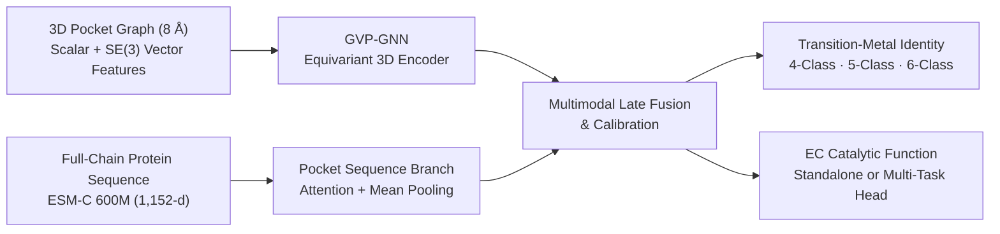
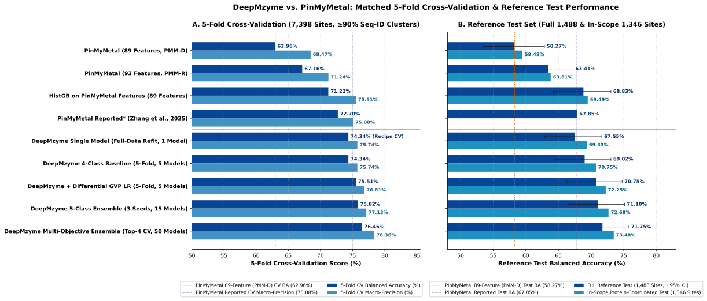
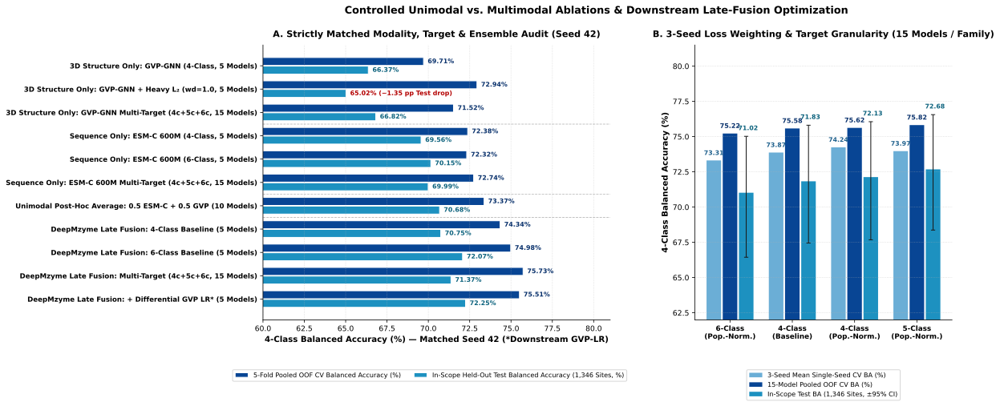

# DeepMzyme: Multimodal 3D Geometric & Protein Language Model Framework for Metalloproteins

[](pyproject.toml)
[](pyproject.toml)
[](pyproject.toml)
[](https://huggingface.co/datasets/GMBioinformatics/DeepMzyme)

**DeepMzyme** is an end-to-end multimodal geometric deep learning framework for structural bioinformatics that predicts transition-metal identity (**Mn, Fe, Co, Ni, Cu, Zn**) at protein metal-binding sites directly from 3D atomic coordinates and protein sequence.

First-row transition metals share nearly identical ionic radii and overlapping first-shell ligand preferences (**His, Cys, Asp, Glu**), governed by the Irving–Williams stability series, second-shell hydrogen-bonding networks, and long-range evolutionary constraints. While existing methods rely on handcrafted coordination-chemistry feature tables, DeepMzyme jointly learns from ***SE*(3)-equivariant 3D pocket graphs (`GVP-GNN`)** and **full-chain evolutionary representations (`ESM-C 600M`)**, supporting 4-, 5-, and 6-class metal identity resolution as well as Enzyme Commission (EC) catalytic function prediction.

---

## Key Highlights

- **Multimodal *SE*(3)-Equivariant + PLM Architecture:** Fuses scalar and vector message passing (`GVP-GNN`) over **8 Å** 3D structural pocket microenvironments with residue-level `ESM-C 600M` embeddings, outperforming sequence-only (`+1.96 pp` CV / `+1.30 pp` Test on 4-class; `+2.66 pp` CV / `+2.11 pp` Test on 6-class) and structure-only (`+4.63 pp` CV / `+4.67 pp` Test on 4-class; `+5.07 pp` Test on matched 15-model ensembles) unimodal baselines.
- **State-of-the-Art Benchmark Performance:** Evaluated against the *Nature Communications* (2025) **PinMyMetal** benchmark on matched **≥ 90% sequence-identity** grouped folds (`7,398` training sites across `2,208` clusters) and the `1,488`-site reference test set:
  - **+11.38 pp** higher 5-fold CV balanced accuracy (`74.34%` vs. `62.96%`) and **+9.28 pp** higher test accuracy (`67.55%` vs. `58.27%`) for a **single end-to-end model** over PinMyMetal's classifier retrained with deployment-available features (`+10.75 pp` for the 5-fold baseline ensemble at `69.02%`).
  - **74.3%–78.0% CV balanced accuracy** (**75.7%–81.1%** macro-precision) and **68.8%–71.8% full-test accuracy** (**70.5%–73.5%** on in-scope protein-coordinated sites) across all 15 pre-declared CV-selected ensembles, surpassing PinMyMetal's published results (`75.08%` CV macro-precision, `67.85%` test accuracy).
- **Sub-Class VIII Resolution (Fe vs. Co / Ni):** Unlike prior 4-class tools that collapse Fe, Co, and Ni into a single `Class VIII` label, DeepMzyme natively supports **5-class** (`Fe` resolved from `Co/Ni`, **65.2%** 5-class CV balanced accuracy and **60.6%** `Fe` recall) and **6-class** (`0.680` pairwise `Co` vs. `Ni` ROC-AUC) training objectives.
- **Open 3D Benchmark Dataset & Forensic Data Audit:** Reconstructed and released **9,398 of 9,408 (`99.89%`)** benchmark metal-binding sites as 3D coordinate structures (`1.1 GB` on [Hugging Face](https://huggingface.co/datasets/GMBioinformatics/DeepMzyme)), curated a symmetry-audited training cohort, and uncovered an undocumented ground-truth bond-valence feature leak in the upstream benchmark tables.
- **Rigorous ML & Software Engineering:** Homology-aware grouped cross-validation, paired non-parametric cluster bootstrap testing (`10,000` replicates), deterministic `Python 3.12` + `uv` lockfile workflow, content-addressed SHA-256 structure storage, and 60+ `pytest` test suites.

---

## Approach

DeepMzyme encodes each metal-binding microenvironment through two complementary branches before graph-level late fusion:



| Model Component | Biophysical & Evolutionary Signal | Mathematical Representation |
| :--- | :--- | :--- |
| **Pocket Graph Nodes**<br>*(residues within 8 Å of ion)* | Amino-acid identity, physicochemical properties, explicit 1st- vs. 2nd-shell coordination role, radial distance to metal center, optional `PROPKA` ΔpKₐ shifts | **Scalar (sᵢ):** one-hot + continuous descriptors + Gaussian RBFs<br>**Vector (Vᵢ ∈ ℝᵛˣ³):** *SE*(3)-equivariant unit vectors for side-chain orientation (`Cα → Cβ`) and radial coordination vector (`Cα → M`) |
| **Spatial & Interaction Edges**<br>*(r ≤ 8 Å + optional `RING`)* | Pairwise inter-residue geometry, sequence separation, and optional non-covalent interactions (H-bonds, π–π stacking, ionic bridges, van der Waals contacts) | **Scalar (sᵢⱼ):** pairwise Gaussian RBF distance encoding + positional separation<br>**Vector (Vᵢⱼ):** unit displacement vectors (`Cα⁽ⁱ⁾ → Cα⁽ʲ⁾`) |
| **Sequence Context Branch**<br>*(`ESM-C 600M`)* | Long-range evolutionary conservation, secondary/tertiary fold context, and metal-binding motifs across the full protein chain | Per-residue embeddings (`ℝᴸˣ¹¹⁵²`) extracted over the full chain and aggregated over pocket residues via dual **attention + mean pooling** |
| **Prediction Heads** | Transition-metal selectivity and enzymatic catalysis | **Metal Head:** 4-class (`Mn, Cu, Zn, Class VIII`), 5-class (`Fe` vs. `Co/Ni`), or 6-class (`Mn, Fe, Co, Ni, Cu, Zn`)<br>**EC Head:** Enzyme Commission class prediction (`--task ec` or `--task joint`) |

---

## Benchmark Results

### 1. Comparison Against PinMyMetal (*Nature Communications*, 2025)



All models are evaluated on **5-fold homology-grouped cross-validation** (`7,398` ion sites grouped into `2,208` clusters at **≥ 90% sequence identity**) and **PinMyMetal's `1,488`-site reference test set** (`Full 1,488` sites and `In-Scope 1,346` protein-coordinated sites) using unweighted 4-class balanced accuracy (mean recall across **Mn**, **Cu**, **Zn**, and **Class VIII = Fe / Co / Ni**) and macro-precision:

| Model / Benchmark Tier | Models | 5-Fold CV Balanced Accuracy | 5-Fold CV Macro-Precision | Reference Test (`1,488` sites) `[95% CI]` | In-Scope Test (`1,346` sites) |
| :--- | :---: | :---: | :---: | :---: | :---: |
| **DeepMzyme (End-to-End 3D Structure + Sequence, Strictly CV-Selected)** | | | | | |
| **DeepMzyme Single Model** *(Full-Data Refit, 1 Model)* | 1 | 74.34%\* | 75.74%\* | **67.55%** `[62.93, 71.65]` | **69.33%** |
| **DeepMzyme 4-Class Baseline** *(5-Fold Ensemble, `lr = 3e-4`)* | 5 | 74.34% | **75.74%** | **69.02%** `[64.47, 73.05]` | **70.75%** |
| **DeepMzyme + Differential GVP LR** *(5-Fold Ensemble, `GVP lr = 1e-4`)* | 5 | **75.51%** | **76.81%** | **70.75%** `[66.29, 74.77]` | **72.25%** |
| **DeepMzyme 5-Class Ensemble** *(Top-1 CV Family, 3 Seeds × 5 Folds)* | 15 | 75.32% (75.82% pooled) | **77.13%** | **71.10%** `[66.65, 75.14]` | **72.68%** |
| **DeepMzyme Multi-Objective Ensemble** *(Top-4 CV Families, All Seeds)* | 50 | 76.27% (76.46% pooled) | **78.36%** | **71.75%** `[67.22, 75.80]` | **73.48%** |
| **Range Across All 15 Pre-Declared CV Ensembles** | 5–70 | **74.34%–77.99%** | **75.67%–81.14%** | **68.83%–71.75%** | **70.49%–73.48%** |
| **PinMyMetal Tabular Comparators** | | | | | |
| **PinMyMetal (Clean Deployment, 89 Features)** *(Matched Splits, `PMM-D`)* | — | 62.96% | 68.47% | 58.27% `[53.53, 62.85]` | 59.48% |
| **PinMyMetal (With Bond-Valence Leak, 93 Features)** *(Matched Splits, `PMM-R`)* | — | 67.16% | 71.24% | 63.41% `[59.64, 67.25]` | 63.81% |
| **Tabular HistGB Baseline** *(89 Deployment Features, `PMM-H`)* | — | 71.22% | 75.51% | 68.83% `[64.26, 73.04]` | 69.49% |
| **PinMyMetal Published** *(Zhang et al., 2025; Ungrouped CV + Leaked Table)* | — | ≈72.70% | 75.08% | 67.85% | — |

*\*5-fold CV score of the underlying single-seed training recipe prior to full-dataset refitting.*

---

### 2. Controlled Modality & Optimization Ablations



To separate architectural modality gains from downstream hyperparameter tuning and ensemble size, we evaluated a **strictly matched 3-modality × 3-target (`4c`, `5c`, `6c`) and 15-model (`4c + 5c + 6c`) ensemble grid** under identical Seed 42 baseline hyperparameters (`wd = 1e-4`, `head_dropout = 0.2`, 50 epochs), followed by a **within-Late-Fusion optimization funnel**:

| Ablation Tier / Model Variant (Seed 42, 5-Fold Grouped CV & Held-Out Test) | Models | 5-Fold Pooled OOF CV (`7,398`) | Reference Test (`1,488`) | In-Scope Test (`1,346`) | Key Optimization & Modeling Insight |
| :--- | :---: | :---: | :---: | :---: | :--- |
| **3D Structure Only (`GVP-GNN`)** | | | | | |
| **3D Structure Only: `GVP-GNN` 4-Class** *(Baseline, `wd = 1e-4`)* | 5 | 69.71% (69.66% mean) | 64.35% | 66.37% | 3D-only baseline; randomly initialized GVP overfits pockets at `lr = 3e-4` |
| **3D Structure Only: `GVP-GNN` 4-Class** *(Heavy *L*₂ `wd = 1.0`)* | 5 | 72.94% (73.25% mean) | 63.35% | 65.02% | `+3.23 pp` pooled CV, but **regresses on Test (`−1.00 pp` Full / `−1.35 pp` In-Scope)** |
| **3D Structure Only: `GVP-GNN` Multi-Target Ensemble** *(`4c + 5c + 6c`)* | 15 | 71.52% | 64.70% | 66.82% | Matched 15-model (`4c + 5c + 6c`) structure-only ensemble (`+1.81 pp` CV, `+0.35 pp` Full Test) |
| **Sequence Only (`ESM-C 600M`)** | | | | | |
| **Sequence Only: `ESM-C 600M` 4-Class** *(Baseline, `wd = 1e-4`)* | 5 | 72.38% (72.33% mean) | 67.72% | 69.56% | Sequence-only 4-class baseline (frozen 600M PLM evolutionary prior) |
| **Sequence Only: `ESM-C 600M` 6-Class** *(`6c → 4c`)* | 5 | 72.32% | 68.54% | 70.15% | Sequence-only 6-class baseline (`57.00%` Clean Test) |
| **Sequence Only: `ESM-C 600M` Multi-Target Ensemble** *(`4c + 5c + 6c`)* | 15 | 72.74% | 68.34% | 69.99% | Matched 15-model (`4c + 5c + 6c`) sequence-only ensemble (`+0.36 pp` CV, `+0.62 pp` Full Test) |
| **Unimodal Post-Hoc Probability Average** | | | | | |
| **Unimodal Post-Hoc Average: `0.5 ESM-C + 0.5 GVP`** *(`4-Class`)* | 10 | 73.37% (73.79%\*) | 68.93% | 70.68% | 10-model unimodal average trails 5-model learned `Late Fusion` (`−0.97 pp` CV) |
| **Unimodal Post-Hoc Average: `0.5 ESM-C + 0.5 GVP`** *(`4c + 5c + 6c`)* | 30 | 75.31% | 69.33% | 70.87% | 30-model unimodal average trails 15-model learned `Late Fusion` (`−0.42 pp` CV, `−0.50 pp` In-Scope) |
| **Bimodal Late Fusion (`GVP-GNN + ESM-C 600M`, Matched Baseline)** | | | | | |
| **DeepMzyme Late Fusion: 4-Class Baseline** *(Matched `wd = 1e-4`)* | 5 | **74.34%** (74.28% mean) | **69.02%** | **70.75%** | **+1.96 pp CV** (`5/5` folds) & **+1.30 pp Full / +1.18 pp In-Scope** vs. `ESM-C 4c` |
| **DeepMzyme Late Fusion: 6-Class Baseline** *(Matched `6c → 4c`)* | 5 | **74.98%** | **70.65%** | **72.07%** | **+2.66 pp CV** & **+2.11 pp Full / +1.92 pp In-Scope** vs. `ESM-C 6c` |
| **DeepMzyme Late Fusion: Multi-Target Ensemble** *(Matched `4c + 5c + 6c`)* | 15 | **75.73%** | **69.77%** | **71.37%** | **+2.99 pp CV** & **+1.43 pp Full / +1.38 pp In-Scope** vs. 15-model `ESM-C` |
| **Within-Late-Fusion Regularization & Optimization Funnel†** | | | | | |
| **DeepMzyme Late Fusion: Global Heavy *L*₂** *(`wd = 1.0`, Negative Control)* | 5 | 74.08% | 67.98% | 69.57% | Global `wd = 1.0` over-penalizes the pretrained `ESM-C` fusion head (`−1.04 pp` Full Test) |
| **DeepMzyme Late Fusion: + Differential GVP LR** *(`GVP lr = 1e-4`)†* | 5 | **75.51%** (75.45% mean) | **70.75%** | **72.25%** | **+1.17 pp CV** & **+1.73 pp Full / +1.50 pp In-Scope** vs. 4-Class Baseline |

*\*Mean-fold CV on confirmation folds 1–4 (`v3-032`). †Downstream optimization campaigns (`GVP lr = 1e-4`, Population-Normalized Loss, and 3-seed confirmation) were executed within `Late Fusion` after it won the matched Stage 6 comparison across `4-class`, `5-class`, `6-class`, and `15-model 4c+5c+6c` ensembles.*

---

### 3. Native 5-Class & 6-Class Resolution Within Class VIII (`Fe`, `Co`, `Ni`)

Unlike prior 4-class tools that merge **Fe**, **Co**, and **Ni** into an undifferentiated `Class VIII` bucket, DeepMzyme natively supports **5-class** (`Fe` separated from `Co + Ni`) and **6-class** (`Mn, Fe, Co, Ni, Cu, Zn`) classification under 5-fold homology-grouped cross-validation (`7,398` sites):

| Target Formulation | Evaluation Cohort | Native Macro Balanced Accuracy | Iron (`Fe`) Recall (`n = 1,737`) | `Co + Ni` / `Ni` / `Co` Resolution |
| :--- | :--- | :---: | :---: | :--- |
| **Native 5-Class** (`Mn, Cu, Zn, Fe, Co+Ni`) | Discovery Seed (`s42`) | **65.2%** *(vs. 20.0% random)* | **60.6%** | `27.4%` `Co + Ni` recall (`n = 758`) |
| **Native 5-Class** (`Mn, Cu, Zn, Fe, Co+Ni`) | Confirmation Seeds (`s43, s44`) | **63.8%** *(vs. 20.0% random)* | **61.1%** | `25.0%` `Co + Ni` recall (`n = 758`) |
| **Native 6-Class** (`Mn, Fe, Co, Ni, Cu, Zn`) | Discovery / Confirmation | **55.8% / 54.5%** *(vs. 16.7% random)* | **61.3% / 61.1%** | `29.5%` `Ni` recall (`n = 475`), `4.9%` `Co` recall (`n = 283`), **`0.680` `[0.582, 0.770]` pairwise `Co` vs. `Ni` ROC-AUC** |

**Key Scientific Takeaways:**
- **End-to-End Learning Without Handcrafted Tables:** Unlike PinMyMetal, which relies on 93 precomputed `NEIGHBORHOOD` and bond-valence table features, DeepMzyme learns directly from 3D coordinates and protein sequence while outperforming PinMyMetal's released classifier across all matched CV and test splits (`p < 0.01`, paired cluster bootstrap).
- **Forensic Audit of Bond-Valence Leakage:** Auditing PinMyMetal's released feature tables revealed that `valence_3a` encodes the ground-truth metal's bond-valence sum in `99.99%` of rows rather than a deployment-time **Zn** probe; removing the four target-dependent columns drops PinMyMetal's matched test **Mn** recall by **−17.4 pp** (`95% CI [11.1, 24.1]`), from `79.0%` (`PMM-R`) to `61.7%` (`PMM-D`). Full matched comparisons, feature-vs-classifier ablations, and homology-filtered subset analyses are documented in [`docs/campaigns/phase2_unified_2026-10/README.md`](docs/campaigns/phase2_unified_2026-10/README.md) and [`docs/campaigns/phase2_unified_2026-10/pmm_matched/README.md`](docs/campaigns/phase2_unified_2026-10/pmm_matched/README.md).

---

## Tech Stack & Repository Structure

- **Deep Learning & Geometric ML:** `PyTorch`, `PyTorch Geometric (PyG)`, custom *SE*(3)-equivariant `GVP-GNN` layers, `ESM-C` (`300M` / `600M` protein language models), `Optuna`, `scikit-learn`.
- **Structural Bioinformatics:** `BioPython`, `Gemmi`, `PROPKA` (electrostatic pKₐ shifts), `RING` (residue interaction networks).
- **Engineering & Reproducibility:** Deterministic `uv` dependency management (`uv.lock`), content-addressed SHA-256 structure store, and 60+ unit and integration test suites.

```text
DeepMzyme/
├── src/
│   ├── train.py                  # Unified CLI entrypoint (metal, EC, and joint multi-task training)
│   ├── model.py                  # GVP-GNN, ESM-C sequence branch, and multimodal fusion architectures
│   ├── featurization.py          # 3D residue & coordination-shell feature extraction
│   ├── graph/                    # 3D pocket graph construction, shell roles, and RING edges
│   ├── embed_helpers/            # ESM-C 300M/600M protein language model embedding pipeline
│   ├── training/                 # Config parsing, grouped CV splits, training loops, and preflight checks
│   └── metal_release/            # Site-level ensemble inference, OOF auditing, and release verification
├── tests/                        # 60+ pytest unit/integration suites and CPU smoke checks
├── bench/                        # Throughput and runtime benchmarking utilities
├── docs/                         # Technical documentation, dataset manifests, and benchmark reports
└── pyproject.toml                # Locked Python 3.12 dependencies managed via uv
```

---

## Quick Start

### 1. Installation & Verification (CPU, No External Data Required)

Clone the repository, install the locked `Python 3.12` environment via [`uv`](https://docs.astral.sh/uv/), and run the automated test and smoke-check suites:

```bash
git clone https://github.com/MECHTI1/DeepMzyme.git
cd DeepMzyme
uv sync --frozen
uv run --frozen --no-sync python src/train.py --help
uv run --frozen --no-sync pytest
uv run --frozen --no-sync python tests/smoke_checks.py
```

### 2. Training a 5-Fold Cross-Validation Model (`GVP-GNN + ESM-C 600M`)

Download the benchmark structures from [Hugging Face (`GMBioinformatics/DeepMzyme`)](https://huggingface.co/datasets/GMBioinformatics/DeepMzyme) into `DeepMzyme_Data/train_and_test_sets_structures_zenodo_pmm_exact/`, compute `ESM-C 600M` embeddings once, and launch grouped 5-fold training:

```bash
uv sync --frozen --group esm

uv run --frozen --no-sync python src/embed_helpers/esmc.py \
  --structure-dir DeepMzyme_Data/train_and_test_sets_structures_zenodo_pmm_exact/train \
  --out-dir DeepMzyme_Data/esm_embeddings_esmc600m \
  --model-name esmc_600m

uv run --frozen --no-sync python src/train.py \
  --task metal \
  --metal-example-unit ion \
  --metal-label-scheme merge_fe_class_viii \
  --structure-dir DeepMzyme_Data/train_and_test_sets_structures_zenodo_pmm_exact/train \
  --summary-csv DeepMzyme_Data/train_and_test_sets_structures_zenodo_pmm_exact/train/final_data_summarazing_table.csv \
  --esm-embeddings-dir DeepMzyme_Data/esm_embeddings_esmc600m \
  --esm-dim 1152 \
  --n-folds 5 \
  --fold-index 0 \
  --train-val-split-by pdbid \
  --epochs 50 \
  --runs-dir runs \
  --run-name example_metal_late_fusion_fold0
```

### 3. Binding-Site Inference on a 3D Structure

Using a bound release manifest, predict metal identity at an explicit 3D coordinate (`--center X Y Z`) or atom locator (`--atom CHAIN:RESSEQ:ICODE:ATOM`) in any PDB/mmCIF structure:

```bash
uv run --frozen --no-sync python src/metal_release_cli.py predict \
  --manifest path/to/bound_manifest.json \
  --structure path/to/structure.pdb \
  --center 12.45 -4.18 28.90 \
  --embedding-cache DeepMzyme_Data/esm_embeddings_esmc600m \
  --output site_prediction.json
```

---

## Dataset & Documentation

- **Hugging Face Dataset & Checkpoints:** [`GMBioinformatics/DeepMzyme`](https://huggingface.co/datasets/GMBioinformatics/DeepMzyme) hosts the reconstructed 3D metal-binding site structures (`9,398` sites, `1.1 GB`), precomputed structural bundles (`CLEAN`/`CARE` splits, `ESM-C` embeddings, `RING` and `PROPKA` features), and released model checkpoints.
- **Documentation & Guides:**
  - **Getting Started & Setup:** [`docs/GETTING_STARTED.md`](docs/GETTING_STARTED.md) and [`docs/README.md`](docs/README.md)
  - **Datasets & Provenance:** [`docs/DATASETS.md`](docs/DATASETS.md) and [`docs/STRUCTURE_STORE.md`](docs/STRUCTURE_STORE.md)
  - **Benchmark Evaluations:** [`docs/campaigns/phase2_unified_2026-10/README.md`](docs/campaigns/phase2_unified_2026-10/README.md) and [`docs/campaigns/phase2_unified_2026-10/pmm_matched/README.md`](docs/campaigns/phase2_unified_2026-10/pmm_matched/README.md)

---

## Author & Acknowledgments

**Author:** Gilad Mechtinger ([`@MECHTI1`](https://github.com/MECHTI1)), Tel Aviv University.

**Upstream References:**
- **GVP-GNN:** Jing et al., *Learning from Protein Structure with Geometric Vector Perceptrons*, ICLR 2021.
- **ESM-C:** EvolutionaryScale, *ESM Cambrian (ESM-C)* protein language models.
- **PinMyMetal:** Zhang et al., *PinMyMetal*, Nature Communications 2025 ([`10.1038/s41467-025-57637-5`](https://doi.org/10.1038/s41467-025-57637-5)) and Zenodo dataset ([`10.5281/zenodo.17610514`](https://doi.org/10.5281/zenodo.17610514)).
- **Related Benchmarks & Tools:** Metal3D (Dürr et al., *Nature Communications* 2023), MAHOMES (Feehan et al.), CLEAN (Yu et al., *Science* 2023), CARE, PROPKA, and RING.
