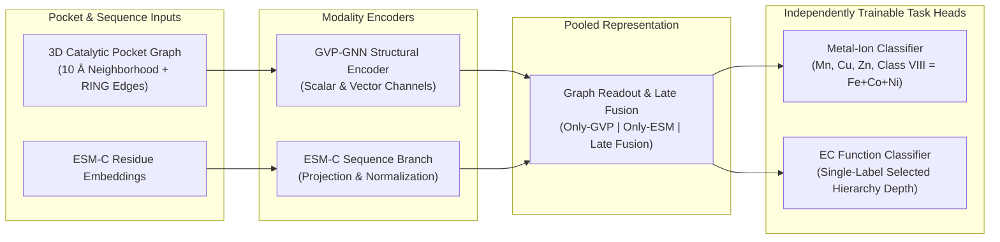

# DeepMzyme

[](https://github.com/MECHTI1/DeepMzyme/actions/workflows/cpu-ci.yml)
[](pyproject.toml)

DeepMzyme combines 3D protein-pocket graphs with protein language-model embeddings to predict catalytic transition-metal identity and enzyme function (EC classification). It implements structure-only, sequence-only, and multimodal fusion architectures with grouped cross-validation, explicit split provenance, and reproducible experiment configurations.

Current project status: transition-metal classification has completed 5-fold cross-validation and held-out benchmark evaluations; EC classification has preliminary fixed-split validation; joint multi-task learning remains an experimental challenger ([`EXPERIMENT_STATUS.md`](EXPERIMENT_STATUS.md)).

## Approach

Metalloenzymes depend on transition-metal cofactors ($\text{Mn}$, $\text{Cu}$, $\text{Zn}$, $\text{Fe}$, $\text{Co}$, $\text{Ni}$) whose coordination geometry and surrounding sequence context jointly determine catalytic specificity. DeepMzyme represents each binding site through two complementary modalities:

1. **3D Structural Pocket Graph (GVP-GNN):** A Geometric Vector Perceptron graph neural network encodes residue-level scalar features (physicochemical descriptors, PROPKA electrostatics, first/second coordination-shell indicators) and 3D vector channels ($\text{C}\alpha$ geometry and side-chain orientations) over spatial radius edges and optional RING non-covalent chemical interaction edges.
2. **Evolutionary Sequence Context (ESM-C):** Precomputed ESM-C protein language model embeddings capture broader sequence conservation across the parent protein chain, projected and normalized at the pocket level.



Metal classification and EC classification are trained and evaluated as independent primary tasks (`--task metal` and `--task ec`), with shared-encoder multi-task training (`--task joint`) available for controlled transfer experiments. Alternative fusion modes (early, hybrid, cross-attention), target formulations (`four_class`, `five_class`, `six_class`), and example granularities (`ion` vs. `pocket`) are documented in [`Plan.md`](Plan.md).

## Results and status

Metal-classification models are evaluated on the common four-class endpoint ($\text{Mn}$, $\text{Cu}$, $\text{Zn}$, and $\text{Class VIII} = \text{Fe}+\text{Co}+\text{Ni}$) using four-class Balanced Accuracy (BA) across a near-copy-disjoint 5-fold cross-validation split (`7,398` ion sites) and the held-out PinMyMetal reference test set (`1,488` ion sites):

| System | Models | 5-fold validation result | Full reference-test result (`1,488` sites) |
|:---|---:|:---|:---|
| Predeclared single-model baseline refit (`Step F`, `4-class`) | 1 | `74.28%` mean-fold BA (`74.34%` pooled OOF BA) | `67.55%` BA (`69.33%` on `1,346`-site eligible subset) |
| 30-model late-fusion ensemble (`Top-4 LF`) | 30 | `76.81%` pooled OOF BA | `72.20%` BA (`73.94%` on `1,346`-site eligible subset) |
| 55-model multimodal ensemble (`CV-Locked Tri-Modal`) | 55 | `77.17%` pooled OOF BA | `71.00%` BA (`61.33%` on `423`-site homology-filtered clean subset) |

**Evaluation notes:**
- **Metric definitions:** Balanced Accuracy (BA) is the unweighted mean recall across $\text{Mn}$, $\text{Cu}$, $\text{Zn}$, and $\text{Class VIII}$. Mean-fold BA averages per-fold scores across the 5 validation folds; pooled out-of-fold (OOF) BA is computed over all `7,398` out-of-fold validation predictions combined.
- **Test-use qualification:** The single-model baseline refit (`Step F`) was the predeclared one-shot evaluation on the held-out test set. Subsequent multi-checkpoint and ensemble test evaluations (`Top-4 LF`, `CV-Locked Tri-Modal`) were selected strictly by `7,398`-site OOF CV and evaluated after the test set had been opened; they are reported with explicit secondary-evaluation disclosure (`both_results_secondary`).
- **Complete evidence & comparators:** Full 27-tier tables, 10,000-draw PDB-cluster paired bootstrap confidence intervals, per-class recalls, subset definitions (`Full`, `LINK-Free`, `Eligible`, `Deduplicated`, `Clean`), and comparisons with published PinMyMetal (`75.08%` CV / `67.85%` test) and Metal3D (`61.70%` test) figures are in [`docs/campaigns/phase2_unified_2026-10/README.md`](docs/campaigns/phase2_unified_2026-10/README.md) and [`docs/DATASETS.md`](docs/DATASETS.md#test-use-ledger).
- **Dataset reconstruction coverage:** The upstream Zenodo PinMyMetal ion-level dataset reconstruction achieves `99.89%` site coverage (`9,398 / 9,408` ions across `7,724` PDB entries); see [`docs/ZENODO_PINMYMETAL_EXACT_ION_LEVEL_REPRODUCIBILITY.md`](docs/ZENODO_PINMYMETAL_EXACT_ION_LEVEL_REPRODUCIBILITY.md).

## Quick start

The commands below verify the locked Linux x86_64 Python 3.12 CPU environment, CLI entry points, unit test suite, and synthetic smoke checks without requiring external datasets or GPU hardware:

```bash
git clone https://github.com/MECHTI1/DeepMzyme.git
cd DeepMzyme
uv sync --frozen
uv run --frozen --no-sync python src/train.py --help
uv run --frozen --no-sync pytest
uv run --frozen --no-sync python tests/smoke_checks.py
```

Full model training and benchmark evaluation require structure bundles, precomputed ESM-C embeddings, and RING interaction features; see [`docs/GETTING_STARTED.md`](docs/GETTING_STARTED.md) and [`docs/DATASETS.md`](docs/DATASETS.md).

## Technical documentation

- **Setup & execution paths:** [`docs/GETTING_STARTED.md`](docs/GETTING_STARTED.md) and [`requirements/README.md`](requirements/README.md)
- **Scientific design & task policy:** [`Plan.md`](Plan.md) and [`docs/PARAMETER_FINDINGS.md`](docs/PARAMETER_FINDINGS.md)
- **Benchmark evaluation & status:** [`EXPERIMENT_STATUS.md`](EXPERIMENT_STATUS.md) and [`docs/campaigns/phase2_unified_2026-10/README.md`](docs/campaigns/phase2_unified_2026-10/README.md)
- **Datasets, splits & structure store:** [`docs/DATASETS.md`](docs/DATASETS.md), [`docs/STRUCTURE_STORE.md`](docs/STRUCTURE_STORE.md), and [`docs/README.md`](docs/README.md)

## Author and acknowledgments

**Primary developer:** Gilad Mechtinger (`MECHTI1`) — multimodal GVP/ESM-C model integration, ion- and pocket-level graph construction, content-addressed structure storage, leakage-controlled cross-validation workflows, and benchmark evaluation tooling.

**Upstream methods and datasets:** Built on Geometric Vector Perceptrons (GVP-GNN; Jing et al.), ESM-C protein language models ( EvolutionaryScale), RING residue interaction networks, PROPKA electrostatics, and benchmark datasets from PinMyMetal (Zheng et al.), Metal3D (Dürr et al.), MAHOMES, CLEAN (Yu et al.), and CARE.
