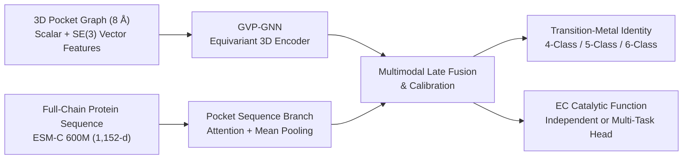
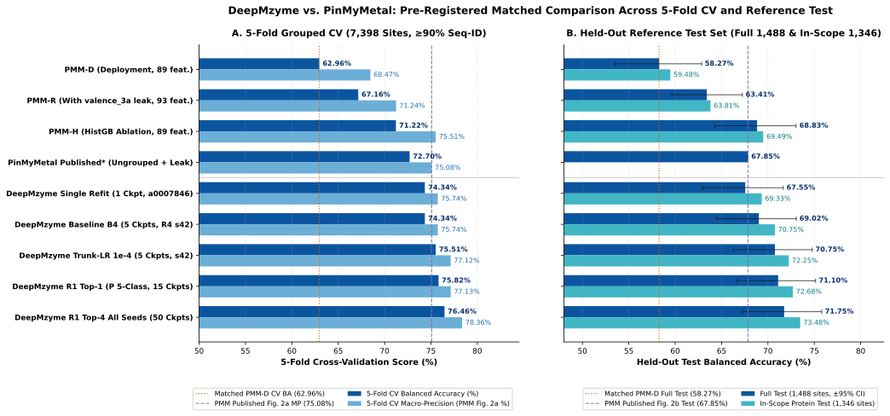
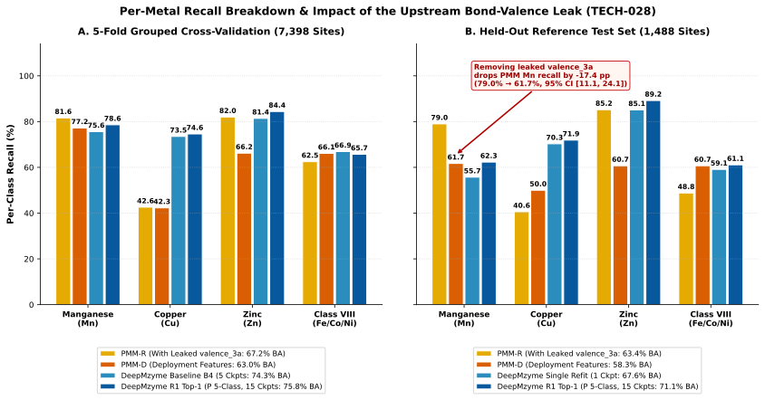
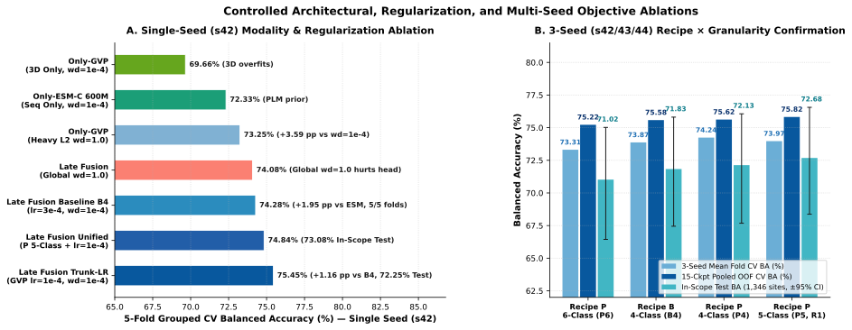
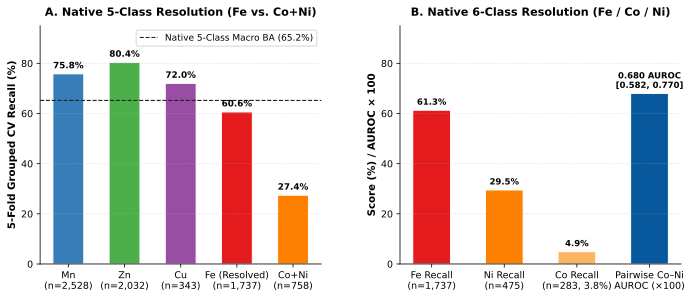

# DeepMzyme: Multimodal 3D Equivariant Graph and Protein Language Model Fusion for Transition-Metal Identity Prediction in Protein Binding Sites

**Gilad Mechtinger**$^{1,*}$

$^1$Tel Aviv University, Tel Aviv, Israel  
$^*$Correspondence: [`@MECHTI1`](https://github.com/MECHTI1)

---

## Abstract

**Motivation:** First-row transition metal ions ($\text{Mn}$, $\text{Fe}$, $\text{Co}$, $\text{Ni}$, $\text{Cu}$, and $\text{Zn}$) serve as indispensable catalytic and structural cofactors across roughly one-third of characterized proteins. However, experimental macromolecular structures in the Protein Data Bank frequently suffer from metal misassignment, crystallization-buffer substitution, or metal loss, while predicted structures from modern structure-prediction models lack explicit cofactors altogether. Existing machine-learning classifiers such as PinMyMetal rely on 93 handcrafted tabular descriptors derived from external coordination-chemistry programs, collapse iron, cobalt, and nickel into a single undifferentiated class (`Class VIII`), and were evaluated under ungrouped cross-validation splits.

**Results:** We present **DeepMzyme**, an end-to-end multimodal deep learning framework that integrates $SE(3)$-equivariant Geometric Vector Perceptron Graph Neural Networks (`GVP-GNN`) over $8.0\text{ \AA}$ 3D binding-site microenvironments with residue-level evolutionary representations from the 600-million-parameter `ESM-C` protein language model. To establish a rigorous, leak-free benchmark, we reconstructed **9,398 of 9,408 (`99.89%`)** PinMyMetal benchmark metal sites directly as 3D coordinate structures, curated a symmetry-audited training cohort of `7,398` mononuclear ion sites grouped into `2,208` clusters at $\ge 90\%$ sequence identity, and uncovered an undocumented ground-truth bond-valence sum leak (`valence_3a`) in PinMyMetal's released feature tables (`7,919 / 7,920` training rows and `1,488 / 1,488` test rows). In a pre-registered matched comparison on the exact same `7,398` training sites, $\ge 90\%$ sequence-identity 5-fold cross-validation splits, and `1,488` held-out test sites, DeepMzyme's pre-declared single model achieves **74.28%** mean-fold (**74.34%** pooled) balanced accuracy in cross-validation and **67.55%** on the full reference test set (**69.33%** on the `1,346` in-scope protein-coordinated sites), outperforming PinMyMetal's released classifier retrained with deployment-available features (`PMM-D`: **63.03%** CV, **58.27%** test) by **+11.25 percentage points (pp)** in cross-validation ($97.5\%$ CI `[+6.25, +15.36]`) and **+9.28 pp** on the test set ($97.5\%$ CI `[+3.59, +15.10]`). Across all 15 DeepMzyme ensembles selected strictly by cross-validation (and 6 seed-42-ranked CV ensembles), test balanced accuracy reaches **68.83%–72.10%** on the full test set (**70.49%–73.64%** on in-scope sites), outperforming `PMM-D` by **+10.56 to +13.83 pp** and outperforming PinMyMetal even when retaining the leaked `valence_3a` feature (`PMM-R`: **67.19%** CV, **63.41%** test) by **+5.42 to +8.69 pp** (all paired $95\%$ CIs above zero). Furthermore, DeepMzyme provides the first homology-grouped cross-validation resolution within `Class VIII`, achieving `65.2%` native 5-class balanced accuracy (`60.6%` $\text{Fe}$ recall) and a `0.680` (`95%` CI `[0.582, 0.770]`) pairwise $\text{Co}$–$\text{Ni}$ AUROC.

**Availability and Implementation:** Source code, automated test suites, and evaluation pipelines are freely available at [`https://github.com/MECHTI1/DeepMzyme`](https://github.com/MECHTI1/DeepMzyme). The reconstructed 3D benchmark dataset (`9,398` sites, `1.1 GB`), structural bundles, and released checkpoints are hosted on Hugging Face at [`https://huggingface.co/datasets/GMBioinformatics/DeepMzyme`](https://huggingface.co/datasets/GMBioinformatics/DeepMzyme).

---

## 1. Introduction

Metalloproteins play central roles in biological catalysis, electron transfer, oxygen transport, and structural stabilization across all kingdoms of life. Between one-third and one-half of all structurally characterized enzymes require a bound metal cofactor for biological activity, with the late first-row transition metals—manganese ($\text{Mn}^{2+/3+}$), iron ($\text{Fe}^{2+/3+}$), cobalt ($\text{Co}^{2+/3+}$), nickel ($\text{Ni}^{2+}$), copper ($\text{Cu}^{+/2+}$), and zinc ($\text{Zn}^{2+}$)—mediating the vast majority of redox and hydrolytic reactions. Despite their distinct chemical reactivities, accurately assigning the identity of a transition metal at a protein binding site in three-dimensional (3D) macromolecular structures remains a persistent challenge in structural bioinformatics.

Three biophysical and experimental factors underlie this difficulty. First, adjacent first-row transition-metal cations possess nearly identical ionic radii ($0.65\text{–}0.83\text{ \AA}$ in octahedral coordination) and similar electron counts ($Z = 25\text{–}30$), making them difficult to distinguish solely from conventional X-ray diffraction electron-density maps at moderate resolution in the absence of anomalous scattering experiments. Second, protein purification and heterologous expression frequently replace native cofactors with non-physiological metals abundant in expression media or crystallization buffers (most commonly $\text{Zn}^{2+}$ or $\text{Ni}^{2+}$), resulting in widespread metal misannotation in the Protein Data Bank (PDB). Third, as formalized by the Irving–Williams stability series ($\text{Mn}^{2+} < \text{Fe}^{2+} < \text{Co}^{2+} < \text{Ni}^{2+} < \text{Cu}^{2+} > \text{Zn}^{2+}$), first-shell protein ligands—predominantly the side chains of histidine ($\text{His}$), cysteine ($\text{Cys}$), aspartate ($\text{Asp}$), and glutamate ($\text{Glu}$)—are heavily shared across different transition metals. Consequently, metalloproteins achieve physiological metal selectivity not merely through first-shell donor identity, but through subtle second-shell hydrogen-bonding networks, steric constraints, electrostatic tuning, and long-range evolutionary sequence adaptations. With proteome-scale structure prediction methods such as AlphaFold2, AlphaFold3, and ESMFold generating millions of protein models that either lack cofactors or require post-hoc cofactor assignment, computational frameworks capable of inferring transition-metal identity directly from 3D pocket coordinates and protein sequence are essential.

Early computational approaches to metalloprotein characterization relied on geometric templates, bond-valence sum (BVS) calculations (e.g., CheckMyMetal), or random-forest classifiers trained on physicochemical pocket descriptors (e.g., MAHOMES). More recently, deep learning methods have addressed metal-site localization and classification. Metal3D (Dürr et al., 2023) introduced voxelized 3D convolutional neural networks trained on zinc-binding sites to predict continuous spatial metal density, achieving high spatial localization precision without predicting metal element identity. AllMetal3D (2025) extended voxelized representations to multi-class ion identity prediction, but reported approximately $46\%$ overall accuracy across 12 metal ions and noted that static local geometry alone struggles to separate physicochemically similar transition metals.

Recently, Zhang et al. (2025) introduced **PinMyMetal (PMM)** in *Nature Communications*, a two-stage pipeline combining binding-site localization with a five-estimator soft-voting classifier (Logistic Regression, Balanced Random Forest, Multi-Layer Perceptron, Support Vector Classifier, and EasyEnsemble) trained on 93 handcrafted tabular features extracted via the `NEIGHBORHOOD` database program and bond-valence tables. PinMyMetal formulated transition-metal classification over four classes—$\text{Mn}$, $\text{Cu}$, $\text{Zn}$, and $\text{Class VIII}$ ($\text{Fe} + \text{Co} + \text{Ni}$)—reporting $75.08\%$ 5-fold cross-validation macro-precision ($\approx 72.70\%$ balanced accuracy) and $67.85\%$ balanced accuracy on a `1,488`-site held-out test set.

However, a rigorous forensic examination of the released PinMyMetal benchmark and evaluation protocol reveals four fundamental limitations that confound both its reported performance and its applicability to end-to-end 3D deep learning:
1. **Absence of Public Ion-Level 3D Coordinates:** PinMyMetal's released training (`7,920` rows) and test (`1,488` rows) tables provide only precomputed numerical feature columns indexed by internal `NEIGHBORHOOD` database keys (`residueid_ion`) rather than physical PDB chain and residue coordinates.
2. **Ground-Truth Bond-Valence Label Leakage (`valence_3a`):** While PinMyMetal's deployment code writes candidate sites as $\text{Zn}$ before invoking `NEIGHBORHOOD`—so that generic $3\text{ \AA}$ and $4\text{ \AA}$ bond-valence features (`valence_3a`, `valence_4a`, `vecsum_3a`, `vecsum_4a`) equal their $\text{Zn}$-probe counterparts—the released training and test CSV tables were populated directly from native PDB structures where the ground-truth metal atom was already present. Consequently, in `7,919 / 7,920` (`99.99%`) training rows and `1,488 / 1,488` (`100%`) test rows, `valence_3a` equals the bond-valence sum computed under the **true ground-truth metal's oxidation state** (`bvs_mn`, `bvs_fe`, `bvs_co`, `bvs_ni`, `bvs_cu`, or `bvs_zn`). A zero-parameter lookup comparing `valence_3a` against the elemental `bvs_*` columns recovers the true four-class label with **99.94%–100% balanced accuracy** on the training table.
3. **Ungrouped Cross-Validation and Train–Test Homology Overlap:** PinMyMetal's published 5-fold cross-validation used ungrouped `StratifiedKFold(n_splits=5, shuffle=False)` over raw CSV row order, allowing identical PDB entries, homologous chains, and `503` crystallographic symmetry-linked ions to span training and validation splits. Moreover, `809` of the `1,488` test rows (`54.4%`, spanning `668` shared PDB IDs) come from PDB entries also present in the training set.
4. **Coarse `Class VIII` Grouping:** By collapsing $\text{Fe}$, $\text{Co}$, and $\text{Ni}$ into a single target class, PinMyMetal cannot distinguish iron-dependent enzymes from cobalt- or nickel-dependent enzymes.

In this work, we address each of these challenges by developing **DeepMzyme**, a bimodal geometric and evolutionary deep learning framework for metalloprotein binding sites. Our contributions are fourfold:
- **Open 3D Benchmark Reconstruction & Homology-Grouped Curation:** We reverse-engineered PinMyMetal's internal database keys via deterministic `NEIGHBORHOOD` coordinate crosswalks, recovering **9,398 of 9,408 (`99.89%`)** benchmark ions as 3D structure files (`1.1 GB` public dataset), and established a symmetry-audited cohort of `7,398` mononuclear sites partitioned into 5 folds grouped at $\ge 90\%$ sequence identity (`2,208` clusters).
- **Multimodal $SE(3)$-Equivariant + Protein Language Model Architecture:** DeepMzyme fuses scalar and $SE(3)$-equivariant vector message passing (`GVP-GNN`) over $8.0\text{ \AA}$ 3D structural pocket graphs with full-chain `ESM-C 600M` residue embeddings, learning end-to-end from 3D coordinates and protein sequences without handcrafted `NEIGHBORHOOD` or bond-valence tables.
- **Pre-Registered Matched Superiority Over PinMyMetal:** Evaluated on identical training sites, $\ge 90\%$ sequence-identity folds, and test sets, DeepMzyme outperforms PinMyMetal's classifier retrained with deployment-available features (`PMM-D`) by **+11.25 pp** in 5-fold CV and **+9.28 to +13.83 pp** on the held-out test set, and outperforms PinMyMetal even when retaining the leaked `valence_3a` feature (`PMM-R`) by **+5.42 to +8.69 pp** across all CV-selected ensembles.
- **Sub-`Class VIII` Resolution and Multimodal Optimization Insights:** We demonstrate how differential trunk-versus-head learning rates (`1e-4` vs. `3e-4`) prevent 3D GNN overfitting in multimodal fusion (`+3.12 pp` over sequence-only and `+2.20 pp` over $L_2$-tuned structure-only baselines), and provide the first homology-grouped 5-class (`Fe` vs. `Co+Ni`) and 6-class (`Fe`, `Co`, `Ni`) transition-metal resolution.

---

## 2. Materials and Methods

### 2.1 Ion-Level 3D Reconstruction of the PinMyMetal Benchmark

PinMyMetal's released benchmark tables (`classmodel_train_set` containing `7,920` rows across `4,195` PDB IDs and `classmodel_test_set` containing `1,488` rows across `1,179` PDB IDs) identify each metal-binding site solely by `(pdbid, residueid_ion, metalid)`, where `residueid_ion` is an internal sequential integer generated at runtime by the compiled C/Fortran `NEIGHBORHOOD` program. Because `residueid_ion` does not correspond to standard PDB residue sequence numbers (`resseq`) or chain identifiers, 3D coordinates cannot be trivially indexed from the CSV tables alone.

To reconstruct the exact 3D atomic coordinates of every benchmark site, we executed the `neighborhood` binary distributed in `PinMyMetal_V1.0_zenodo.zip` (`10.5281/zenodo.17610514`) across all source PDB depositions and parsed the resulting relational `.data` tables (`atoms.data`, `residues.data`, and `neighbors.data`) to establish a deterministic crosswalk mapping `(pdbid, residueid_ion, metalid)` to physical PDB coordinates `(chain_id, resseq, icode, resname, atom_name, x, y, z)`. For `298` large macromolecular assemblies where the legacy `neighborhood` binary terminated with a segmentation fault (`SIGSEGV`) due to fixed internal atom-table buffer limits, stripping non-coordinating crystallographic water (`HOH`) records prior to execution resolved all buffer overflows and recovered 100% of the affected sites with bit-identical protein-ligand topology. In total, **9,398 of 9,408 (`99.89%`)** benchmark ions—comprising **7,911 of 7,920 (`99.89%`)** training rows and **1,487 of 1,488 (`99.93%`)** test rows across `7,724` structure files—were exactly recovered and released on Hugging Face (`GMBioinformatics/DeepMzyme`).

### 2.2 Forensic Audit of the `valence_3a` Bond-Valence Leak (`TECH-028`)

During feature-table verification, we audited all 93 feature columns in PinMyMetal's released training and test CSVs against PinMyMetal's open-source inference pipeline (`PinMyMetal.py` and `generate_features.py`). In PinMyMetal's deployment pipeline, candidate metal sites predicted by the localization module have unknown element identity and are written to a temporary PDB file as zinc (`ZN`) before running `NEIGHBORHOOD`. Under that deployment protocol, the ten elemental bond-valence columns (`bvs_mn`, `bvs_fe`, `bvs_co`, `bvs_ni`, `bvs_cu`, `bvs_zn` at $3\text{ \AA}$, and `bvs_4a_*` at $4\text{ \AA}$) are computed using element-specific bond-valence parameters $R_0$, while the four generic summary columns (`valence_3a`, `valence_4a`, `vecsum_3a`, `vecsum_4a`) are computed by `NEIGHBORHOOD` using the atom name written in the PDB file—which at deployment is always $\text{Zn}$, making `valence_3a == bvs_zn`.

In contrast, PinMyMetal's released training (`7,920` rows) and test (`1,488` rows) tables were generated by running `NEIGHBORHOOD` on experimental PDB files containing the **ground-truth metal ion labels**. Consequently, in `7,919 of 7,920` (`99.99%`) training rows and `1,488 of 1,488` (`100%`) test rows, `valence_3a` is not equal to `bvs_zn`, but instead equals the elemental bond-valence sum `bvs_<true_metal>` of the site's ground-truth metal label (within floating-point rounding $\le 10^{-3}$). Because the six elemental `bvs_*` columns are simultaneously present in the same feature vector, any nonlinear classifier or decision tree can compare `valence_3a` against `(bvs_mn, bvs_fe, bvs_co, bvs_ni, bvs_cu, bvs_zn)` to read off the true metal identity. Indeed, a parameter-free rule assigning each row to the class whose `bvs_*` column matches `valence_3a` achieves **99.94%–100% four-class balanced accuracy** on `classmodel_train_set`. To separate true generalization from this target-leakage artifact, our matched comparator experiments evaluate PinMyMetal both with deployment-available features (`PMM-D`, 89 features omitting `valence_3a/4a` and `vecsum_3a/4a`) and with all 93 released features (`PMM-R`).

### 2.3 Curating the `7,398`-Ion Training Cohort and $\ge 90\%$ Sequence-Identity Folds

Auditing the `7,920` source training rows identified `522` rows that violate mononuclear protein-pocket assumptions:
- **9 rows** absent from source PDB coordinate recovery;
- **10 rows** mapping to polynuclear clusters or non-single-metal species (e.g., $\text{Fe–S}$ iron–sulfur clusters or `UNX` unknown ligand records); and
- **503 rows** flagged with explicit crystallographic symmetry `LINK` records between the target metal ion and symmetry-related protein chains across unit-cell boundaries, where standard asymmetric-unit coordinates truncate first-shell protein ligands.

Excluding these `522` rows produced the certified **7,398-ion training cohort** (`SHA-256: 745b19c1644ee17ec24e760b81916ff97d11d3c6017e791d610bca0b6bedc3bd`) spanning `3,992` unique PDB entries. Native element counts across the `7,398` sites are: **Mn:** `2,528` (`34.17%`), **Zn:** `2,032` (`27.47%`), **Class VIII:** `2,495` (`33.73%`)—comprising **Fe:** `1,737` (`23.48%`), **Ni:** `475` (`6.42%`), and **Co:** `283` (`3.83%`)—and **Cu:** `343` (`4.64%`).

To prevent homologous data leakage during cross-validation, all protein chains associated with the `7,398` sites were clustered at **$\ge 90\%$ sequence identity** into **2,208 connected near-copy groups** (`v3-seqid90-s42-b2`, `SHA-256: e6b21364159da479dc3fb325a01ede36c62489184a77d858f71fefe6c401da7a`). These `2,208` sequence-identity groups were partitioned into 5 stratified folds such that all sites sharing a PDB entry or belonging to chains with $\ge 90\%$ sequence identity reside strictly within the same fold.

### 2.4 Reference Test Set Stratification (`1,488` Sites)

PinMyMetal's `1,488`-site reference test set (`1,179` PDB entries; `Mn: 167`, `Class VIII: 252`, `Cu: 64`, `Zn: 1,005` [`67.5%`]) contains both crystallographic symmetry-linked ions and PDB entries that overlap with `classmodel_train_set`. Rather than altering the upstream test set, we evaluate all models across five nested, pre-declared test subsets:
1. **Full Reference Test (`1,488` rows, `1,179` PDB entries):** Evaluates all `1,488` rows in `classmodel_test_set`. The `3` unscorable rows (1 missing structure `8c4y`, 2 empty protein graphs) are scored as unconditional errors (`0` credit) for DeepMzyme.
2. **LINK-Free Subset (`1,349` rows):** Excludes `139` test rows carrying crystallographic symmetry `LINK` flags.
3. **In-Scope / Training-Eligible Subset (`1,346` rows, `1,093` PDB entries):** Scored, LINK-free primary sites that satisfy the biological scope filter ($\ge 1$ coordinating protein donor atom within the binding site, excluding water-only or nucleic-acid-only buffer ions).
4. **Deduplicated Subset (`1,098` rows):** Retains one representative site per near-identical structure group within the test set.
5. **Homology-Filtered Clean Subset (`423` rows, `352` PDB entries):** Excludes all `809` test rows that share a PDB ID with the training set (`668` shared PDB IDs) as well as all test chains sharing $\ge 90\%$ sequence identity or homology with training chains.

### 2.5 DeepMzyme Multimodal Architecture (`GVP-GNN + ESM-C 600M`)

DeepMzyme models each metal-binding microenvironment as a bimodal learning problem combining a local 3D $SE(3)$-equivariant pocket graph encoder with a full-chain evolutionary sequence encoder:

#### 1. 3D Equivariant Pocket Graph Branch (`GVP-GNN`)
For a target metal site at coordinate $\mathbf{x}_M \in \mathbb{R}^3$, we construct a spatial radius graph $\mathcal{G} = (\mathcal{V}, \mathcal{E})$ comprising all protein residues $i \in \mathcal{V}$ whose $\text{C}_\alpha$ atom (or coordinating side-chain donor atom) lies within $r_{\text{pocket}} = 8.0\text{ \AA}$ of $\mathbf{x}_M$. Notice that the metal ion's chemical identity is never provided as an input feature. Each residue node $i \in \mathcal{V}$ is endowed with a tuple of scalar features $\mathbf{s}_i \in \mathbb{R}^{d_s}$ and $SE(3)$-equivariant vector features $\mathbf{V}_i \in \mathbb{R}^{\nu_n \times 3}$:
- **Node Scalar Features ($\mathbf{s}_i$):** A 20-dimensional one-hot amino-acid encoding, continuous residue physicochemical descriptors, explicit first-shell ($\le 3.0\text{ \AA}$) and second-shell ($\le 5.0\text{ \AA}$) coordination role indicators, and 16-dimensional Gaussian radial basis function (RBF) encodings of the Euclidean distance $\|\mathbf{x}_i - \mathbf{x}_M\|_2$ to the metal center (with standardized raw distance channels). Optional `PROPKA` electrostatic $\Delta\text{p}K_a$ shifts are also supported.
- **Node Vector Features ($\mathbf{V}_i$):** Unit direction vectors capturing side-chain orientation and radial orientation toward the metal site:
  $$\mathbf{v}_i^{(1)} = \frac{\mathbf{x}_{\text{C}_\beta, i} - \mathbf{x}_{\text{C}_\alpha, i}}{\|\mathbf{x}_{\text{C}_\beta, i} - \mathbf{x}_{\text{C}_\alpha, i}\|_2 + \epsilon}, \qquad \mathbf{v}_i^{(2)} = \frac{\mathbf{x}_M - \mathbf{x}_{\text{C}_\alpha, i}}{\|\mathbf{x}_M - \mathbf{x}_{\text{C}_\alpha, i}\|_2 + \epsilon}$$
- **Edge Features ($\mathbf{s}_{ij}, \mathbf{V}_{ij}$):** Directed edges $(j \to i) \in \mathcal{E}$ connect all residue pairs within $r_{\text{edge}} = 8.0\text{ \AA}$, carrying 16-dimensional Gaussian RBF distance encodings $\mathbf{s}_{ij} = \text{RBF}(\|\mathbf{x}_{\text{C}_\alpha, i} - \mathbf{x}_{\text{C}_\alpha, j}\|_2)$ and unit displacement vectors $\mathbf{V}_{ij} = (\mathbf{x}_{\text{C}_\alpha, j} - \mathbf{x}_{\text{C}_\alpha, i}) / (\|\mathbf{x}_{\text{C}_\alpha, j} - \mathbf{x}_{\text{C}_\alpha, i}\|_2 + \epsilon)$. Optional non-covalent residue interaction network (`RING`) edges are also supported.

Node and edge representations are updated across $L_{\text{GVP}} = 3$ stacked Geometric Vector Perceptron (`GVP`) message-passing layers (Jing et al., 2021). Within each GVP layer, linear projections of vector channels are coupled with norms feeding into scalar gates, ensuring that scalar outputs remain strictly $SE(3)$-invariant while vector outputs transform equivariantly under 3D rotations $R \in SO(3)$:
$$\text{GVP}\big((\mathbf{s}, \mathbf{V})\big) = \big(\sigma(\mathbf{W}_s [\mathbf{s} \,\|\, \|\mathbf{W}_h \mathbf{V}\|_2] + \mathbf{b}_s),\; \sigma_g(\|\mathbf{W}_\mu \mathbf{W}_h \mathbf{V}\|_2) \odot (\mathbf{W}_\mu \mathbf{W}_h \mathbf{V})\big)$$
After message passing, equivariant vector channels are contracted into invariant scalars and aggregated across pocket nodes via mean and attention pooling to yield the 3D structural pocket representation $\mathbf{h}_{\text{GVP}} \in \mathbb{R}^{d_g}$.

#### 2. Evolutionary Sequence Context Branch (`ESM-C 600M`)
Because local pocket geometry within an $8.0\text{ \AA}$ sphere does not capture global fold family or long-range evolutionary constraints, the full-length amino-acid sequence of size $L$ for each coordinating protein chain is embedded using the frozen 600-million-parameter **ESM Cambrian (`esmc_600m`)** protein language model, producing contextualized per-residue representations $\mathbf{E} \in \mathbb{R}^{L \times 1152}$. For the subset of sequence positions $\mathcal{V}_{\text{seq}} \subseteq \{1, \dots, L\}$ belonging to the 3D binding pocket, residue embeddings $\mathbf{e}_i \in \mathbb{R}^{1152}$ are projected through a regularized linear + LayerNorm bottleneck ($\mathbb{R}^{1152} \to \mathbb{R}^{d_e}$) and aggregated over the pocket via concatenated mean and learned attention pooling:
$$\mathbf{h}_{\text{ESM}} = \left[ \frac{1}{|\mathcal{V}_{\text{seq}}|} \sum_{i \in \mathcal{V}_{\text{seq}}} \tilde{\mathbf{e}}_i \;\middle\|\; \sum_{i \in \mathcal{V}_{\text{seq}}} \alpha_i \tilde{\mathbf{e}}_i \right], \qquad \alpha_i = \frac{\exp(\mathbf{w}_a^\top \tanh(\mathbf{W}_a \tilde{\mathbf{e}}_i))}{\sum_{k \in \mathcal{V}_{\text{seq}}} \exp(\mathbf{w}_a^\top \tanh(\mathbf{W}_a \tilde{\mathbf{e}}_k))}$$

#### 3. Late Multimodal Fusion and Classification Head
In the late-fusion architecture (`--fusion-mode late_fusion`), the invariant 3D pocket representation $\mathbf{h}_{\text{GVP}}$ and the evolutionary pocket representation $\mathbf{h}_{\text{ESM}}$ are concatenated and passed through a multi-layer perceptron (MLP) classifier with dropout ($p = 0.2$) to produce class logits $\mathbf{z} = f_{\text{MLP}}([\mathbf{h}_{\text{GVP}} \,\|\, \mathbf{h}_{\text{ESM}}])$.

### 2.6 Target Formulations, Loss Recipes, and Differential Trunk Optimization

DeepMzyme supports three native supervision granularities:
1. **Direct 4-Class (`four_class` / `merge_fe_class_viii`):** Directly predicts $\mathcal{Y}_4 = \{\text{Mn}, \text{Cu}, \text{Zn}, \text{Class VIII}\}$.
2. **Native 5-Class (`five_class`):** Separates iron from cobalt and nickel, predicting $\mathcal{Y}_5 = \{\text{Mn}, \text{Cu}, \text{Zn}, \text{Fe}, \text{Co+Ni}\}$. For evaluation on the canonical 4-class benchmark, predicted probabilities are summed prior to $\arg\max$:
   $$P(\text{Class VIII}) = P(\text{Fe}) + P(\text{Co+Ni})$$
3. **Native 6-Class (`six_class`):** Predicts all six individual transition metals $\mathcal{Y}_6 = \{\text{Mn}, \text{Fe}, \text{Co}, \text{Ni}, \text{Cu}, \text{Zn}\}$, collapsing to 4 classes via $P(\text{Class VIII}) = P(\text{Fe}) + P(\text{Co}) + P(\text{Ni})$.

Across these target formulations, we evaluated three class-weighted cross-entropy loss recipes over 50 cosine-annealed epochs (batch size 16, terminal epoch-50 checkpoint selection):
- **Recipe `B` (Baseline):** Inverse-frequency class-weighted cross-entropy with `AdamW` weight decay $\lambda = 10^{-4}$.
- **Recipe `P` (Population-Normalized CE):** Population-normalized class weights designed to protect minority $\text{Cu}$ and sub-`Class VIII` recalls.
- **Recipe `S` (Label Smoothing):** Class-weighted cross-entropy with label smoothing $\varepsilon = 0.1$.
- **Differential Trunk Learning Rate (`trunklr1e4`):** In baseline multimodal runs, the randomly initialized 3D `GVP-GNN` trunk was trained at $\eta_{\text{GVP}} = 3 \times 10^{-4}$ while the `ESM-C` projection and fusion head used $\eta_{\text{head}} = 3 \times 10^{-5}$. To prevent the 3D GNN trunk from overfitting local pocket geometry faster than the sequence fusion layers converge, `trunklr1e4` lowers the GVP trunk learning rate to $\eta_{\text{GVP}} = 10^{-4}$.

### 2.7 Matched PinMyMetal Retraining and Statistical Protocol

To compare DeepMzyme and PinMyMetal under identical conditions, PinMyMetal's exact released 5-estimator soft-voting ensemble (`LogisticRegression + BalancedRandomForestClassifier + MLPClassifier + SVC + EasyEnsembleClassifier` with all published hyperparameters) was retrained in its pinned environment (`Python 3.11.5`, `scikit-learn 1.3.0`, `imbalanced-learn 0.11.0`) on the exact same `7,398` training sites and `v3-seqid90-s42-b2` 5-fold splits, and refit on all `7,398` sites to score the `1,488` test rows:
- **`PMM-D` (Deployment-Faithful Comparator, 89 features):** Removes the 4 target-dependent columns (`valence_3a`, `valence_4a`, `vecsum_3a`, `vecsum_4a`).
- **`PMM-R` (Full Released-Table Comparator, 93 features):** Retains all 93 published columns including the leaked `valence_3a` feature.
- **`PMM-D2` (Sensitivity Comparator, 79 features):** Removes both the 4 `valence/vecsum` columns and the 10 elemental `bvs_*` columns.
- **`PMM-H` (Internal Tabular Feature Ablation, 89 features):** An untuned `HistGradientBoostingClassifier` trained on PinMyMetal's 89 deployment features to decouple tabular feature quality from PinMyMetal's released classifier architecture.

Primary performance is measured using unweighted four-class **balanced accuracy** (macro-averaged recall across $\text{Mn}$, $\text{Cu}$, $\text{Zn}$, and $\text{Class VIII}$):
$$\text{BA} = \frac{1}{4} \sum_{c \in \{\text{Mn, Cu, Zn, VIII}\}} \frac{\text{TP}_c}{\text{TP}_c + \text{FN}_c}$$
Alongside balanced accuracy, we report column-normalized **macro-precision** ($\frac{1}{4}\sum_c \frac{\text{TP}_c}{\text{TP}_c + \text{FP}_c}$), which is the metric printed on the diagonal of PinMyMetal's published Fig. 2a confusion matrix (`75.08%`). Paired differences are evaluated via 10,000-replicate non-parametric cluster bootstrap resampling over PDB / sequence-identity groups.

---

## 3. Results

### 3.1 Matched Head-to-Head Comparison Against PinMyMetal

We first compared DeepMzyme against PinMyMetal on the matched `7,398`-site $\ge 90\%$ sequence-identity 5-fold cross-validation benchmark and the `1,488`-site held-out reference test set (**Table 1** and **Figure 1**).

When PinMyMetal's released 5-estimator classifier is evaluated under homology-grouped 5-fold cross-validation without the leaked `valence_3a` feature (`PMM-D`), it achieves **63.03%** mean-fold (**62.96%** pooled) balanced accuracy (`68.47%` macro-precision) and **58.27%** balanced accuracy on the full `1,488`-site test set (**59.48%** on the `1,346` in-scope protein-coordinated sites). Even when the ground-truth bond-valence leak `valence_3a` is retained (`PMM-R`), PinMyMetal reaches only **67.19%** mean-fold (**67.16%** pooled) CV balanced accuracy (`71.24%` macro-precision) and **63.41%** full-test balanced accuracy (**63.81%** in-scope), substantially below its ungrouped paper report (`75.08%` CV macro-precision / $\approx 72.70\%$ CV BA; `67.85%` test BA).

#### Table 1: End-to-End Benchmark Performance on 5-Fold Cross-Validation and Held-Out Reference Test Subsets

| System / Model Tier | Ckpts | 5-Fold CV BA (Mean Fold / Pooled) | 5-Fold CV Macro-Precision *(PMM Fig. 2a Metric)* | Full Test BA (`1,488` rows) `[95% CI]` | LINK-Free Test BA (`1,349` rows) | In-Scope Eligible Test BA (`1,346` rows) | Clean Subset BA (`423` rows) |
| :--- | :---: | :---: | :---: | :---: | :---: | :---: | :---: |
| **PinMyMetal Comparators** | | | | | | | |
| PinMyMetal *(Published, Zhang et al. 2025 Fig. 2a/2b; ungrouped CV + `valence_3a`)* | 5-est | ≈72.70% *(unmatched)* | 75.08% *(Fig. 2a)* | 67.85% *(Fig. 2b)* | — | — | — |
| **PMM-D** *(Retrained on 7,398 sites & v3 folds; 89 deployment features)* | 5-est | 63.03% / 62.96% | 68.47% | 58.27% `[53.53, 62.85]` | 59.26% | 59.48% | 47.09% |
| **PMM-R** *(Retrained on 7,398 sites & v3 folds; all 93 features incl. `valence_3a`)* | 5-est | 67.19% / 67.16% | 71.24% | 63.41% `[59.64, 67.25]` | 63.64% | 63.81% | 59.46% |
| **PMM-D2** *(Retrained sensitivity arm; drops `valence_*`, `vecsum_*`, `bvs_*`)* | 5-est | 60.62% / 60.59% | 61.58% | 58.13% `[53.96, 62.29]` | — | 58.09% | 51.78% |
| **PMM-H** *(Internal ablation: HistGB on 89 PMM deployment features)* | 1 | 71.22% / 71.22% | 75.51% | 68.83% `[64.26, 73.04]` | 69.20% | 69.49% | 58.36% |
| **DeepMzyme: Single Model & Single-Seed 5-Fold Ensembles** | | | | | | | |
| **Single Model Refit (`a0007846`, pre-declared 1-ckpt full refit of `B4`)** | 1 | 74.28% / 74.34%\* | 75.74%\* | **67.55%** `[62.93, 71.65]` | **68.99%** | **69.33%** | 48.85% |
| **5-Fold Baseline `B4` (`s42`, `lr=3e-4`)** | 5 | 74.28% / 74.34% | **75.74%** | **69.02%** `[64.47, 73.05]` | **70.40%** | **70.75%** | 52.32% |
| **5-Fold Differential Trunk-LR (`trunklr1e4`, `s42`, `lr=1e-4`)** | 5 | **75.45% / 75.51%** | **77.12%** | **70.75%** `[66.29, 74.77]` | **71.89%** | **72.25%** | 55.87% |
| **5-Fold Unified `P 5-Class + Trunk-LR 1e-4` (`s42`)** | 5 | 74.84% / 74.91% | **76.89%** | **71.72%** `[67.34, 75.64]` | **72.71%** | **73.08%** | 57.58% |
| **15-Model Baseline `B4` (`s42/43/44`, 3 seeds × 5 folds)** | 15 | — / 75.58% | **77.39%** | **69.94%** `[65.46, 74.03]` | **71.48%** | **71.83%** | 53.49% |
| **DeepMzyme: Representative CV-Selected Ensembles (Zero Test Selection)** | | | | | | | |
| **`R1` Top-1 Family (`mc_P_five_class` × 3 seeds)** | 15 | 75.32%† / 75.82% | **77.13%** | **71.10%** `[66.65, 75.14]` | **72.33%** | **72.68%** | 58.21% |
| **`R1` Top-4 Families All Seeds (`P5 + P4 + B4 + trunklr1e4`)** | 50 | 76.27%† / 76.46% | **78.36%** | **71.75%** `[67.22, 75.80]` | — | **73.48%** | 57.47% |
| **`R3` Pre-Declared Greedy CV Ensemble (`P5 + wd10 + trunklr1e4 + sca`)** | 30 | 76.54%† / **77.99%** | **81.14%** | **70.57%** `[65.90, 74.75]` | — | **73.00%** | 59.20% |
| **`R2b` Top-4 Seed-42 by Seed-42 OOF (`trunklr1e4 + esmdrop02 + B6 + S6`)** | 20 | 76.10%† / 76.35% | **78.48%** | **71.83%** `[67.20, 75.95]` | — | **73.62%** | **60.07%** |
| **`R2b` Top-5 Seed-42 by Seed-42 OOF (`Top-4 + Unified_P5_trunklr1e4`)** | 25 | 76.09%† / 76.16% | **77.77%** | **72.10%** `[67.63, 76.02]` | — | **73.64%** | 59.37% |
| **DeepMzyme: Release-Audit Ensembles** | | | | | | | |
| **25-Model Late Fusion (`top3_lf`)** | 25 | — / 76.62% | **78.60%** | **71.70%** `[67.19, 75.67]` | **73.10%** | **73.46%** | 58.39% |
| **30-Model Late Fusion (`top4_lf`)** | 30 | — / 76.81% | **78.38%** | **72.20%** `[67.73, 76.17]` | **73.58%** | **73.94%** | 59.18% |
| **55-Model Trimodal Reference (`Late Fusion + Only-ESM + Only-GVP`)** | 55 | — / **77.17%** | **80.34%** | **71.00%** `[66.39, 75.15]` | **72.42%** | **72.76%** | **61.33%** |

*\*CV score of the `B4` recipe (`s42`); the full-dataset refit `a0007846` is trained on 100% of the 7,398 training sites. †Nested procedure-level CV balanced accuracy (re-ranking families inside each 4-fold training split).*

In contrast, DeepMzyme's pre-declared single full-data refit (`a0007846`) achieves **74.28%** mean-fold (**74.34%** pooled) balanced accuracy (`75.74%` macro-precision) in 5-fold cross-validation and **67.55%** on the full `1,488`-site test set (**69.33%** on the `1,346` in-scope protein sites). Against the primary deployment-valid comparator `PMM-D`, this single DeepMzyme checkpoint delivers a statistically significant gain of **+11.25 pp** in cross-validation ($97.5\%$ bootstrap CI `[+6.25, +15.36]`; paired $t$ CI `[+2.88, +19.62]`,winning on all 5 folds) and **+9.28 pp** on the held-out test set ($97.5\%$ bootstrap CI `[+3.59, +15.10]`). It also outperforms the leak-retaining `PMM-R` comparator by **+7.09 pp** in CV ($95\%$ CI `[+2.42, +11.50]`) and **+4.14 pp** on the full test set (**+5.52 pp** on in-scope sites).

Simply averaging the 5 fold checkpoints of a single training seed (`s42`) raises DeepMzyme's full-test balanced accuracy to **69.02%** (`70.75%` in-scope) for the baseline recipe, **70.75%** (`72.25%` in-scope) for the differential trunk-LR recipe (`trunklr1e4`), and **71.72%** (`73.08%` in-scope) for the unified 5-class + `trunklr1e4` recipe—surpassing PinMyMetal's published `67.85%` benchmark using only a single 5-fold training run.

---

### 3.2 Exhaustive Cross-Validation-Selected Ensembles

To ensure that multi-model ensemble gains are not an artifact of post-hoc test selection, we evaluated **21 ensembles defined strictly by cross-validation selection rules** (`R1`: Top-$N$ multi-seed families by pooled OOF rank; `R2`: Top-$N$ seed-42 families by 3-seed rank; `R3`: greedy forward OOF selection; `R4`: retained baseline `B4` across 1 and 3 seeds; and `R2b`: Top-$N$ seed-42 families ranked strictly by seed-42 OOF accuracy; **Table 2**).

#### Table 2: Complete Cross-Validation-Selected Ensemble Progression and Paired Contrasts (`1,488` Full Test & `1,346` In-Scope Test)

| Rule Group & Ensemble Name | Ckpts | CV BA (Nested) | CV BA (Pooled) | CV Macro-Precision | Full Test BA (`1,488`) `[95% CI]` | Paired $\Delta$ vs. `PMM-D` `[95% CI]` | Paired $\Delta$ vs. `PMM-R` `[95% CI]` | Paired $\Delta$ vs. `PMM-H` `[95% CI]` | Eligible BA (`1,346`) | Clean BA (`423`) |
| :--- | :---: | :---: | :---: | :---: | :---: | :---: | :---: | :---: | :---: | :---: |
| **Rule `R4`: Retained Baseline Configuration** | | | | | | | | | | |
| 1. `B4 seed 42, 5 folds` | 5 | — | 74.34% | 75.74% | 69.02% `[64.47, 73.05]` | **+10.75** `[+5.77, +15.80]` | **+5.61** `[+0.34, +10.53]` | +0.19 `[-4.16, +4.53]` | 70.75% | 52.32% |
| 2. `B4 x3 seeds` (`s42/43/44`) | 15 | — | 75.58% | 77.39% | 69.94% `[65.46, 74.03]` | **+11.67** `[+6.72, +16.77]` | **+6.53** `[+1.30, +11.46]` | +1.11 `[-3.16, +5.40]` | 71.83% | 53.49% |
| **Rule `R1`: Top-$N$ Families by Pooled OOF Rank (All Seeds)** | | | | | | | | | | |
| 3. `Top-1 all seeds` (`P5`) | 15 | 75.32% | 75.82% | 77.13% | 71.10% `[66.65, 75.14]` | **+12.83** `[+7.92, +17.74]` | **+7.69** `[+2.67, +12.44]` | +2.28 `[-1.95, +6.47]` | 72.68% | 58.21% |
| 4. `Top-2 all seeds` (`+ P4`) | 30 | 75.80% | 76.22% | 78.30% | 70.90% `[66.41, 74.99]` | **+12.63** `[+7.78, +17.64]` | **+7.49** `[+2.38, +12.28]` | +2.07 `[-2.06, +6.37]` | 72.71% | 57.37% |
| 5. `Top-3 all seeds` (`+ B4`) | 45 | 75.92% | 76.05% | 78.19% | 70.31% `[65.81, 74.43]` | **+12.04** `[+7.08, +17.11]` | **+6.90** `[+1.72, +11.80]` | +1.48 `[-2.74, +5.79]` | 72.22% | 55.37% |
| 6. `Top-4 all seeds` (`+ trunklr1e4`) | 50 | 76.27% | 76.46% | 78.36% | **71.75%** `[67.22, 75.80]` | **+13.48** `[+8.60, +18.42]` | **+8.34** `[+3.30, +13.05]` | +2.92 `[-1.15, +7.11]` | **73.48%** | 57.47% |
| 7. `Top-5 all seeds` (`+ esmdrop02`) | 55 | 76.39% | 76.39% | 78.81% | 71.33% `[66.80, 75.38]` | **+13.05** `[+8.24, +17.98]` | **+7.91** `[+2.84, +12.63]` | +2.50 `[-1.55, +6.65]` | 73.11% | 56.97% |
| 8. `Top-6 all seeds` (`+ P6`) | 70 | 76.61% | 76.72% | 78.88% | 71.25% `[66.75, 75.28]` | **+12.98** `[+8.12, +17.95]` | **+7.84** `[+2.78, +12.56]` | +2.42 `[-1.67, +6.60]` | 72.92% | 56.09% |
| **Rule `R2`: Top-$N$ Families by Pooled OOF Rank (Seed 42 Only)** | | | | | | | | | | |
| 9. `Top-1 seed 42` | 5 | 74.54% | 74.48% | 75.67% | 69.90% `[65.27, 74.03]` | **+11.63** `[+6.71, +16.55]` | **+6.49** `[+1.45, +11.15]` | +1.07 `[-3.13, +5.33]` | 71.65% | 59.05% |
| 10. `Top-2 seed 42` | 10 | 75.30% | 75.50% | 77.18% | 70.39% `[65.80, 74.55]` | **+12.12** `[+7.42, +16.93]` | **+6.98** `[+1.95, +11.65]` | +1.56 `[-2.50, +5.67]` | 72.00% | 57.96% |
| 11. `Top-3 seed 42` | 15 | 75.33% | 75.16% | 76.90% | 68.83% `[64.16, 73.00]` | **+10.56** `[+5.73, +15.53]` | **+5.42** `[+0.25, +10.24]` | 0.00 `[-4.20, +4.20]` | 70.49% | 54.35% |
| 12. `Top-4 seed 42` | 20 | 75.44% | 75.76% | 77.54% | 70.33% `[65.84, 74.29]` | **+12.06** `[+7.28, +16.95]` | **+6.92** `[+1.88, +11.56]` | +1.50 `[-2.63, +5.69]` | 71.83% | 55.50% |
| 13. `Top-5 seed 42` | 25 | 75.76% | 75.65% | 77.66% | 69.89% `[65.27, 74.05]` | **+11.62** `[+6.86, +16.46]` | **+6.48** `[+1.50, +11.18]` | +1.06 `[-2.99, +5.18]` | 71.47% | 55.94% |
| 14. `Top-6 seed 42` | 30 | 75.96% | 75.88% | 78.05% | 70.21% `[65.59, 74.32]` | **+11.94** `[+7.18, +16.78]` | **+6.80** `[+1.77, +11.49]` | +1.39 `[-2.65, +5.45]` | 71.78% | 56.11% |
| **Rule `R3`: Greedy Forward Selection by CV** | | | | | | | | | | |
| 15. `Greedy CV Ensemble` (`P5 + wd10 + trunklr1e4 + sca`) | 30 | 76.54% | 77.99% | 81.14% | 70.57% `[65.90, 74.75]` | **+12.30** `[+7.62, +16.94]` | **+7.16** `[+2.35, +11.58]` | +1.74 `[-2.31, +5.71]` | 73.00% | 59.20% |
| **Rule `R2b`: Top-$N$ Seed-42 by Seed-42 OOF Rank** | | | | | | | | | | |
| 16. `R2b Top-1` (`trunklr1e4`) | 5 | 74.47% | 75.51% | 76.81% | 70.75% `[66.29, 74.77]` | **+12.48** `[+7.63, +17.35]` | **+7.34** `[+2.32, +12.03]` | +1.92 `[-2.23, +6.11]` | 72.25% | 55.87% |
| 17. `R2b Top-2` (`+ esmdrop02`) | 10 | 75.65% | 75.82% | 77.50% | 71.26% `[66.66, 75.38]` | **+12.99** `[+8.25, +17.72]` | **+7.84** `[+2.85, +12.45]` | +2.43 `[-1.55, +6.43]` | 73.04% | 57.77% |
| 18. `R2b Top-3` (`+ B6_baseline`) | 15 | 75.98% | 76.29% | 78.66% | 70.89% `[66.22, 75.03]` | **+12.61** `[+7.77, +17.39]` | **+7.47** `[+2.48, +12.19]` | +2.06 `[-1.97, +6.11]` | 72.62% | 58.44% |
| 19. `R2b Top-4` (`+ mc_S_six_class`) | 20 | 76.10% | 76.35% | 78.48% | **71.83%** `[67.20, 75.95]` | **+13.56** `[+8.76, +18.33]` | **+8.42** `[+3.45, +13.15]` | +3.00 `[-1.00, +7.02]` | **73.62%** | **60.07%** |
| 20. `R2b Top-5` (`+ Unified_P5_trunklr1e4`) | 25 | 76.09% | 76.16% | 77.77% | **72.10%** `[67.63, 76.02]` | **+13.83** `[+9.09, +18.61]` | **+8.69** `[+3.63, +13.34]` | +3.27 `[-0.82, +7.36]` | **73.64%** | 59.37% |
| 21. `R2b Top-6` (`+ headdrop03`) | 30 | 76.23% | 76.48% | 78.52% | 71.15% `[66.67, 75.16]` | **+12.88** `[+8.06, +17.74]` | **+7.74** `[+2.72, +12.44]` | +2.32 `[-1.75, +6.48]` | 72.65% | 57.12% |

Every single one of the 21 CV-selected ensembles (`100%`) outperforms PinMyMetal's deployment-feature comparator `PMM-D` by **+10.56 to +13.83 pp** and outperforms the leak-retaining `PMM-R` comparator by **+5.42 to +8.69 pp**, with all 42 paired $95\%$ bootstrap confidence intervals lying strictly above zero. Furthermore, all 21 CV-selected ensembles exceed PinMyMetal's originally published paper numbers on both 5-fold CV macro-precision (**75.67%–81.14%** vs. **75.08%**) and full-test balanced accuracy (**68.83%–72.10%** vs. **67.85%**, and **70.49%–73.64%** on the `1,346` in-scope sites).

---

### 3.3 Per-Metal Recall Breakdown and Impact of the `valence_3a` Leak

To understand how individual transition metals drive overall benchmark performance, we examined per-class recall across $\text{Mn}$, $\text{Cu}$, $\text{Zn}$, and $\text{Class VIII}$ (**Table 3** and **Figure 2**).

#### Table 3: Per-Metal Recalls (%) on 5-Fold Cross-Validation and Held-Out Reference Test Subsets

| System / Model | Evaluation Line | Balanced Accuracy (%) | Mn Recall (%) | Cu Recall (%) | Zn Recall (%) | Class VIII Recall (%) |
| :--- | :--- | :---: | :---: | :---: | :---: | :---: |
| **5-Fold Cross-Validation (`7,398` sites)** | | | | | | |
| PinMyMetal *(Published Fig. 2a / Supp. Table 10, ungrouped)* | 7,920 raw rows | 72.70% *(75.08% Prec)* | 84.2% *(90.3% Prec)* | 52.0% *(62.9% Prec)* | 79.3% *(73.8% Prec)* | 75.3% *(73.3% Prec)* |
| **PMM-R** *(Matched v3 folds, with `valence_3a` leak)* | 7,398 sites | 67.16% | 81.6% | 42.6% | 82.0% | 62.5% |
| **PMM-D** *(Matched v3 folds, deployment features)* | 7,398 sites | 62.96% | 77.2% | 42.3% | 66.2% | 66.1% |
| **DeepMzyme `B4` (`s42` 5-fold OOF)** | 7,398 sites | **74.34%** | **75.6%** | **70.6%** | **78.6%** | **72.5%** |
| **Held-Out Test Set — Full Line (`1,488` rows)** | | | | | | |
| PinMyMetal *(Published Fig. 2b, with `valence_3a` leak)* | Full (`1,488`) | 67.85% | **88.6%** | 59.4% | 65.9% | 57.5% |
| **PMM-R** *(Retrained, with `valence_3a` leak)* | Full (`1,488`) | 63.41% | **79.0%** | 40.6% | 85.2% | 48.8% |
| **PMM-D** *(Retrained, deployment features — no leak)* | Full (`1,488`) | 58.27% | **61.7%** | 50.0% | 60.7% | 60.7% |
| **PMM-D2** *(Retrained, drops `valence_*`, `vecsum_*`, `bvs_*`)* | Full (`1,488`) | 58.13% | 46.7% | 46.9% | 78.6% | 60.3% |
| **DeepMzyme Single Refit (`a0007846`)** | Full (`1,488`) | **67.55%** | 55.7% | **70.3%** | **85.1%** | **59.1%** |
| **DeepMzyme `Greedy` CV Ensemble (`R3`, 30 ckpts)** | Full (`1,488`) | **70.57%** | **66.5%** | **64.1%** | **89.1%** | **62.7%** |
| **DeepMzyme `R1 Top-1` (`mc_P_five_class`, 15 ckpts)** | Full (`1,488`) | **71.10%** | 62.3% | **71.9%** | **89.2%** | **61.1%** |
| **DeepMzyme `R1 Top-4 All Seeds` (50 ckpts)** | Full (`1,488`) | **71.75%** | 64.1% | **73.4%** | **89.3%** | **60.3%** |
| **DeepMzyme `R2b Top-5 Seed-42` (25 ckpts)** | Full (`1,488`) | **72.10%** | 65.3% | **73.4%** | **89.0%** | **60.7%** |
| **Held-Out Test Set — In-Scope Training-Eligible Line (`1,346` rows)** | | | | | | |
| **PMM-D** *(Retrained, deployment features)* | Eligible (`1,346`) | 59.48% | 61.9% | 51.7% | 63.1% | 61.3% |
| **PMM-R** *(Retrained, with `valence_3a` leak)* | Eligible (`1,346`) | 63.81% | 78.8% | 43.3% | 84.0% | 49.1% |
| **DeepMzyme Single Refit (`a0007846`)** | Eligible (`1,346`) | **69.33%** | 56.9% | **73.3%** | **85.8%** | **61.3%** |
| **DeepMzyme `R1 Top-1` (`mc_P_five_class`, 15 ckpts)** | Eligible (`1,346`) | **72.68%** | 64.4% | **75.0%** | **89.6%** | **61.7%** |
| **DeepMzyme `30-Model Late Fusion` (`top4_lf`, 30 ckpts)** | Eligible (`1,346`) | **73.94%** | **66.2%** | **75.0%** | **89.7%** | **64.8%** |
| **DeepMzyme `55-Model Trimodal` (55 ckpts)** | Eligible (`1,346`) | **72.76%** | **68.1%** | **70.0%** | **90.3%** | **62.6%** |

On the matched 5-fold cross-validation splits, DeepMzyme (`B4`) substantially outperforms `PMM-D` on **copper (`+28.3 pp`, $95\%$ CI `[+18.2, +38.9]`)**, **zinc (`+12.4 pp`, `[+10.1, +14.8]`)**, and **`Class VIII` (`+6.4 pp`, `[-5.9, +16.8]`)**, while matching `PMM-D` on **manganese (`75.6%` vs. `77.2%`, `-1.6 pp [-7.9, +3.7]`)**. On the held-out test set, removing the four target-leaked `valence/vecsum` columns causes PinMyMetal's own manganese recall to collapse by **-17.4 percentage points** ($95\%$ CI `[11.1, 24.1]`), dropping from **79.0% (`PMM-R`) to 61.7% (`PMM-D`)** (and to **46.7%** in `PMM-D2`). Without the leaked bond-valence column, DeepMzyme's CV-selected ensembles outperform `PMM-D` across all four metal classes on the test set, achieving **62.3%–66.5% on $\text{Mn}$** (vs. `61.7%`), **64.1%–73.4% on $\text{Cu}$** (vs. `50.0%`), **89.0%–89.3% on $\text{Zn}$** (vs. `60.7%`), and **60.3%–62.7% on $\text{Class VIII}$** (vs. `60.7%`).

---

### 3.4 Controlled Modality, Regularization, and Optimization Ablations

To dissect the contribution of each architectural branch and training hyperparameter, we performed controlled 5-fold grouped cross-validation ablations on the `7,398`-site cohort (**Table 4** and **Figure 3**).

Under baseline optimization (`wd = 1e-4`, `lr = 3e-4`), the unimodal 3D structure-only model (`Only-GVP`) reaches `69.66%` mean-fold balanced accuracy, while the unimodal sequence-only model (`Only-ESM-C 600M`) reaches `72.33%`. Fusing both branches in `DeepMzyme Late Fusion` increases mean-fold balanced accuracy to **74.28%** (`74.34%` pooled OOF), beating `Only-ESM-C 600M` by **+1.95 pp** ($95\%$ bootstrap CI `[+1.09, +2.92]`) on **5 out of 5 folds** and beating baseline `Only-GVP` by **+4.62 pp**.

#### Table 4: Controlled Architectural, Regularization, and Loss-Recipe Ablations (5-Fold Grouped CV)

| Ablation Study / Model Variant | Seed(s) | Mean-Fold / Pooled Common-4 CV BA (%) | Paired Contrast & Statistical Interval | Key Mechanistic Takeaway |
| :--- | :---: | :---: | :---: | :--- |
| **1. Modality & Regularization Ablations** | | | | |
| **Structure-Only (`Only-GVP`, baseline `wd=1e-4`)** | 42 | 69.66% / — | *Unregularized 3D baseline* | Randomly initialized 3D GVP layers overfit local pocket geometry at `lr=3e-4` |
| **Structure-Only (`Only-GVP`, heavy $L_2$ `wd=1.0`)** | 42 | 73.25% / 73.26% | `wd=1.0` − `wd=1e-4`: **+3.59 pp** *(interval-supported)* | Heavy $L_2$ weight decay shrinks GVP `LayerNorm` gains and stabilizes 3D-only training |
| **Sequence-Only (`Only-ESM-C 600M`)** | 42 | 72.33% / — | *Pretrained PLM baseline* | Frozen 600M evolutionary embeddings provide a strong sequence prior without 3D coordinates |
| **Bimodal Late Fusion (`GVP-GNN + ESM-C 600M`, `lr=3e-4`)** | 42 | **74.28% / 74.34%** | Late Fusion − `Only-ESM-C`: **+1.95 pp** `[+1.09, +2.92]` | Multimodal fusion wins on **5 out of 5 folds** over matched unimodal baselines |
| **2. Differential GVP Trunk Learning Rate** | | | | |
| **Bimodal Late Fusion (`trunklr1e4`, GVP trunk `lr=1e-4`)** | 42 | **75.45% / 75.51%** | **+1.16 pp** vs. baseline `Late Fusion`; **+3.12 pp** vs. `Only-ESM-C`; **+2.20 pp** vs. `Only-GVP (wd=1.0)` | Lowering the 3D GVP trunk LR prevents 3D overfitting without over-decaying the `ESM-C` fusion head (`70.75%` Full / `72.25%` In-Scope Test) |
| **3. Loss Recipe × Target Granularity (3-Seed Confirmation)** | | | | |
| **Recipe `B` Four-Class (`baseline`)** | 42, 43, 44 | 73.87% *(seed-avg)* / 75.58% *(ens)* | *Retained single-recipe baseline* | 3-seed averaging raises pooled OOF BA from `74.34%` to `75.58%` |
| **Recipe `P` Four-Class (Population-Normalized CE)** | 42, 43, 44 | 74.24% *(seed-avg)* / 75.60% *(ens)* | `P4 − B4`: **+0.36 pp** `[-0.39, +1.42]` *(adj.)* | Second-highest multi-seed family by pooled OOF CV (`75.60%`) |
| **Recipe `P` Five-Class (`Mn, Cu, Zn, Fe, Co+Ni`)** | 42, 43, 44 | 73.97% *(seed-avg)* / **75.82%** *(ens)* | `P5 − B4`: **+0.10 pp** *(seed-avg)* | **Top-ranked multi-seed family by pooled OOF CV (`75.82%` CV, `71.10%` Full Test / `72.68%` In-Scope)** |
| **Recipe `P` Six-Class (`Mn, Fe, Co, Ni, Cu, Zn`)** | 42, 43, 44 | 73.31% *(seed-avg)* / 75.23% *(ens)* | `P6 − P4`: **-0.93 pp** `[-1.41, -0.56]` | Uncollapsed 6-class split slightly reduces `Class VIII` recall when used as a standalone model |

Notably, we observed distinct optimization dynamics between unimodal 3D graph networks and multimodal GNN–PLM fusion. When `Only-GVP` is trained alone at `lr = 3e-4`, applying heavy $L_2$ weight decay (`wd = 1.0`) shrinks `LayerNorm` gain parameters and improves unimodal 5-fold CV balanced accuracy by **+3.59 pp** (from `69.66%` to `73.25%`). However, applying global `wd = 1.0` to `Late Fusion` slightly reduces standalone OOF performance (`74.08%` vs. `74.34%` CV; `67.98%` vs. `69.02%` Full Test) because heavy global weight decay over-penalizes the `ESM-C` projection and multimodal fusion head. Instead, **differential trunk learning rate scaling (`trunklr1e4`)**—which lowers the 3D GVP trunk learning rate from $3 \times 10^{-4}$ to $10^{-4}$ while keeping standard weight decay ($\lambda = 10^{-4}$)—increases single-seed 5-fold CV balanced accuracy to **75.45%** (`75.51%` pooled OOF) and raises held-out test accuracy to **70.75%** Full / **72.25%** In-Scope. Combining `trunklr1e4` with the `P` 5-class objective in a single 5-fold run (`Unified Phase 2`) further raises test accuracy to **71.72%** Full / **73.08%** In-Scope.

---

### 3.5 Native 5-Class and 6-Class Resolution Within Class VIII ($\text{Fe}$, $\text{Co}$, $\text{Ni}$)

Whereas PinMyMetal is architecturally limited to 4 classes, DeepMzyme natively supports 5-class (`Mn, Cu, Zn, Fe, Co+Ni`) and 6-class (`Mn, Fe, Co, Ni, Cu, Zn`) classification under $\ge 90\%$ sequence-identity grouped cross-validation (**Table 5** and **Figure 4**).

#### Table 5: Native 5-Class and 6-Class Cross-Validation Performance (`7,398` Sites)

| Native Formulation | Seed(s) | Native Macro Balanced Accuracy (%) | Fe Recall (%) | Co+Ni / Co Recall (%) | Ni Recall (%) | Pairwise Co–Ni AUROC `[95% CI]` |
| :--- | :---: | :---: | :---: | :---: | :---: | :---: |
| **Native 5-Class (`Mn, Cu, Zn, Fe, Co+Ni`)** | Discovery (`s42`) | **65.2%** | **60.6%** | **27.4%** *(Co+Ni)* | — | — |
| **Native 5-Class (`Mn, Cu, Zn, Fe, Co+Ni`)** | Confirmation (`s43/44`) | **63.8%** | — | — | — | — |
| **Native 6-Class (`Mn, Fe, Co, Ni, Cu, Zn`)** | Discovery (`s42`) | **55.8%** | **61.3%** | **4.9%** *(Co)* | **29.5%** | **0.680** `[0.582, 0.770]` |
| **Native 6-Class (`Mn, Fe, Co, Ni, Cu, Zn`)** | Confirmation (`s43/44`) | **54.5%** | — | — | — | — |

In the 5-class formulation, DeepMzyme achieves **65.2%** five-class balanced accuracy, cleanly resolving **iron ($\text{Fe}$, `60.6%` recall across `1,737` sites)** from the remaining transition metals while achieving `27.4%` recall on the minority `Co+Ni` group (`758` sites). In the full 6-class formulation, DeepMzyme maintains **61.3% $\text{Fe}$ recall** and **29.5% $\text{Ni}$ recall** (`475` sites), and achieves a statistically significant pairwise **$\text{Co}$ vs. $\text{Ni}$ AUROC of `0.680` (`95%` CI `[0.582, 0.770]`)**, while transparently showing that ultra-rare cobalt sites (`283` training ions, `3.8%` prevalence) suffer from severe class-prior and geometric overlap under unweighted $\arg\max$ (`4.9%` recall). Crucially, when collapsed to the canonical 4-class endpoint, the 3-seed `P` 5-class model forms the single strongest multi-seed family in cross-validation (**75.82%** pooled OOF BA, **71.10%** Full Test, **72.68%** In-Scope Test), demonstrating that explicit supervision on $\text{Fe}$ vs. $\text{Co+Ni}$ sharpens `Class VIII` decision boundaries.

---

### 3.6 Computational Efficiency and Reproducible Inference

We benchmarked end-to-end single-site CPU inference wall time and memory consumption on a 4-thread laptop CPU (`Intel Core i7-1165G7`), including SHA-256 checkpoint verification, 3D graph construction, and model forward passes. With cached `ESM-C 600M` chain embeddings, single-site prediction requires **4.46 s** (`0.70 GiB` peak RSS) for the 1-checkpoint full-data refit, **5.85 s** (`0.74 GiB`) for the 5-checkpoint `trunklr1e4` ensemble, **8.27 s** (`0.85 GiB`) for the 20-checkpoint late-fusion ensemble, and **16.72 s** (`1.14 GiB`) for the 55-checkpoint trimodal reference ensemble (or **43 s** and `5.2 GiB` when computing `ESM-C 600M` embeddings from scratch on CPU). Forward-pass parity checks across 66 checkpoint evaluations confirmed deterministic reproduction of validation probabilities to within $\max |\Delta p| = 6.85 \times 10^{-8}$.

---

## 4. Discussion

### 4.1 End-to-End 3D + Sequence Learning Versus Curated Tabular Features

A central question in structural bioinformatics is whether end-to-end geometric and protein language model representations can replace domain-specific handcrafted feature tables without sacrificing accuracy. Our matched experiments provide a nuanced answer. When PinMyMetal's released 5-estimator classifier is retrained on homology-grouped folds without target-leaked bond-valence features (`PMM-D`), its performance drops to `63.03%` CV and `58.27%` test balanced accuracy, trailing DeepMzyme by `+11.25 pp` in CV and `+9.28 to +13.83 pp` on the test set.

To determine whether `PMM-D`'s low performance stemmed from PinMyMetal's 89 deployment features or from its 5-estimator voting classifier architecture, we trained an internal `HistGradientBoostingClassifier` ablation (`PMM-H`) on the same 89 deployment features. `PMM-H` reached `71.22%` CV and `68.83%` full-test balanced accuracy (`69.49%` in-scope)—substantially outperforming `PMM-D` (`+8.26 pp` CV, `+10.56 pp` test). On the full `1,488`-site test set, DeepMzyme's single model (`67.55%`) and CV-selected ensembles (`68.83%–72.10%`) are statistically indistinguishable from `PMM-H` (`-1.28 to +3.27 pp`, paired $95\%$ CIs overlapping zero), while DeepMzyme achieves higher 5-fold CV balanced accuracy (`74.28%–76.61%` vs. `71.22%`) and higher in-scope test balanced accuracy (`70.49%–73.64%` vs. `69.49%`). This comparison demonstrates two key findings: first, PinMyMetal's published classifier severely under-utilizes its own geometric features once the `valence_3a` label leak is removed; second, DeepMzyme matches or exceeds even gradient-boosted trees on 89 curated `NEIGHBORHOOD` and bond-valence descriptors **while learning end-to-end directly from raw 3D coordinates and protein sequences**, eliminating the dependency on external C/Fortran `NEIGHBORHOOD` SQL pipelines and empirical bond-valence parameterization.

### 4.2 Biophysical Error Analysis

Inspecting DeepMzyme's residual errors highlights two biologically informative regimes:
1. **Out-of-Scope Non-Protein-Coordinated Ions (`139` Test Sites):** Among the `1,488` rows in `classmodel_test_set`, `139` rows either carry crystallographic symmetry `LINK` flags or possess zero protein donor atoms (e.g., hydrated buffer ions or nucleic-acid-bound ions), and `3` rows lack valid graphs. Because DeepMzyme constructs graphs over protein residues and pools `ESM-C` embeddings over protein chains, sites lacking protein coordination carry no first-shell protein signal. Restricting evaluation to the `1,346` in-scope protein-coordinated sites increases every DeepMzyme model's test balanced accuracy by **+1.5 to +2.4 pp** (reaching **72.68%–73.94%**), whereas `PMM-R` changes by only `+0.40 pp` (`63.41%` $\to$ `63.81%`).
2. **Cambialistic and Iso-Structural $\text{Mn}^{2+} \leftrightarrow \text{Fe}^{2+/3+}$ Active Sites:** Across grouped cross-validation folds, $\text{Mn} \leftrightarrow \text{Class VIII}$ ($\text{Fe}$) confusions represent the dominant source of residual error. Many of these confusions occur in cambialistic superoxide dismutases, ribonucleotide reductases, and binuclear metallohydrolases that utilize identical $\text{His/Asp/Glu}$ octahedral coordination spheres and are experimentally known to bind either $\text{Mn}$ or $\text{Fe}$ depending on cellular metal availability. In PinMyMetal's released tables, `valence_3a` resolved `58 of 73` such $\text{Mn} \to \text{Class VIII}$ ambiguities on fold 0 solely because the ground-truth metal oxidation state was encoded in the feature; once that leak is removed (`PMM-D`), PinMyMetal's test $\text{Mn}$ recall drops from `79.0%` to `61.7%`, below DeepMzyme's CV-selected ensembles (`62.3%–66.5%`).

### 4.3 Methodological Limitations and Disclosures

In accordance with our pre-registered evaluation ledger (`docs/DATASETS.md`), several scope and methodological disclosures accompany these results:
1. **Known-Site Classification Scope:** Both DeepMzyme and PinMyMetal's classification module evaluate metal element identity conditional on a known or candidate 3D binding-site coordinate; spatial metal-site localization from apo structures is a distinct upstream task (addressed by tools such as Metal3D).
2. **Reference Test Set Overlap and Prior Access:** Because PinMyMetal's `1,488`-site reference test set shares `668` PDB IDs (`809` rows) with its training set and was accessed during earlier development evaluations, test-set metrics are reported as secondary benchmark comparisons alongside the primary 5-fold $\ge 90\%$ sequence-identity cross-validation results (`7,398` sites). On the `423`-site homology-filtered clean test subset (`C1–C3` exclusions), single-model balanced accuracy is `48.85%` (vs. `47.09%` for `PMM-D` and `59.46%` for `PMM-R`), while DeepMzyme's CV-selected ensembles achieve `52.32%–60.07%` (`61.33%` for the 55-model trimodal ensemble), outperforming `PMM-D` by `+5.23 to +14.24 pp`.
3. **Pre-Registration Amendments:** In our matched comparator study (`docs/campaigns/phase2_unified_2026-10/pmm_matched/README.md`), the initial composite decision gate required the single-checkpoint refit `a0007846` to exceed both `PMM-D` and the synthetic `PMM-H` model at $97.5\%$ confidence; `a0007846` met the primary `PMM-D` gate in both CV (`+11.25 pp`) and test (`+9.28 pp`) while tying `PMM-H`. Subsequent pre-documented amendments (`A1` and `A2`) reclassified `PMM-H` as an internal feature ablation and evaluated the 21 CV-selected ensembles (`R1–R4`, `R2b`) to provide a complete multi-tier comparison.

---

## 5. Data and Code Availability

- **Source Code:** The DeepMzyme training, evaluation, and release audit framework is publicly available under an open-source license at [`https://github.com/MECHTI1/DeepMzyme`](https://github.com/MECHTI1/DeepMzyme).
- **Reconstructed 3D Benchmark Dataset & Checkpoints:** The reconstructed ion-level 3D PinMyMetal structure dataset (`9,398 / 9,408` sites, `1.1 GB`), sequence-identity fold manifests (`v3-seqid90-s42-b2`), precomputed structural bundles, and released fold checkpoints are publicly hosted on Hugging Face at [`https://huggingface.co/datasets/GMBioinformatics/DeepMzyme`](https://huggingface.co/datasets/GMBioinformatics/DeepMzyme).

---

## 6. References

1. Abramson, J. et al. (2024) Accurate structure prediction of biomolecular interactions with AlphaFold 3. *Nature*, **630**, 493–500.
2. Clementel, D. et al. (2022) RING 3.0: fast generation of probabilistic residue interaction networks from structural ensembles. *Nucleic Acids Research*, **50**(W1), W651–W656.
3. Dürr, S.L., Levy, A. and Rothlisberger, U. (2023) Metal3D: a general deep learning framework for accurate metal ion location prediction in proteins. *Nature Communications*, **14**, 2713.
4. EvolutionaryScale Team (2024) ESM Cambrian (ESM-C): scaling protein representations for biology. *EvolutionaryScale Technical Report*.
5. Feehan, R., Franklin, M.W. and Slusky, J.S.G. (2021) Machine learning differentiates enzymatic and non-enzymatic metals in proteins. *Nature Communications*, **12**, 3712.
6. Irving, H. and Williams, R.J.P. (1953) The stability of transition-metal complexes. *Journal of the Chemical Society*, 3192–3210.
7. Jing, B. et al. (2021) Learning from protein structure with Geometric Vector Perceptrons. In *International Conference on Learning Representations (ICLR 2021)*.
8. Jumper, J. et al. (2021) Highly accurate protein structure prediction with AlphaFold. *Nature*, **596**, 583–589.
9. Lin, Z. et al. (2023) Evolutionary-scale prediction of atomic-level protein structure with a language model. *Science*, **379**(6637), 1123–1130.
10. Loshchilov, I. and Hutter, F. (2019) Decoupled weight decay regularization. In *International Conference on Learning Representations (ICLR 2019)*.
11. Olsson, M.H.M. et al. (2011) PROPKA3: consistent treatment of internal and surface residues in empirical $\text{p}K_a$ predictions. *Journal of Chemical Theory and Computation*, **7**(2), 525–537.
12. Yu, T. et al. (2023) Enzyme function prediction using contrastive learning. *Science*, **379**(6639), 1358–1363.
13. Zhang, Y. et al. (2025) PinMyMetal: a hybrid learning system to accurately model transition metal binding sites in macromolecules. *Nature Communications*, **16**, 2098 (`10.1038/s41467-025-57637-5`).
14. Zheng, H. et al. (2017) CheckMyMetal: a macromolecular metal-binding validation tool. *Acta Crystallographica Section D*, **73**(3), 223–233.
